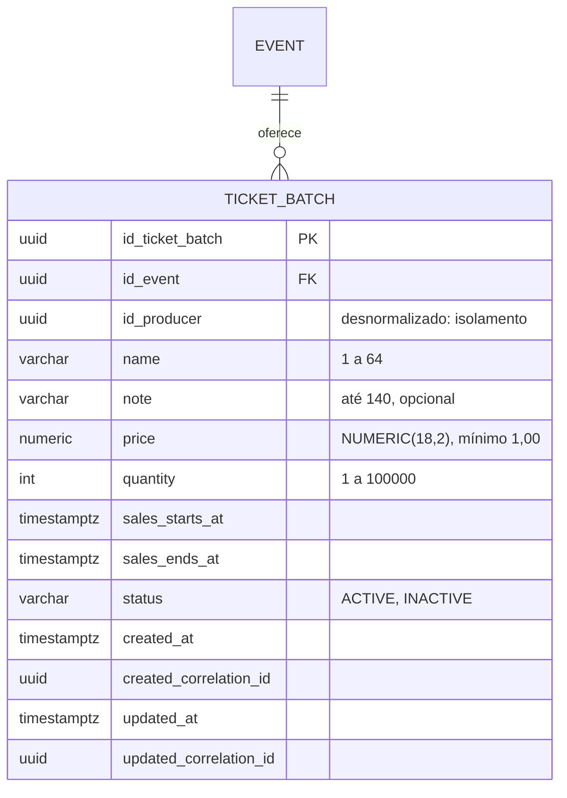
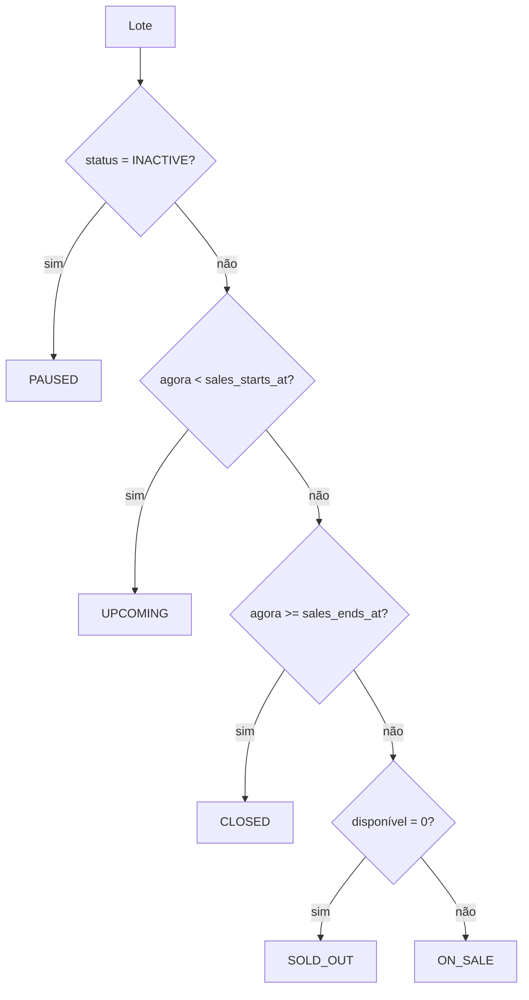
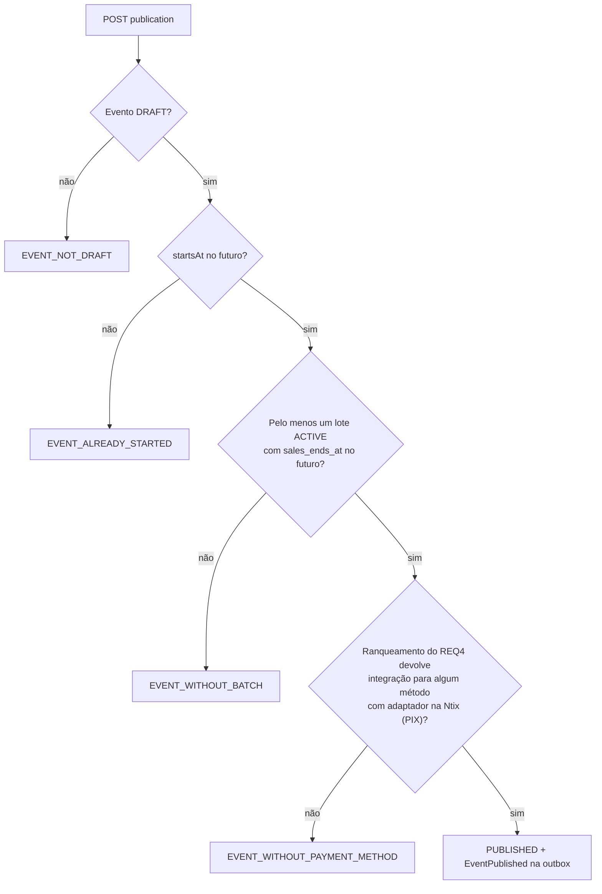

# REQ10 - Lotes de Ingressos e Publicação do Evento

- **Status**: Implementado (aguardando validação)
- **Área**: produtor / catálogo
- **Depende de**: REQ9 (eventos do produtor); REQ4 (ranqueamento de integrações, usado na publicação)
- **Habilita**: REQ11 (vitrine), REQ6 (pedidos)
- **Jornada**: passo 2 de 7 da [jornada de compra](../docs/jornada-de-compra.md)

## Objetivo de Negócio

**O que entrega**: o produtor define o que vende em cada evento e coloca o evento à venda.

- **Lotes**: cada lote tem nome (ex.: "1º lote - Pista"), preço, quantidade e janela de venda. O produtor cria, lista, edita e pausa lotes.
- **Disponibilidade**: cada lote mostra quantos ingressos foram vendidos, quantos estão reservados e quantos restam.
- **Publicação**: o produtor publica o evento. A partir daí ele aparece no hub e na loja (REQ11) e pode ser comprado (REQ6).

**O que impacta**:
- **Receita**: preço e estoque são o que o produtor vende. A virada de lote por data é a principal ferramenta de preço do mercado de eventos.
- **Experiência do comprador**: o evento só fica visível quando tem lote e forma de pagamento, então o comprador não chega a um evento que não pode comprar.
- **Operação**: a publicação verifica que o produtor configurou como receber (REQ4) antes de expor o evento.

**Por que é positivo**: transforma o rascunho do REQ9 em produto vendável, com regras de estoque que evitam vender mais do que existe.

## Problema de Negócio

Depois do REQ9, o evento existe, mas não tem preço nem estoque, e nunca sai de `DRAFT`. Sem este requisito:

- Não há o que comprar: o pedido (REQ6) referencia lotes.
- A vitrine (REQ11) não tem critério para mostrar um evento.
- Um evento poderia ser exposto sem nenhuma forma de pagamento configurada, gerando pedido que não pode ser pago.

## Modelo de dados



### Estado de venda do lote (derivado, não gravado)



`disponível = quantity - vendidos - reservados`. Vendidos são itens de pedidos `PAID`; reservados, de pedidos `PENDING_PAYMENT` dentro de `expires_at` (REQ6). **Até o REQ6 existir, vendidos e reservados são zero**, e o REQ6 completa a consulta. A regra fica no domínio (`TicketBatchAvailability`), reaproveitada por REQ11 e REQ6.

### Publicação



## Riscos

### Da ausência
| Risco | Impacto | Mitigação |
|---|---|---|
| Evento sem preço e estoque | Nada é vendido | Este requisito |
| Evento sempre em rascunho | Vitrine vazia | Publicação |

### De negócio no requisito
| Risco | Impacto | Mitigação |
|---|---|---|
| Produtor reduz a quantidade abaixo do já vendido | Ingresso vendido sem lugar | `quantity` nunca abaixo de vendidos + reservados (RN6) |
| Preço alterado com pedido em aberto | Comprador paga valor diferente do que viu | O pedido congela o preço (REQ6); a alteração vale para novos pedidos |
| Evento publicado sem forma de receber | Pedidos que não podem ser pagos; frustração | Publicação exige integração disponível para Pix (RN10) |
| Produtor não aprovado vende | Golpe com evento falso | Provisório: sem exigência de `ACTIVE`, porque a aprovação ainda não existe; o dinheiro cai na conta AbacatePay do próprio produtor, não na Ntix (Decisões, item 1) |
| Lote excluído com pedido | Pedido sem referência | Lote não é excluído, só pausado (`INACTIVE`, RN8) |

### De tecnologia no requisito
| Risco | Impacto | Mitigação |
|---|---|---|
| Lote de evento de outro produtor | Alteração indevida de preço | Consulta por `(id_producer, id_event, id_ticket_batch)` (RN1) |
| Edição de quantidade concorrente com uma reserva | Estoque negativo | A edição trava a linha do lote (`FOR UPDATE`), a mesma trava que a reserva usa no REQ6 |
| Consulta de disponibilidade lenta | Painel lento | Índice por `id_ticket_batch` nos itens de pedido (REQ6); agregação só dos lotes do evento |

## Implementação de Tecnologia

### Contrato

Headers auditáveis e access token do REQ5 (`ProducerUser`, `producer_slug` = `{slug}`), como no REQ9.

#### `POST /api/v1/producers/{slug}/events/{eventId}/batches`

```json
{
  "name": "1º lote - Pista",
  "note": "Meia-entrada mediante documento",
  "priceCents": 12000,
  "quantity": 500,
  "salesStartsAt": "2026-12-01T12:00:00.000Z",
  "salesEndsAt": "2027-01-31T23:59:59.000Z",
  "status": "ACTIVE"
}
```

- **201 Created**, `Location: .../batches/{batchId}`, corpo no formato do item da lista.
- **400**: `BATCH_NAME_INVALID_NOTIFICATION_CODE`, `BATCH_NOTE_INVALID_NOTIFICATION_CODE`, `BATCH_PRICE_INVALID_NOTIFICATION_CODE`, `BATCH_QUANTITY_INVALID_NOTIFICATION_CODE`, `BATCH_SALES_PERIOD_INVALID_NOTIFICATION_CODE`, `BATCH_STATUS_INVALID_NOTIFICATION_CODE`, `EVENT_ALREADY_STARTED_NOTIFICATION_CODE`.
- **404**: `EVENT_NOT_FOUND_NOTIFICATION_CODE`.

#### `GET /api/v1/producers/{slug}/events/{eventId}/batches`

Ordenado por `salesStartsAt` e depois `priceCents`.

**200 OK**
```json
[
  {
    "id": "7c1d...",
    "name": "1º lote - Pista",
    "note": "Meia-entrada mediante documento",
    "priceCents": 12000,
    "quantity": 500,
    "soldQuantity": 0,
    "reservedQuantity": 0,
    "availableQuantity": 500,
    "salesStartsAt": "2026-12-01T12:00:00.000Z",
    "salesEndsAt": "2027-01-31T23:59:59.000Z",
    "status": "ACTIVE",
    "saleState": "UPCOMING"
  }
]
```

#### `PUT /api/v1/producers/{slug}/events/{eventId}/batches/{batchId}`

Mesmo corpo do `POST`, substituição completa. Pausar é `status: "INACTIVE"`.

- **200 OK**, corpo no formato do item.
- **400**: os códigos do `POST`, mais `BATCH_QUANTITY_BELOW_SOLD_NOTIFICATION_CODE`.
- **404**: `EVENT_NOT_FOUND_NOTIFICATION_CODE`, `BATCH_NOT_FOUND_NOTIFICATION_CODE`.

#### `POST /api/v1/producers/{slug}/events/{eventId}/publication`

Sem corpo.

- **200 OK**: o evento no formato da leitura do REQ9, com `status: "PUBLISHED"`.
- **400**: `EVENT_ALREADY_STARTED_NOTIFICATION_CODE`, `EVENT_WITHOUT_BATCH_NOTIFICATION_CODE`, `EVENT_WITHOUT_PAYMENT_METHOD_NOTIFICATION_CODE`.
- **404**: `EVENT_NOT_FOUND_NOTIFICATION_CODE`.
- **409**: `EVENT_NOT_DRAFT_NOTIFICATION_CODE`.

Comuns: **401**, **403**, **499**, **500** sem corpo.

### Regras de negócio
- **RN1**: lote pertence a um evento, que pertence a um produtor; o usuário só opera lotes do próprio produtor.
- **RN2**: `name` com 1 a 64 caracteres, único dentro do evento (`BATCH_NAME_ALREADY_EXISTS`, 409). `note` opcional, até 140.
- **RN3**: `priceCents` inteiro de 100 a 10.000.000 (R$ 1,00 a R$ 100.000,00). O mínimo é o do Pix no AbacatePay.
- **RN4**: `quantity` inteiro de 1 a 100.000.
- **RN5**: `salesStartsAt` antes de `salesEndsAt`; `salesEndsAt` até o `endsAt` do evento. Janelas de lotes diferentes podem se sobrepor (ex.: Pista e VIP ao mesmo tempo).
- **RN6**: na edição, `quantity` não fica abaixo de vendidos + reservados (`BATCH_QUANTITY_BELOW_SOLD`).
- **RN7**: o estado de venda é derivado, conforme o fluxograma: `PAUSED`, `UPCOMING`, `CLOSED`, `SOLD_OUT` ou `ON_SALE`.
- **RN8**: lote não é excluído; é pausado com `INACTIVE`, e volta com `ACTIVE`. Lote pausado não é vendido.
- **RN9**: lotes de evento que já começou não são criados nem editados (`EVENT_ALREADY_STARTED`).
- **RN10**: a publicação exige evento `DRAFT`, com início no futuro, com ao menos um lote `ACTIVE` cuja venda não terminou, e com ao menos um método que o ranqueamento do REQ4 devolve não vazio **e** que tem adaptador na Ntix (hoje só `PIX`).
- **RN11**: publicado, o evento não volta para `DRAFT`. A publicação grava `EventPublished` na outbox (id do evento, produtor, slug), na mesma transação.
- **RN12**: o status do produtor não é verificado na publicação, porque a aprovação ainda não existe (Decisões, item 1).

### Camadas
- **Domain** (`BoundedContexts/EventContext`):
  - Entidade `TicketBatch` com `BatchNameValueObject`, `MoneyValueObject` (centavos, RN3), `BatchQuantityValueObject`, `SalesPeriodValueObject`.
  - Serviço `TicketBatchAvailability`: recebe o lote, vendidos, reservados e o instante, e devolve disponível e `saleState` (RN7). Reutilizado por REQ11 e REQ6.
  - `Event.Publish(batches, availablePaymentMethods, now)` aplica RN10 e devolve `MethodResult`.
  - `PaymentMethodsWithAdapter` (lista com `PIX`) fica no `PaymentContext`, para REQ10 e REQ7 usarem a mesma lista.
- **Infra** (`PostgreSql/Repositories/Events`): `ITicketBatchRepository` (`CreateAsync`, `ListByEventAsync`, `GetForUpdateAsync`, `UpdateAsync`) e `GetBatchSalesAsync(idsLote)`, que neste requisito devolve zeros e no REQ6 passa a somar os pedidos. `IEventRepository.UpdateStatusAsync`.
- **Application**: `CreateTicketBatch`, `GetTicketBatches`, `UpdateTicketBatch`, `PublishEvent`. `PublishEvent` chama `RankPaymentIntegrationsUseCase` (ou o serviço `PaymentIntegrationRanking` com o repositório) para cada método com adaptador e grava a outbox.
- **Presentation**: `ProducerEventBatchesV1Controller` (`api/v1/producers/{slug}/events/{eventId}/batches`) e a ação `publication` no `ProducerEventsV1Controller`. Payload `TicketBatchV1Request`.

### Banco (`data/events/`)
- `003-create-ticket-batch-table.sql`: `events.ticket_batch` com FK para `events.event`, FK composta `(id_event, id_producer)` para garantir o mesmo produtor, `CHECK` de `status`, `price >= 1.00`, `quantity > 0` e `sales_ends_at > sales_starts_at`. Exige `ux_event_id_event_id_producer (id_event, id_producer)` em `events.event`.
- `004-create-ticket-batch-indexes.sql`: `ux_ticket_batch_event_name (id_event, name)`, `ix_ticket_batch_id_event`.

### Configuração e implantação
- Nenhuma chave nova.
- **Front (`web/`)**: no painel, lista de lotes do evento, formulário, pausar/reativar e botão Publicar, com a mensagem de cada recusa (sem lote, sem integração de pagamento, com link para a aba Integrações).

### Observabilidade
- Logs: lote criado, editado, pausado; evento publicado; publicação recusada com o motivo (código).
- Métricas: funis `ntix.events.batches.create`, `ntix.events.batches.update`, `ntix.events.batches.list`, `ntix.events.publish`, com o desfecho por motivo de recusa.
- Painel no dashboard "Eventos".

### Testes
- **Unitários**: value objects do lote (RN2 a RN5); `TicketBatchAvailability` com cada estado (RN7); `Event.Publish` com cada recusa (RN10); casos de uso.
- **Integrados**: repositório de lotes (nome único, FK composta, `FOR UPDATE`), outbox na mesma transação da publicação.
- **Funcionais**: os Critérios de Aceite, com integração AbacatePay cadastrada pelos passos do REQ4.
- **Carga** (k6): `tsts/LoadTests/producers-batches-tests.js`, perfil moderado, a confirmar.

### Dependências
Nenhuma nova.

### Fora do escopo
- Virada automática de lote por esgotamento (cada lote tem a própria janela; o produtor programa as datas).
- Tipo de ingresso/setor separado de lote, meia-entrada com regra, cupom.
- Ingresso gratuito.
- Despublicar, cancelar ou encerrar evento.
- Limite de ingressos por comprador (o limite por pedido fica no REQ6).

## Critérios de Aceite

```gherkin
# language: pt
Funcionalidade: Lotes de ingressos e publicação do evento

  Contexto:
    Dado o produtor "mare-cultural" autenticado
    E o evento "Festival Horizonte" em DRAFT

  Cenário: Criar um lote
    Quando o produtor cria o lote "1º lote - Pista" de R$ 120,00 com 500 ingressos
    Então recebe 201
    E o lote tem 500 ingressos disponíveis

  Cenário: Preço abaixo do mínimo
    Quando o produtor cria um lote de R$ 0,50
    Então recebe 400 com BATCH_PRICE_INVALID_NOTIFICATION_CODE

  Cenário: Venda do lote termina depois do evento
    Quando o produtor cria um lote cuja venda termina depois do fim do evento
    Então recebe 400 com BATCH_SALES_PERIOD_INVALID_NOTIFICATION_CODE

  Cenário: Estados de venda
    Dado um lote com venda a partir de amanhã
    Então o estado de venda é UPCOMING
    Quando o produtor pausa o lote
    Então o estado de venda é PAUSED

  Cenário: Publicar o evento
    Dado um lote ACTIVE em venda
    E uma integração AbacatePay ativa na rota de PIX
    Quando o produtor publica o evento
    Então o evento fica PUBLISHED
    E o evento EventPublished está na outbox

  Cenário: Publicar sem lote
    Quando o produtor publica o evento sem lotes
    Então recebe 400 com EVENT_WITHOUT_BATCH_NOTIFICATION_CODE

  Cenário: Publicar sem forma de pagamento
    Dado um lote ACTIVE em venda
    E nenhuma integração na rota de PIX
    Quando o produtor publica o evento
    Então recebe 400 com EVENT_WITHOUT_PAYMENT_METHOD_NOTIFICATION_CODE

  Cenário: Publicar duas vezes
    Dado o evento PUBLISHED
    Quando o produtor publica o evento
    Então recebe 409 com EVENT_NOT_DRAFT_NOTIFICATION_CODE
```

## Decisões tomadas na implementação

Implementado na ordem da jornada, depois do REQ9. O que o requisito não definia foi decidido assim:

- **Ranqueamento na mesma transação da publicação**: `PublishEventUseCase` lê rotas, integrações e catálogo pelos repositórios do REQ4 e aplica o serviço de domínio `PaymentIntegrationRanking`, em vez de chamar o `RankPaymentIntegrationsUseCase`, que abre a própria transação no mesmo Unit of Work.
- **Métodos com adaptador** em `PaymentMethodsWithAdapter` (`PaymentContext`), hoje só `PIX`. Rota só de boleto ou cartão não publica.
- **Trava do evento** (`FOR UPDATE`) na criação de lote e na publicação, para as duas não se cruzarem; a edição de lote trava o próprio lote, a mesma trava que a reserva do REQ6 vai usar.
- **Vendidos e reservados** vêm de `ITicketBatchRepository.GetSalesAsync`, que devolve zero até o REQ6 somar os pedidos. O contrato da lista já traz `soldQuantity`, `reservedQuantity` e `availableQuantity`.
- **Venda depois do fim do evento** usa o código `BATCH_SALES_PERIOD_INVALID`, com a mensagem "A venda do lote deve terminar até o fim do evento.".
- **Publicação recusada por evento já iniciado** responde 400 `EVENT_ALREADY_STARTED`, como na edição; `EVENT_NOT_DRAFT` é o único 409 da publicação.
- **Id da rota que não é GUID** responde 404, como evento ou lote inexistente.
- **Front**: com `?api=real`, cada evento da aba Eventos tem o botão "Lotes", que abre a lista de lotes com pausar/reativar, o formulário de novo lote (preço em reais, enviado em centavos) e o botão "Publicar evento" enquanto for rascunho. Sem a flag, a demonstração não muda.
- **Carga**: perfil moderado em `tsts/LoadTests/producers-batches-tests.js`; a publicação fica fora, porque acontece uma vez por evento.

## Decisões em aberto

1. **Produtor não aprovado publica?** Provisório: sim, porque todo produtor está `PENDING` e não há aprovação implementada. Exigir `ACTIVE` trava a jornada até existir o backoffice (ou uma alteração manual no banco).
2. **Preço mínimo de R$ 1,00**, pelo limite do Pix no AbacatePay. Ingresso gratuito fica para requisito próprio?
3. **Nome do lote único no evento**: adotado para o comprador não ver dois lotes iguais.
4. **Quantidade máxima de 100.000 por lote** e preço máximo de R$ 100.000,00: valores provisórios.
5. **Exibir `soldQuantity` e `reservedQuantity` no painel**: adotado; a vitrine pública não mostra esses números (REQ11).
