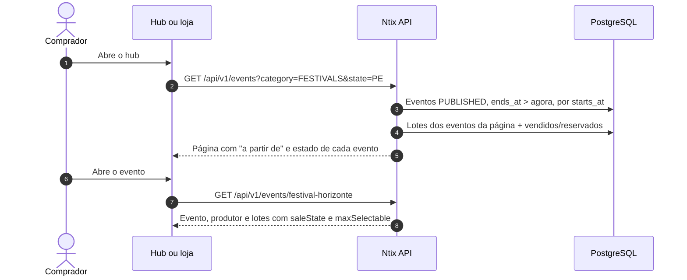

# REQ11 - Vitrine Pública de Eventos

- **Status**: Implementado (aguardando validação)
- **Área**: comprador / catálogo
- **Depende de**: REQ10 (lotes e publicação)
- **Habilita**: REQ6 (pedidos)
- **Jornada**: passo 3 de 7 da [jornada de compra](../docs/jornada-de-compra.md)

## Objetivo de Negócio

**O que entrega**: o comprador encontra os eventos publicados e vê o que pode comprar, sem precisar de conta.

- **Lista do hub**: eventos publicados de todos os produtores, por data, com filtros de categoria, cidade, UF e período.
- **Lista da loja**: o mesmo, restrito a um produtor (loja whitelabel).
- **Página do evento**: dados do evento, produtor e lotes, com preço, estado de venda e quantos ingressos dá para escolher.

**O que impacta**:
- **Receita**: é a porta de entrada da venda. O hub é canal de aquisição da Ntix; a loja, do produtor.
- **Experiência**: o comprador vê só o que pode comprar agora, com o estado real de cada lote (`ON_SALE`, `SOLD_OUT`, `UPCOMING`).
- **Front**: `HubHomePage`, `EventPage` e a loja deixam de usar `web/src/hub/catalog.ts`.

**Por que é positivo**: liga o catálogo do produtor ao comprador. Sem a vitrine, o evento publicado no REQ10 não chega a ninguém.

## Problema de Negócio

O hub e a página do evento mostram eventos fictícios, gerados no navegador. Depois do REQ10, o evento real existe e está publicado, mas nenhum comprador o vê. Também não há como o front saber a disponibilidade real de cada lote para limitar a escolha.

## Fluxo



## Riscos

### Da ausência
| Risco | Impacto | Mitigação |
|---|---|---|
| Evento publicado invisível | Nenhuma venda | Este requisito |
| Disponibilidade só no navegador | Comprador escolhe lote esgotado e só descobre no pedido | `saleState` e `maxSelectable` reais |

### De negócio no requisito
| Risco | Impacto | Mitigação |
|---|---|---|
| Concorrente lê o volume de vendas do produtor | Exposição comercial | A vitrine não mostra vendidos nem estoque: só `saleState` e `maxSelectable` (até 6, o limite do pedido) (RN5) |
| Evento em rascunho vaza | Divulgação antes da hora | Só `PUBLISHED` (RN1); rascunho responde 404 igual a inexistente |
| Evento encerrado continua na lista | Comprador frustrado | Só `ends_at` no futuro na lista (RN2); a página de evento encerrado continua acessível, com lotes `CLOSED`, para links antigos |

### De tecnologia no requisito
| Risco | Impacto | Mitigação |
|---|---|---|
| Endpoint público mais acessado da plataforma | Carga no banco em lançamento de evento | Consulta paginada (máximo 50), índices por `status, starts_at`; `Cache-Control: public, max-age=15` (RN8) |
| Busca textual com `LIKE` | Varredura de tabela | Sem busca textual neste requisito, só filtros exatos (Decisões, item 1) |
| Disponibilidade defasada pelo cache | Lote mostrado em venda já esgotado | Até 15 s de defasagem; o pedido (REQ6) revalida com trava |

## Implementação de Tecnologia

### Contrato

Endpoints **anônimos** (`[AllowAnonymous]`), com os headers auditáveis (`X-Correlation-Id`, `X-Origin-Service`, `X-Requested-At`) como os demais. `X-Execution-User` opcional.

#### `GET /api/v1/events`

| Parâmetro | Tipo | Regra |
|---|---|---|
| `producer` | slug | Opcional. Só eventos do produtor (loja whitelabel) |
| `category` | enum | Opcional. Categorias do REQ9 |
| `city` | texto | Opcional. Igualdade exata, sem diferenciar maiúsculas e acentos (coluna normalizada) |
| `state` | UF | Opcional |
| `startsFrom`, `startsTo` | data ISO | Opcional. Janela sobre `startsAt` |
| `page`, `pageSize` | inteiro | Padrão 1 e 20; `pageSize` até 50 |

**200 OK**
```json
{
  "items": [
    {
      "slug": "festival-horizonte",
      "title": "Festival Horizonte",
      "category": "FESTIVALS",
      "startsAt": "2027-03-20T18:00:00.000Z",
      "venueName": "Parque das Dunas",
      "city": "Recife",
      "state": "PE",
      "imageUrl": "https://cdn.exemplo.com/horizonte.jpg",
      "producer": { "slug": "mare-cultural", "name": "Maré Cultural" },
      "priceFromCents": 12000,
      "saleState": "ON_SALE"
    }
  ],
  "page": 1,
  "pageSize": 20,
  "totalItems": 1
}
```

`saleState` do evento: `ON_SALE` se algum lote está em venda; senão `UPCOMING` se algum ainda vai abrir; senão `SOLD_OUT` se algum esgotou; senão `CLOSED`. `priceFromCents` é o menor preço entre os lotes `ON_SALE` (ou, sem nenhum, entre os `UPCOMING`); nulo se não houver.

- **400**: `EVENT_FILTER_INVALID_NOTIFICATION_CODE` (categoria, UF, datas ou paginação fora da regra).

#### `GET /api/v1/events/{eventSlug}`

**200 OK**
```json
{
  "slug": "festival-horizonte",
  "title": "Festival Horizonte",
  "description": "Três palcos, um pôr do sol e nenhuma pressa.",
  "category": "FESTIVALS",
  "startsAt": "2027-03-20T18:00:00.000Z",
  "endsAt": "2027-03-21T03:00:00.000Z",
  "doorsOpenAt": "2027-03-20T17:00:00.000Z",
  "venueName": "Parque das Dunas",
  "address": "Av. Beira-Mar, 1200",
  "city": "Recife",
  "state": "PE",
  "ageRating": "AGE_16",
  "imageUrl": "https://cdn.exemplo.com/horizonte.jpg",
  "producer": { "slug": "mare-cultural", "name": "Maré Cultural" },
  "saleState": "ON_SALE",
  "maxTicketsPerOrder": 6,
  "batches": [
    {
      "id": "7c1d...",
      "name": "1º lote - Pista",
      "note": "Meia-entrada mediante documento",
      "priceCents": 12000,
      "salesStartsAt": "2026-12-01T12:00:00.000Z",
      "salesEndsAt": "2027-01-31T23:59:59.000Z",
      "saleState": "ON_SALE",
      "maxSelectable": 6
    }
  ]
}
```

- **404**: `EVENT_NOT_FOUND_NOTIFICATION_CODE` (inexistente ou não publicado).

Comuns: **499** cancelamento; **500** sem corpo.

### Regras de negócio
- **RN1**: só eventos `PUBLISHED` aparecem, na lista e no detalhe.
- **RN2**: a lista mostra só eventos com `endsAt` no futuro, ordenados por `startsAt` crescente e, no empate, por `slug`. O detalhe também atende evento encerrado.
- **RN3**: lotes `INACTIVE` (pausados) não aparecem. Os demais aparecem com o `saleState` do REQ10, ordenados como no painel.
- **RN4**: o `saleState` do evento e o `priceFromCents` seguem as regras do contrato.
- **RN5**: a vitrine não expõe quantidade, vendidos nem reservados. `maxSelectable` = mínimo entre o disponível e o limite por pedido (`OrderConfiguration:MaxTicketsPerOrder`, padrão 6, o mesmo do REQ6); zero fora de `ON_SALE`.
- **RN6**: o produtor de cada evento aparece com slug e nome comercial, lidos de `producers.producer`.
- **RN7**: filtros inválidos recusam a consulta inteira com `EVENT_FILTER_INVALID`, sem ignorar silenciosamente.
- **RN8**: resposta com `Cache-Control: public, max-age=15` (lista e detalhe).

### Camadas
- **Domain**: reutiliza `TicketBatchAvailability` (REQ10). Novo serviço `EventSaleSummary` (RN4) no `EventContext`, a partir dos estados dos lotes.
- **Infra** (`PostgreSql/Repositories/Events`):
  - `IPublicEventRepository.SearchAsync(filtro, página)` com contagem total, e `GetPublishedBySlugAsync(slug)`.
  - Os lotes da página vêm numa segunda consulta (`id_event = ANY(@ids)`), com vendidos e reservados agregados por `GetBatchSalesAsync` (REQ10/REQ6), sem N+1.
  - Nome do produtor por `IProducerRepository.GetNamesByIdsAsync(ids)`, em uma consulta.
  - Coluna `city_normalized` (minúsculas, sem acento) em `events.event`, preenchida pela `Application` na gravação (REQ9 passa a gravá-la), para filtro exato com índice.
- **Application**: `SearchPublicEvents` e `GetPublicEvent`, consultas (`IUseCase<TInput, TOutput>`) com transação só de leitura, `*Log` e `*Diagnostics`. `OrderConfiguration` (com `MaxTicketsPerOrder`) nasce aqui e é usada pelo REQ6.
- **Presentation**: `EventsV1Controller` (`api/v1/events`), com o header de cache.

### Banco (`data/events/`)
- `005-add-event-city-normalized.sql`: coluna `city_normalized` (idempotente, `ADD COLUMN IF NOT EXISTS`).
- `006-create-public-event-indexes.sql`: `ix_event_status_starts_at (status, starts_at)`, `ix_event_status_state_city (status, state, city_normalized)`, `ix_event_status_category (status, category)`.

### Configuração e implantação
- `OrderConfiguration:MaxTicketsPerOrder` = 6 em `appsettings.json`.
- **Front (`web/`)**: `HubHomePage` com filtros e paginação, loja do produtor com `?producer={slug}`, `EventPage` com os lotes e o seletor limitado por `maxSelectable`. A busca textual do hub, que hoje filtra no navegador, filtra só a página carregada (Decisões, item 1).

### Observabilidade
- Logs: consulta com filtros usados (sem dado pessoal), evento não encontrado (slug).
- Métricas: funis `ntix.events.search` e `ntix.events.public_get`; histograma de latência das duas consultas.
- Painel "Vitrine" no dashboard "Eventos".

### Testes
- **Unitários**: `EventSaleSummary` (cada combinação de estados), `maxSelectable` (RN5), validação dos filtros (RN7).
- **Integrados**: busca com cada filtro, paginação e contagem, evento em rascunho e encerrado fora da lista, lotes pausados fora do detalhe.
- **Funcionais**: os Critérios de Aceite.
- **Carga** (k6): `tsts/LoadTests/events-public-tests.js`. Proposta: 200 VUs, p95 < 300 ms, < 1% de erros, porque é a rota de maior tráfego em lançamento (a confirmar).

### Dependências
Nenhuma nova.

### Fora do escopo
- Busca textual (título, artista), destaques e ordenação por popularidade.
- Eventos passados no hub.
- Domínio próprio do produtor (`custom_domain`) resolvendo a loja.
- SEO (sitemap, metadados).

## Critérios de Aceite

```gherkin
# language: pt
Funcionalidade: Vitrine pública de eventos

  Contexto:
    Dado o evento "Festival Horizonte" PUBLISHED do produtor "mare-cultural" em Recife-PE
    E o lote "1º lote - Pista" de R$ 120,00 em venda
    E o evento "Teatro Z" em DRAFT

  Cenário: Hub lista só eventos publicados
    Quando o comprador abre o hub
    Então vê "Festival Horizonte" a partir de R$ 120,00
    E não vê "Teatro Z"

  Cenário: Filtro por UF
    Quando o comprador filtra a UF "SP"
    Então a lista vem vazia

  Cenário: Loja do produtor
    Dado o evento "Show Y" PUBLISHED do produtor "produtor-y"
    Quando o comprador abre a loja de "mare-cultural"
    Então vê só "Festival Horizonte"

  Cenário: Página do evento
    Quando o comprador abre "festival-horizonte"
    Então vê o lote "1º lote - Pista" ON_SALE com até 6 ingressos selecionáveis
    E não vê a quantidade total do lote

  Cenário: Lote com poucos ingressos
    Dado que restam 2 ingressos no lote "1º lote - Pista"
    Quando o comprador abre "festival-horizonte"
    Então o lote permite escolher até 2 ingressos

  Cenário: Lote pausado não aparece
    Dado o lote "VIP" pausado
    Quando o comprador abre "festival-horizonte"
    Então não vê o lote "VIP"

  Cenário: Rascunho não é encontrado
    Quando o comprador abre o slug de "Teatro Z"
    Então recebe 404 com EVENT_NOT_FOUND_NOTIFICATION_CODE

  Cenário: Filtro inválido
    Quando o comprador filtra com pageSize 500
    Então recebe 400 com EVENT_FILTER_INVALID_NOTIFICATION_CODE
```

## Decisões tomadas na implementação

Implementado na ordem da jornada, depois do REQ10. O que o requisito não definia foi decidido assim:

- **Cidade normalizada como coluna gerada** (`city_normalized GENERATED ALWAYS AS (translate(lower(city), ...)) STORED`): a regra fica no banco, vale para os eventos já criados e não exigiu mudar a gravação do REQ9. A consulta normaliza o filtro com a mesma expressão.
- **Total da paginação** com `COUNT(*) OVER ()` na própria consulta; só a página além do fim faz a contagem à parte.
- **Filtro inválido** devolve uma notificação `EVENT_FILTER_INVALID` por filtro, cada uma com a mensagem do problema.
- **Loja de produtora inexistente** (`?producer=` com slug que não existe) devolve a lista vazia, sem 404, para não revelar quais slugs existem.
- **Slug inexistente, rascunho ou acima de 126 caracteres** respondem 404 `EVENT_NOT_FOUND`, sem validar o formato.
- **Produtora na resposta** com slug e nome comercial, lidos de uma vez para a página (`IProducerRepository.GetProfilesByIdsAsync`).
- **`OrderConfiguration:MaxTicketsPerOrder`** nasce aqui (padrão 6, em `appsettings.json`), para o REQ6 usar o mesmo limite.
- **Front**: com `?api=real`, o hub carrega a primeira página da vitrine (50 eventos) e a página de cada evento em paralelo, e as telas atuais do hub passam a usar esses dados. Como a API não expõe estoque, o lote em venda vira, no hub, um lote com `maxSelectable` ingressos; o aviso de "últimos ingressos" não aparece no modo real (Decisões, item 2). Filtros e busca do hub continuam no navegador, sobre os eventos carregados. O checkout segue em demonstração até o REQ6.
- **Carga**: `tsts/LoadTests/events-public-tests.js` com o perfil proposto (200 VUs, p95 < 300 ms), a confirmar.

## Decisões em aberto

1. **Busca textual**: fora do escopo. Se for necessária, a proposta é o full-text do PostgreSQL (`tsvector` com índice GIN), sem `LIKE` e sem dependência nova.
2. **Esconder estoque**: a vitrine mostra só o estado e até 6 selecionáveis. O produtor quer exibir "últimos ingressos" (ex.: abaixo de 10% do lote)?
3. **Cache de 15 segundos** na lista e no detalhe: aceitável?
4. **Perfil de carga** de 200 VUs para a vitrine: confirmar.
5. **Evento encerrado** continua acessível pelo link, mas fora da lista: adotado.
