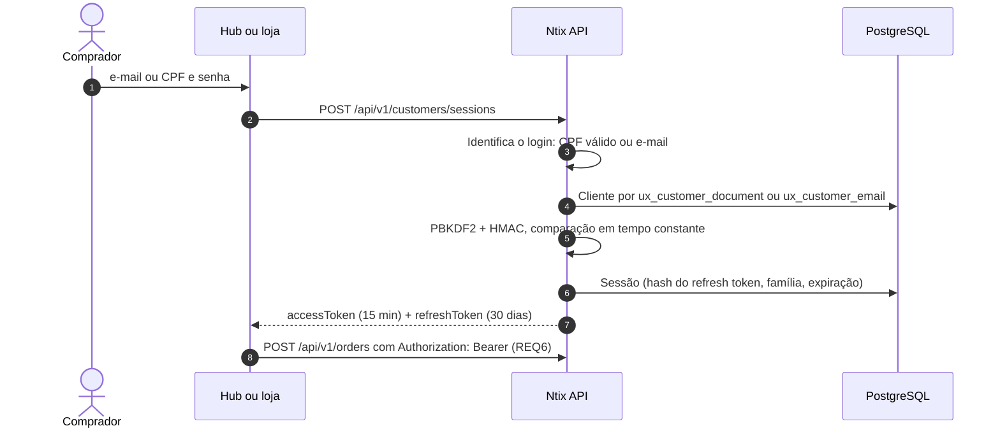
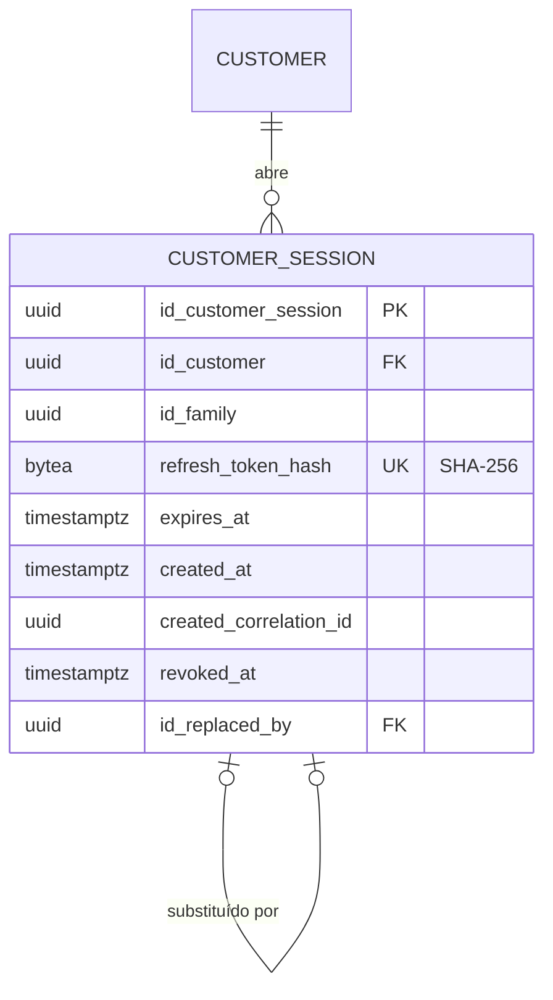

# REQ12 - Autenticação do Cliente

- **Status**: Proposto
- **Área**: comprador / plataforma
- **Depende de**: cadastro do cliente (`POST /api/v1/customers`, já entregue); REQ5 (infraestrutura de JWT e sessões, reaproveitada)
- **Habilita**: REQ6 (pedidos), REQ7 (pagamento), REQ13 (pedidos e ingressos do cliente)
- **Jornada**: passo 3 de 7 da [jornada de compra](../docs/jornada-de-compra.md), em paralelo com REQ9-REQ11

## Objetivo de Negócio

**O que entrega**: o comprador entra no hub e nas lojas com **e-mail ou CPF** e senha, como define o MER, e a API passa a saber quem está comprando.

- **Login** com e-mail ou CPF e a senha do cadastro.
- **Sessão** com access token curto e refresh token rotativo, como a do produtor (REQ5).
- **Logout**, que revoga a sessão no servidor.
- **Meus dados**: o comprador consulta o próprio cadastro.

**O que impacta**:
- **Receita**: o pedido (REQ6) precisa de um comprador identificado, com nome, e-mail e CPF, que o Pix do AbacatePay pede.
- **Experiência**: uma conta só para o hub e todas as lojas (o cliente é identidade global no MER).
- **Segurança**: pedidos e ingressos (REQ13) só são vistos pelo dono.

**Por que é positivo**: sem login, a Ntix não sabe para quem emitir o ingresso nem a quem mostrar o pedido. Reaproveita o desenho já validado do REQ5, então o custo é baixo.

## Problema de Negócio

O cadastro grava o cliente com senha, mas não há como entrar. O front simula a sessão no navegador (`web/src/customer/session.tsx`). Sem este requisito, o pedido não tem dono e qualquer pessoa veria pedidos e ingressos de outra.

## Fluxos





O ciclo de vida da sessão (ativa, substituída, revogada, expirada, família revogada no reuso) é o mesmo do REQ5.

## Riscos

### Da ausência
| Risco | Impacto | Mitigação |
|---|---|---|
| Pedido sem dono | REQ6 e REQ13 impossíveis | Este requisito |
| Sessão só no navegador | Qualquer um vê pedidos de outro | Endpoints do comprador exigem token |

### De negócio no requisito
| Risco | Impacto | Mitigação |
|---|---|---|
| Descobrir se um CPF ou e-mail tem conta | Lista de clientes para golpe | Mesma resposta e tempo parecido para conta inexistente e senha errada (RN3) |
| Comprador esquece a senha e desiste da compra | Venda perdida | Recuperação de senha fica para requisito próprio (Decisões, item 2) |

### De tecnologia no requisito
| Risco | Impacto | Mitigação |
|---|---|---|
| Token do comprador aceito no painel do produtor (ou o contrário) | Escalada de acesso | Claim `actor` distinto (`CUSTOMER`); política `Customer` exige o claim, e a `ProducerUser` exige `producer_slug`, que o token do comprador não tem (RN7); teste funcional cruzado |
| Força bruta de senha | Conta invadida | Hash lento do cadastro e limite de tentativas por login (RN9) |
| Dado pessoal no token | JWT é legível | Só identificadores (RN6) |
| Roubo do refresh token | Sessão sequestrada | Rotação e revogação da família no reuso, gravação só do hash |

## Implementação de Tecnologia

### Contrato

Headers auditáveis em todos.

#### `POST /api/v1/customers/sessions` (login, anônimo)

```json
{ "login": "123.456.789-09", "password": "S3nha!forte" }
```

**200 OK**
```json
{
  "accessToken": "eyJ...",
  "accessTokenExpiresIn": 900,
  "refreshToken": "mF3q...",
  "refreshTokenExpiresIn": 2592000,
  "customer": { "id": "c1a2...", "firstName": "Marina" }
}
```

- **400**: `LOGIN_REQUIRED_NOTIFICATION_CODE`, `PASSWORD_REQUIRED_NOTIFICATION_CODE`.
- **401**: `INVALID_CREDENTIALS_NOTIFICATION_CODE`.
- **429**: `TOO_MANY_LOGIN_ATTEMPTS_NOTIFICATION_CODE`, com `Retry-After`.

#### `POST /api/v1/customers/sessions/refresh` (anônimo)

`{ "refreshToken": "mF3q..." }` → **200** com o corpo do login e um novo par; **401** `INVALID_REFRESH_TOKEN_NOTIFICATION_CODE`.

#### `POST /api/v1/customers/sessions/revoke`

`{ "refreshToken": "mF3q..." }` → **204**, mesmo para token desconhecido (não revela se existe).

#### `GET /api/v1/customers/me` (política `Customer`)

**200 OK**
```json
{
  "id": "c1a2...",
  "fullName": "Marina Souza",
  "email": "marina@exemplo.com",
  "document": "***.456.789-**",
  "phoneNumber": "81999990000"
}
```

Comuns: **401** sem token válido nos endpoints autenticados; **499**; **500** sem corpo.

### Regras de negócio
- **RN1**: `login` com 11 dígitos depois de retirar `.` e `-`, e CPF válido (`CpfValueObject`), é buscado por documento; caso contrário, é tratado como e-mail (`EmailValueObject`, normalizado como no cadastro). Formato inválido nos dois também responde 401, sem dizer qual.
- **RN2**: a senha é conferida com `PasswordHashValueObject.Build(senha, salt, PrivateKey)` e `CryptographicOperations.FixedTimeEquals`, como no REQ5.
- **RN3**: conta inexistente e senha errada têm a mesma resposta; para conta inexistente, o hash é calculado com salt fixo.
- **RN4**: access token de 15 minutos (`JwtConfiguration:AccessTokenMinutes`); refresh token de 32 bytes aleatórios, gravado só como SHA-256, com validade de `CustomerSessionConfiguration:RefreshTokenDays` (padrão 30).
- **RN5**: cada renovação revoga o token usado e emite outro da mesma família; reuso de token substituído revoga a família. Logout revoga a família.
- **RN6**: claims do access token: `sub` (id do cliente), `actor` = `CUSTOMER`, `jti` (sessão), `iss`, `aud`, `exp`. Nunca nome, e-mail ou CPF.
- **RN7**: endpoints do comprador usam a política `Customer` (exige `actor = CUSTOMER`). Token do comprador não passa na política `ProducerUser`, e token do produtor não passa na `Customer`.
- **RN8**: em endpoint do comprador, `ExecutionUser` é o `sub` do token.
- **RN9**: no máximo 10 tentativas de login a cada 15 minutos por login normalizado (CPF só com dígitos, e-mail normalizado), reaproveitando o `LoginAttemptLimiter` do REQ5 com uma chave prefixada (`customer:`), para não somar com o produtor.
- **RN10**: `GET /me` devolve o CPF ofuscado (`CpfValueObject.GetObfuscatedValue()`) e o primeiro nome no login (`firstName`), sem o nome completo no corpo do login.

### Camadas
- **Domain** (`CustomerContext`): entidade `CustomerSession` e enum `CustomerSessionState`, espelhando `ProducerUserSession`. `CustomerLoginValueObject` (RN1), que decide entre CPF e e-mail.
- **Infra** (`PostgreSql/Repositories/Customers`): `ICustomerRepository.GetByEmailAsync`, `GetByDocumentAsync`, `GetByIdAsync`; `ICustomerSessionRepository` igual ao do produtor.
- **Application**: `CreateCustomerSession`, `RefreshCustomerSession`, `RevokeCustomerSession`, `GetCurrentCustomer`, com `*Log` e `*Diagnostics`. Emissão do token em `CustomerAccessTokenIssuer` (`Base/Authentication`), com a mesma `JwtConfiguration`; claims em `CustomerClaims`.
- **Presentation**: `CustomerSessionsV1Controller` (`api/v1/customers/sessions`); ação `me` no `CustomersV1Controller`. Política `CUSTOMER_POLICY = "Customer"` em `AuthenticationExtensions`, e extensão `User.GetCustomerId()`.

### Banco (`data/customers/`)
- `003-create-customer-session-table.sql` e `004-create-customer-session-indexes.sql` (`ux_customer_session_refresh_token_hash`, `ix_customer_session_id_family`), espelhando os do REQ5.

### Configuração e implantação
- `CustomerSessionConfiguration:RefreshTokenDays` = 30.
- Reaproveita `JwtConfiguration` e `LoginAttemptConfiguration` do REQ5. Nenhum secret novo.
- **Front (`web/`)**: `CustomerLoginPage` e `AuthForm` chamam a API; `customer/session.tsx` guarda o access token em memória e o refresh token em `localStorage`, como o painel; o cliente HTTP renova uma vez no 401. Depois do cadastro, o front faz o login automaticamente com os mesmos dados.

### Observabilidade
- Logs: login aceito (id do cliente), recusado (motivo, login ofuscado), limite atingido, reuso de refresh token (família revogada).
- Métricas: funis `ntix.customers.sessions.create`, `.refresh`, `.revoke`; contador `ntix.customers.sessions.refresh_reuse`.
- Dashboard "Sessões do cliente".

### Testes
- **Unitários**: `CustomerLoginValueObject` (CPF com e sem máscara, e-mail, inválido), claims sem dado pessoal, política `Customer`, casos de uso (RN2 a RN5, RN9 com `FakeTimeProvider`).
- **Integrados**: repositório de sessões (rotação, reuso, revogação da família), busca por documento e e-mail.
- **Funcionais**: os Critérios de Aceite, incluindo o cruzamento de tokens.
- **Carga** (k6): `tsts/LoadTests/customers-sessions-tests.js`, mesmo perfil do login do produtor (50 VUs, p95 < 1 s, < 1% de erros).

### Dependências
Nenhuma nova.

### Fora do escopo
- Recuperação e troca de senha, verificação de e-mail.
- Edição dos dados do cliente.
- Login social.
- Vínculo cliente-produtor (`PRODUCER_CUSTOMER`): nasce no primeiro pedido (REQ6).

## Critérios de Aceite

```gherkin
# language: pt
Funcionalidade: Autenticação do cliente

  Contexto:
    Dado o cliente "Marina Souza" com o CPF "123.456.789-09" e o e-mail "marina@exemplo.com"

  Cenário: Login por e-mail
    Quando ela entra com "marina@exemplo.com" e a senha correta
    Então recebe 200 com access token e refresh token

  Cenário: Login por CPF com máscara
    Quando ela entra com "123.456.789-09" e a senha correta
    Então recebe 200 com access token e refresh token

  Cenário: Conta inexistente e senha errada respondem igual
    Quando alguém entra com "ninguem@exemplo.com"
    E alguém entra com "marina@exemplo.com" e a senha errada
    Então as duas tentativas recebem 401 com INVALID_CREDENTIALS_NOTIFICATION_CODE

  Cenário: Limite de tentativas
    Dado 10 tentativas erradas com o CPF dela nos últimos 15 minutos
    Quando ela entra com a senha correta
    Então recebe 429 com TOO_MANY_LOGIN_ATTEMPTS_NOTIFICATION_CODE

  Cenário: Renovação rotativa
    Dado que ela está autenticada
    Quando renova a sessão
    Então recebe um novo par de tokens
    E o refresh token anterior deixa de funcionar

  Cenário: Meus dados
    Dado que ela está autenticada
    Quando consulta os próprios dados
    Então vê o CPF "***.456.789-**"

  Cenário: Token do cliente não abre o painel do produtor
    Dado que ela está autenticada
    Quando chama GET /api/v1/producers/mare-cultural/events com o token dela
    Então recebe 403

  Cenário: Token do produtor não abre a conta do cliente
    Dado o usuário do produtor "mare-cultural" autenticado
    Quando chama GET /api/v1/customers/me com o token dele
    Então recebe 403
```

## Decisões em aberto

1. **Refresh token de 30 dias** para o comprador (o do produtor dura 7), porque o comprador volta ao hub com menos frequência e não deve ser obrigado a digitar a senha no meio da compra. Confirmar.
2. **Recuperação de senha**: fora do escopo, mas é risco direto de venda perdida. Priorizar logo depois da jornada?
3. **Limite de 10 tentativas por 15 minutos**, o mesmo do produtor (REQ5): aplicar ao comprador?
4. **Login automático depois do cadastro**: o front chama o login com os dados recém-cadastrados. Alternativa: o `POST /customers` passar a devolver a sessão.
