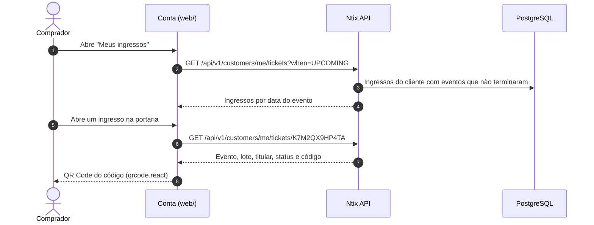

# REQ13 - Pedidos e Ingressos do Cliente

- **Status**: Proposto
- **Área**: comprador / pós-venda
- **Depende de**: REQ8 (efetivação e emissão dos ingressos); REQ12 (autenticação do cliente)
- **Jornada**: passo 7 de 7 da [jornada de compra](../docs/jornada-de-compra.md), o último

## Objetivo de Negócio

**O que entrega**: o comprador encontra, na conta dele, todos os pedidos e ingressos, de qualquer produtor, no hub ou em qualquer loja.

- **Meus pedidos**: lista paginada, do mais recente ao mais antigo, com status, evento e total.
- **Detalhe do pedido**: o `GET /api/v1/orders/{code}` do REQ6, já com pagamento e ingressos.
- **Meus ingressos**: próximos e passados, agrupáveis por evento.
- **Detalhe do ingresso**: dados para a portaria, com o código que vira QR Code no front.

**O que impacta**:
- **Experiência**: o comprador não depende de e-mail para achar o ingresso no dia do evento.
- **Operação do produtor**: menos atendimento de "não recebi meu ingresso".
- **Produto**: as telas `OrdersPage`, `OrderDetailPage`, `TicketsPage` e `TicketDetailPage` deixam de ser demonstração.

**Por que é positivo**: fecha a jornada. Depois do REQ8 o ingresso existe, mas só aparece na tela de confirmação; se o comprador fechar a aba, não tem como reencontrá-lo.

## Problema de Negócio

A conta do comprador mostra pedidos fictícios (`demoOrders` em `web/src/customer/orders.ts`). Depois do REQ8, os ingressos reais estão no banco, mas o comprador só os vê no `GET /orders/{code}`, sabendo o código. Sem este requisito, perder a tela de confirmação é perder o acesso ao ingresso.

## Fluxo



## Riscos

### Da ausência
| Risco | Impacto | Mitigação |
|---|---|---|
| Ingresso só na tela de confirmação | Comprador sem ingresso na portaria; atendimento e reembolso | Este requisito |

### De negócio no requisito
| Risco | Impacto | Mitigação |
|---|---|---|
| Print do QR compartilhado | Duas pessoas tentam entrar com o mesmo ingresso | Check-in único por código (requisito futuro); fora do escopo aqui |
| Pedido de um produtor visto por outro produtor | Exposição de compradores | Endpoints só do comprador (política `Customer`); o painel do produtor não usa estas rotas |

### De tecnologia no requisito
| Risco | Impacto | Mitigação |
|---|---|---|
| Cliente lê ingresso de outro pelo código | Ingresso roubado | Consulta sempre por `(code, id_customer)`; de outro responde 404 (RN1) |
| Lista sem limite | Resposta grande e lenta | Paginação com `pageSize` até 50 (RN2) |
| Consulta por evento em cada item | N+1 | Junção com `events.event` na mesma consulta, com índices do REQ6 e REQ8 |

## Implementação de Tecnologia

### Contrato

Headers auditáveis e access token do cliente (política `Customer`).

#### `GET /api/v1/customers/me/orders?status=PAID&page=1&pageSize=20`

`status` opcional (`PENDING_PAYMENT`, `PAID`, `EXPIRED`), aplicado sobre o status efetivo.

**200 OK**
```json
{
  "items": [
    {
      "code": "NX7K2QH9MP",
      "status": "PAID",
      "createdAt": "2027-01-10T15:00:00.000Z",
      "paidAt": "2027-01-10T15:04:12.000Z",
      "totalCents": 39000,
      "ticketCount": 3,
      "event": {
        "slug": "festival-horizonte",
        "title": "Festival Horizonte",
        "startsAt": "2027-03-20T18:00:00.000Z",
        "city": "Recife",
        "state": "PE",
        "imageUrl": "https://cdn.exemplo.com/horizonte.jpg"
      },
      "producer": { "slug": "mare-cultural", "name": "Maré Cultural" }
    }
  ],
  "page": 1,
  "pageSize": 20,
  "totalItems": 1
}
```

- **400**: `ORDER_FILTER_INVALID_NOTIFICATION_CODE`.

#### `GET /api/v1/orders/{code}`

Do REQ6, com o pagamento (REQ7) e os ingressos (REQ8). Sem mudança de contrato; ganha `producer` (slug e nome), como a lista.

#### `GET /api/v1/customers/me/tickets?when=UPCOMING&page=1&pageSize=20`

`when`: `UPCOMING` (padrão; eventos que não terminaram, por `startsAt` crescente) ou `PAST` (terminados, por `startsAt` decrescente).

**200 OK**
```json
{
  "items": [
    {
      "code": "K7M2QX9HP4TA",
      "status": "VALID",
      "batchName": "1º lote - Pista",
      "holderName": "Marina Souza",
      "orderCode": "NX7K2QH9MP",
      "event": {
        "slug": "festival-horizonte",
        "title": "Festival Horizonte",
        "startsAt": "2027-03-20T18:00:00.000Z",
        "doorsOpenAt": "2027-03-20T17:00:00.000Z",
        "venueName": "Parque das Dunas",
        "address": "Av. Beira-Mar, 1200",
        "city": "Recife",
        "state": "PE",
        "imageUrl": "https://cdn.exemplo.com/horizonte.jpg"
      }
    }
  ],
  "page": 1,
  "pageSize": 20,
  "totalItems": 3
}
```

- **400**: `TICKET_FILTER_INVALID_NOTIFICATION_CODE`.

#### `GET /api/v1/customers/me/tickets/{code}`

**200 OK**: o item da lista, mais `ageRating` do evento e `issuedAt`.
**404**: `TICKET_NOT_FOUND_NOTIFICATION_CODE`.

Comuns: **401**, **403** (token que não é de cliente), **499**, **500** sem corpo.

### Regras de negócio
- **RN1**: o cliente só lista e lê os próprios pedidos e ingressos; o de outro responde 404.
- **RN2**: paginação com `page` a partir de 1 e `pageSize` de 1 a 50 (padrão 20), como no REQ11.
- **RN3**: pedidos ordenados por `createdAt` decrescente; o status mostrado é o efetivo (`Order.GetEffectiveStatus`, REQ6).
- **RN4**: só pedidos `PAID` têm ingressos; a lista de ingressos traz apenas ingressos emitidos.
- **RN5**: `UPCOMING` = evento com `endsAt` no futuro; `PAST` = evento já terminado.
- **RN6**: o código do ingresso é o conteúdo do QR Code. A API não gera imagem: o front desenha com `qrcode.react`, que já está no projeto.

### Camadas
- **Domain**: reutiliza `Order.GetEffectiveStatus` e `Ticket`. Sem regra nova de domínio além do filtro `TicketPeriod` (`UPCOMING`/`PAST`).
- **Infra**: `IOrderRepository.ListByCustomerAsync(idCustomer, status, página, agora)` com contagem; `ITicketRepository.ListByCustomerAsync(idCustomer, período, página, agora)` e `GetByCodeAsync(code, idCustomer)`, com a junção de evento numa só consulta. Nome do produtor por `IProducerRepository.GetNamesByIdsAsync` (REQ11).
- **Application**: `GetCustomerOrders`, `GetCustomerTickets`, `GetCustomerTicket`, consultas com transação de leitura, `*Log` e `*Diagnostics`. Saídas em `Base/Orders/Outputs`.
- **Presentation**: ações em `CustomersV1Controller` (`me/orders`, `me/tickets`, `me/tickets/{code}`).

### Banco
- `data/orders/005-create-customer-history-indexes.sql`: `ix_orders_id_customer_created_at` (se o REQ6 não tiver criado) e `ix_ticket_id_customer_id_event` (REQ8), garantidos aqui de forma idempotente.

### Configuração e implantação
- Nenhuma chave nova.
- **Front (`web/`)**: `OrdersPage`, `OrderDetailPage`, `TicketsPage` e `TicketDetailPage` passam a usar a API pela skill `frontend-integration`; `TicketDetailPage` desenha o QR do código com `qrcode.react`. O "Pagar agora" de um pedido `PENDING_PAYMENT` válido leva ao checkout do REQ7.

### Observabilidade
- Logs: consultas com filtro e quantidade devolvida; ingresso não encontrado (código ofuscado nos 4 últimos caracteres).
- Métricas: funis `ntix.customers.orders.list`, `ntix.customers.tickets.list`, `ntix.customers.tickets.get`.
- Painel "Conta do cliente" no dashboard "Pedidos".

### Testes
- **Unitários**: filtros e paginação, `TicketPeriod`, casos de uso.
- **Integrados**: listas por cliente com pedidos de vários produtores, status efetivo `EXPIRED` no filtro, isolamento entre clientes, ingressos próximos e passados.
- **Funcionais**: os Critérios de Aceite.
- **Carga** (k6): `tsts/LoadTests/customers-tickets-tests.js`, perfil moderado (50 VUs, p95 < 500 ms), a confirmar; o pico esperado é na abertura dos portões de um evento grande.

### Dependências
Nenhuma nova.

### Fora do escopo
- Check-in na portaria e status `USED` alterado pela API.
- Transferência de ingresso, troca de titular.
- Carteira do Apple/Google, PDF do ingresso, envio por e-mail.
- Cancelamento e reembolso pelo comprador.

## Critérios de Aceite

```gherkin
# language: pt
Funcionalidade: Pedidos e ingressos do cliente

  Contexto:
    Dado a cliente "Marina" autenticada
    E o pedido "NX7K2QH9MP" de Marina PAID com 3 ingressos do "Festival Horizonte" (20/03/2027)
    E o pedido "NXA1B2C3D4" de Marina expirado
    E o pedido "NXJOAO0001" de João PAID

  Cenário: Meus pedidos
    Quando Marina lista os pedidos
    Então vê "NX7K2QH9MP" PAID e "NXA1B2C3D4" EXPIRED, do mais recente ao mais antigo
    E não vê "NXJOAO0001"

  Cenário: Filtrar pedidos pagos
    Quando Marina lista os pedidos com status PAID
    Então vê só "NX7K2QH9MP"

  Cenário: Próximos ingressos
    Quando Marina lista os ingressos próximos
    Então vê 3 ingressos do "Festival Horizonte"

  Cenário: Ingressos passados
    Dado um ingresso de Marina de um evento que já terminou
    Quando Marina lista os ingressos passados
    Então vê esse ingresso

  Cenário: Detalhe do ingresso
    Quando Marina abre o ingresso "K7M2QX9HP4TA"
    Então vê o evento, o lote, o titular e o status VALID

  Cenário: Ingresso de outro cliente
    Quando Marina abre um ingresso de João
    Então recebe 404 com TICKET_NOT_FOUND_NOTIFICATION_CODE

  Cenário: Paginação inválida
    Quando Marina lista os pedidos com pageSize 100
    Então recebe 400 com ORDER_FILTER_INVALID_NOTIFICATION_CODE
```

## Decisões em aberto

1. **Pedidos expirados na lista**: aparecem, com status `EXPIRED`, para o comprador entender o que aconteceu. Esconder por padrão?
2. **QR Code desenhado no front** a partir do código: adotado, sem dependência no back. A portaria (requisito futuro) lê o mesmo código.
3. **Carga**: perfil moderado proposto.
