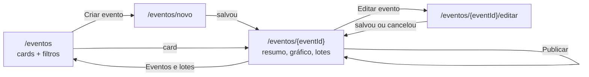
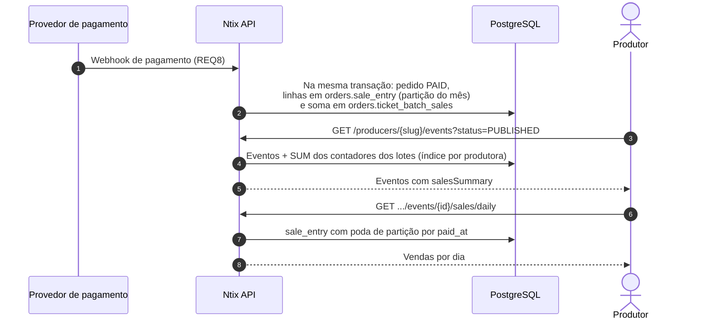

# REQ14 - Organização da Rota de Eventos do Produtor

- **Status**: Em implementação
- **Área**: produtor / painel; comprador / vitrine (descrição formatada)
- **Depende de**: REQ8 (efetivação dos pagamentos); REQ9 (eventos do produtor); REQ10 (lotes e publicação); REQ11 (vitrine pública)

## Objetivo de Negócio

**O que entrega**: a aba Eventos do painel (`https://produtores.ntix.com.br/eventos`), com a API real, passa a ter a experiência que a demonstração prometeu, com números de venda calculados pela API de forma performática:

- **Lista em cards** (`/eventos`): um card por evento com nome, situação, data, local, ingressos vendidos sobre a capacidade (barra `Meter`) e vendas brutas. Filtros por situação: Todos, Rascunho, Publicados, Encerrados. O card leva ao detalhe.
- **Página do evento** (`/eventos/{eventId}`): cabeçalho com nome, data e local; situação; resumo de vendas; gráfico de vendas por dia; os lotes, cada um com seu detalhe de vendas; formulário de lote; botão **Publicar evento**.
- **Criação** (`/eventos/novo`) e **edição** (`/eventos/{eventId}/editar`) em páginas próprias, com o nome do evento no título da edição.
- **Descrição formatada**: o produtor escreve a descrição com títulos, subtítulos, negrito, itálico, listas e links num editor visual, sem ver sintaxe. A vitrine (REQ11) mostra a descrição formatada.
- **Situação "Encerrado"** na API: todo evento cujo término passou.

**Para quem**: a produtora logada (administradora ou equipe) no painel; o comprador, na vitrine, pela descrição formatada.

**Com que dados**: eventos e lotes (REQ9/REQ10) e as vendas efetivadas (REQ8), consolidadas em estruturas de leitura próprias no momento do pagamento.

**O que impacta**:
- **Experiência do produtor**: a tela mais usada do painel vira o lugar onde ele acompanha a venda de cada evento.
- **Receita**: o produtor vê qual evento vende pouco e reage (novo lote, divulgação) sem pedir relatório à Ntix.
- **Conversão na vitrine**: uma descrição organizada (atrações, horários, regras de entrada) vende melhor que um bloco de texto corrido.
- **Desempenho**: resumos e gráficos não varrem pedidos a cada acesso; o custo é pago uma vez, no pagamento.
- **Produto**: a demonstração vira a implementação.

**Por que é positivo**: a demonstração é o argumento de venda da Ntix. Quando a tela real é pior que a demonstrada, o produtor percebe a plataforma como inacabada justamente no primeiro uso.

## Problema de Negócio

Hoje a rota tem duas telas diferentes:

| | Demonstração (`EventsListPage`, `EventDetailPage`) | Real com `?api=real` (`ProducerEventsPage`) |
|---|---|---|
| Lista | Cards (`.event-cards`) com venda por evento | Linhas no estilo da aba Equipe (`.team-list`) |
| Venda por evento | Vendidos/capacidade e vendas brutas | Nenhuma; a API não devolve |
| Criação | Botão "Criar evento" → `/eventos/novo` | Formulário fixo ao lado da lista, sempre aberto |
| Edição | Página do evento | Botão "Editar" troca o formulário ao lado sem aviso |
| Lotes | Página do evento, com URL | Botão "Lotes" abre uma seção no rodapé, sem URL e fora da vista |
| Situação | Rascunho, Em venda, Encerrado | Rascunho, Publicado; sem encerrado |
| Descrição | — | `textarea` de texto puro; a vitrine mostra texto corrido |

Problemas concretos:

1. O produtor não vê quanto cada evento vendeu sem abrir os lotes um a um.
2. O formulário de criação ocupa metade da tela o tempo todo.
3. "Lotes" aparece abaixo da dobra; o produtor acha que nada aconteceu.
4. "Editar" troca o formulário sem mudar de página; é fácil salvar no evento errado.
5. Não há URL para um evento: não dá para recarregar, voltar ou mandar o link para a equipe.
6. Evento que já aconteceu continua "Publicado", misturado aos que estão à venda.
7. A descrição não tem formatação; o produtor não consegue separar atrações, horários e regras.

## Fluxo





## Riscos

### Da ausência
| Risco | Impacto | Mitigação |
|---|---|---|
| Tela real pior que a demonstrada | Produtor aprovado sente perda de qualidade; menos eventos criados | Este requisito |
| Sem venda por evento | Produtor não reage a evento parado; menos receita para ele e para a Ntix | Resumo no card e na página do evento |
| Edição sem página própria | Alteração gravada no evento errado | Edição em rota própria, com o nome do evento no título |
| Descrição sem formatação | Página do evento menos persuasiva na vitrine | Editor visual com Markdown |

### De negócio no requisito
| Risco | Impacto | Mitigação |
|---|---|---|
| Vendas brutas lidas como valor a receber | Produtor espera repasse maior que o real | Rótulo "Vendas brutas" e nota "antes das taxas"; receita líquida fica fora (RN8) |
| Números de venda de um produtor vistos por outro | Exposição comercial | Resumo e gráfico só nos endpoints do painel, com a política `ProducerUser` e a checagem de slug já existentes; a vitrine pública (REQ11) continua sem vendidos |
| Reservas contadas como vendas | Número inflado que depois "cai" | Só pedidos `PAID` entram (RN3) |
| Link malicioso na descrição | Comprador levado a site de golpe a partir da página oficial | Só links `https`, abertos com `rel="noopener noreferrer nofollow"`; produtor é identificado e aprovado |

### De tecnologia no requisito
| Risco | Impacto | Mitigação |
|---|---|---|
| Resumo divergente dos pedidos | Produtor vê número errado | Escrita no mesmo Unit of Work da efetivação (REQ8); teste integrado de reconciliação: contadores = soma de `sale_entry` = soma dos itens pagos |
| Pagamento repetido (webhook duplicado) | Venda contada duas vezes | A escrita só acontece na transição para `PAID`, que o REQ8 já torna idempotente; `sale_entry` tem chave única por item de pedido |
| Concorrência entre pagamentos do mesmo lote | Contador perde incremento | `INSERT ... ON CONFLICT DO UPDATE SET sold_quantity = sold_quantity + EXCLUDED.sold_quantity` (atômico) |
| Partição do mês inexistente | Pagamento falha ao gravar | Partições criadas com antecedência pelo script e partição `DEFAULT` como rede de segurança; alerta quando a `DEFAULT` recebe linhas (RN14) |
| XSS pela descrição | Script executado na vitrine | Descrição guardada como Markdown, nunca HTML; o renderizador ignora HTML cru e só produz os elementos permitidos (RN20) |
| Peso do editor no bundle | Painel mais lento | Editor carregado sob demanda (`React.lazy`) só nas rotas de criação e edição |
| Quebra de contrato | Front antigo quebra | `salesSummary` é aditivo; `ENDED` é valor novo de `status`, tratado no front na mesma entrega |
| Recarregar `/eventos/{eventId}` no subdomínio | 404 do nginx | Mesma regra de SPA das outras rotas do painel (`panelPath`) |

## Implementação de Tecnologia

### Contrato

Autenticação, headers auditáveis (`X-Correlation-Id`, `X-Origin-Service`, `X-Requested-At`) e códigos de notificação continuam os do REQ9, salvo os novos abaixo.

**1. `status` com `ENDED`** em todas as saídas de evento do painel e no filtro:

- `GET /api/v1/producers/{slug}/events?status=DRAFT|PUBLISHED|ENDED`
- Valor inválido em `status` responde 400 com `EVENT_STATUS_INVALID` (código existente de `EventStatusValueObject`, que passa a aceitar `ENDED` só como filtro).

**2. `salesSummary`** em `ProducerEventOutput` (lista, detalhe, criação e edição):

```json
{
  "id": "0b6e2c1a-7f43-4c55-9a5e-1d2f3a4b5c6d",
  "slug": "festival-horizonte",
  "title": "Festival Horizonte",
  "description": "## Atrações\n\n- **Banda Maré** às 21h\n- DJ Horizonte às 23h\n\n### Entrada\n\nLeve documento com foto.",
  "status": "PUBLISHED",
  "startsAt": "2027-03-20T21:00:00Z",
  "endsAt": "2027-03-21T06:00:00Z",
  "...": "demais campos do REQ9",
  "salesSummary": {
    "capacity": 1200,
    "soldQuantity": 431,
    "grossCents": 5172000,
    "paidOrders": 298
  }
}
```

**3. Detalhe de vendas por lote** em `TicketBatchOutput` (`GET .../events/{eventId}/batches`), aditivo:

```json
{ "id": "…", "name": "1º lote", "soldQuantity": 300, "reservedQuantity": 4, "availableQuantity": 196, "grossCents": 3600000, "paidOrders": 210, "...": "demais campos do REQ10" }
```

**4. Vendas por dia** (novo):

- `GET /api/v1/producers/{slug}/events/{eventId}/sales/daily?from=2026-11-01&to=2026-11-30`
- Política `ProducerUser`; datas no fuso `America/Sao_Paulo`; `from`/`to` opcionais (padrão: últimos 30 dias até hoje); intervalo máximo de 366 dias.
- 200:

```json
{
  "from": "2026-11-01",
  "to": "2026-11-30",
  "days": [
    { "date": "2026-11-01", "soldQuantity": 12, "grossCents": 144000, "paidOrders": 9 }
  ]
}
```

- Dias sem venda vêm com zero, para o gráfico não ter buracos.
- 400: `SALES_PERIOD_INVALID` (data inválida, `from` > `to` ou mais de 366 dias).
- 404: `PRODUCER_NOT_FOUND`, `EVENT_NOT_FOUND` (inclusive evento de outra produtora).
- 499: cancelamento, como nos demais.

**5. Descrição** (`description` de `EventV1Request`): Markdown no subconjunto da RN19, até 5000 caracteres de fonte (RN2 do REQ9). Na vitrine (`GET /api/v1/events/{eventSlug}`), o mesmo Markdown.

### Regras de negócio e validações

Situação

- **RN1**: a situação exposta pela API é `DRAFT`, `PUBLISHED` ou `ENDED`. Todo evento com `endsAt` menor ou igual ao instante da consulta é `ENDED`, publicado ou não; antes disso, vale a situação gravada (`DRAFT` ou `PUBLISHED`).
- **RN2**: `ENDED` é regra do domínio (`Event` calcula a situação com o `TimeProvider`), não do front e não de um processo agendado. A coluna `status` continua guardando só a decisão do produtor (`DRAFT`/`PUBLISHED`).
- **RN3**: o filtro traduz em SQL sobre índice: `DRAFT` = `status = 'DRAFT' AND ends_at > now`; `PUBLISHED` = `status = 'PUBLISHED' AND ends_at > now`; `ENDED` = `ends_at <= now`. Evento `ENDED` não aceita edição, lote novo nem publicação (as regras do REQ9/REQ10 já bloqueiam por início; esta só dá o nome).
- **RN4**: a vitrine (REQ11) continua listando só publicados que não terminaram; nada muda para o comprador.

Resumo e vendas

- **RN5**: `capacity` é a soma de `quantity` de todos os lotes do evento, ativos e pausados. Evento sem lote: `0`.
- **RN6**: só pedidos `PAID` contam; reservas (`PENDING_PAYMENT`) ficam fora de `soldQuantity`, `grossCents`, `paidOrders` e do gráfico.
- **RN7**: `grossCents` usa o preço gravado no item do pedido (REQ6), não o preço atual do lote.
- **RN8**: receita líquida e taxas ficam fora; serão criadas sob demanda.
- **RN9**: na transição do pedido para `PAID` (REQ8), no mesmo Unit of Work: uma linha por item em `orders.sale_entry` e a soma do item em `orders.ticket_batch_sales` (upsert atômico).
- **RN10**: o resumo do evento é a soma dos contadores dos seus lotes; a lista do painel busca os resumos de todos os eventos da página numa única consulta, sem acesso por evento e sem ler pedidos.
- **RN11**: o gráfico lê `orders.sale_entry` filtrando por `paid_at` no intervalo, para o PostgreSQL podar as partições fora dele.
- **RN12**: o card mostra só o resumo do evento; o detalhe de cada lote (vendidos, reservados, disponíveis, vendas brutas, pedidos) é experiência da página do evento.

Banco de dados

- **RN13**: `orders.sale_entry` é particionada por `RANGE (paid_at)`, uma partição por mês, com chave primária `(id_order_item, paid_at)`. Colunas: `id_order_item`, `id_order`, `id_producer`, `id_event`, `id_ticket_batch`, `quantity`, `unit_price`, `paid_at`, `created_correlation_id`. Índice por partição em `(id_event, paid_at) INCLUDE (quantity, unit_price, id_order)`.
- **RN14**: o script cria as partições de janeiro de 2026 a dezembro de 2028 e uma partição `DEFAULT`. Como não há worker, o insert devolve a partição de cada linha (`tableoid`); a que cair na `DEFAULT` gera o log de aviso 7212 e incrementa a métrica `ntix.sales.default_partition.rows`, sinal de que é hora de criar partições novas.
- **RN15**: contadores somados na efetivação: `orders.ticket_batch_sales` (um por lote, para o detalhe da página do evento) e `orders.event_sales` (um por evento, para o card e o resumo, porque um pedido com itens de dois lotes conta como um pedido só). Colunas `sold_quantity`, `gross_amount`, `paid_orders`, `updated_at`; índices `ix_ticket_batch_sales_id_event` e `ix_event_sales_id_producer`, este com `INCLUDE` dos números.
- **RN16**: índice `events.event (id_producer, status, ends_at)` para o filtro da RN3. A capacidade usa o índice `ix_ticket_batch_id_event` já existente: são poucos lotes por evento, e trocar o índice faria o script idempotente apagá-lo e recriá-lo a cada implantação.
- **RN17**: o script de implantação faz o backfill idempotente a partir dos pedidos `PAID` existentes (`INSERT ... SELECT ... ON CONFLICT DO NOTHING` em `sale_entry`; recálculo completo de `ticket_batch_sales`).
- **RN18**: `orders.orders`, `order_item` e `ticket` não são particionadas neste requisito (ver Decisões em aberto, item 2).

Descrição formatada

- **RN19**: subconjunto aceito: título (`##`), subtítulo (`###`), parágrafo, negrito, itálico, lista com marcadores, lista numerada, link e citação. Nada de imagem, tabela, código ou HTML.
- **RN20**: a vitrine renderiza só os elementos da RN19; HTML cru é ignorado; links que não sejam `https` viram texto; links abrem em nova aba com `rel="noopener noreferrer nofollow"`.
- **RN21**: o editor é visual (o produtor vê o texto já formatado), com barra de ferramentas (Título, Subtítulo, Negrito, Itálico, Lista, Lista numerada, Link, Citação) e atalhos de teclado (`Ctrl+B`, `Ctrl+I`, `Ctrl+K`) e de digitação (`## `, `- `, `1. `, `> ` viram formatação). O que ele grava é Markdown.
- **RN22**: o contador do editor mostra caracteres usados de 5000, contando o Markdown gravado; acima do limite o botão de salvar fica desabilitado, e a API continua validando (RN2 do REQ9).
- **RN23**: descrições antigas em texto puro são Markdown válido; não há migração.

Telas

- **RN24**: a lista ordena por situação (Publicados, Rascunhos, Encerrados) e, dentro dela, por início crescente; com filtro ativo, só por início.
- **RN25**: filtros em abas/chips "Todos", "Rascunho", "Publicados", "Encerrados", mapeados no parâmetro `status`; o filtro escolhido vai para a URL (`/eventos?situacao=encerrados`) para sobreviver ao recarregar.
- **RN26**: card sem lote mostra "Sem lotes ainda"; com lote, a barra `Meter` mostra `soldQuantity` de `capacity` e o rodapé mostra os dois números e `grossCents` (`formatCents`). Selo: "Rascunho", "Publicado" (ao vivo), "Encerrado".
- **RN27**: lista vazia mostra "Nenhum evento ainda" com o botão "Criar evento"; filtro sem resultado mostra "Nenhum evento nesta situação".
- **RN28**: `/eventos/novo` cria em rascunho e navega para `/eventos/{id}` do evento criado.
- **RN29**: `/eventos/{eventId}/editar` só existe até o início do evento; depois, o botão "Editar evento" some e a rota redireciona para a página do evento.
- **RN30**: na página do evento, "Publicar evento" aparece só em rascunho e fica desabilitado sem lote ativo, com a nota "Adicione um lote para poder publicar." (REQ10).
- **RN31**: a página do evento mostra em `stat-row`: "Ingressos vendidos" (`soldQuantity` de `capacity`), "Vendas brutas" (com nota "antes das taxas") e "Pedidos" (`paidOrders`); abaixo, o gráfico "Vendas por dia" (barras de ingressos por dia, com vendas brutas no detalhe de cada barra), com períodos 7, 30 e 90 dias.
- **RN32**: cada lote, na tabela da página do evento, mostra barra de vendidos, preço, período, estado de venda (REQ10), reservados, disponíveis, vendas brutas e pedidos, e a ação de pausar/retomar.
- **RN33**: evento publicado e não encerrado mostra "Ver na vitrine", em nova aba.
- **RN34**: `eventId` inexistente ou de outra produtora (404) redireciona para `/eventos`.

### Camadas

- **Domain**:
  - `EventContext`: `Event.StatusAt(DateTime now)` devolve `DRAFT`, `PUBLISHED` ou `ENDED` (RN1). Enum/constante de situação exposta separada da situação gravada.
  - `OrderContext`: `OrderPaidEvent` já carrega itens com `BatchId`, `Quantity` e `UnitPriceCents`; a montagem das entradas de venda sai daí.
  - `EventDescriptionValueObject`: sem mudança de regra (limite de 5000 sobre a fonte).
- **Infra** (SQL nativo com `Npgsql`, scripts em `data/`):
  - `data/orders/007-create-sale-entry-table.sql` (RN13, RN14), `008-create-sales-counters.sql` (RN15), `009-reconcile-sales.sql` (RN17, com trava exclusiva durante o recálculo); `data/events/007-create-event-status-indexes.sql` (RN16).
  - `SalesRepository` (`ISalesRepository`): `RegisterPaidOrderAsync` (insere em `sale_entry` e faz os upserts dos dois contadores), `GetEventSummariesAsync(producerId, eventIds)`, `GetBatchTotalsAsync(batchIds)`, `GetDailySalesAsync(eventId, fromUtc, beforeUtc, timeZone)`.
  - Repositório de eventos: filtro por situação com `now` como parâmetro (RN3).
- **Application**:
  - O caso de uso da efetivação (REQ8) chama `RegisterPaidOrderAsync` no mesmo Unit of Work da transição para `PAID`.
  - `GetProducerEventsUseCase`, `GetProducerEventUseCase`, `CreateEventUseCase`, `UpdateEventUseCase`: `Status` via `StatusAt(timeProvider.GetUtcNow())` e `SalesSummary`.
  - Lotes: `TicketBatchOutput` ganha `GrossCents` e `PaidOrders`.
  - Novo `GetEventDailySalesUseCase` (entrada: slug, eventId, from, to; saída: dias preenchidos com zero), com funil de métricas (solicitações e desfechos).
- **Presentation (WebApi)**: `ProducerEventsV1Controller` ganha `GET {eventId}/sales/daily`; o filtro aceita `ENDED`; OpenAPI atualizado.
- **Front (`web/`)**, pela skill `frontend-integration`:
  - `api/events.ts`: `EventStatus` com `ENDED`, `EventSalesSummary`, campos novos do lote, `getEventDailySales`.
  - `PanelRoutes.tsx`: com `isRealApi()`, as rotas `eventos`, `eventos/novo`, `eventos/:eventId` e `eventos/:eventId/editar` apontam para as páginas reais; sem a flag, a demonstração continua como está.
  - `ProducerEventsPage.tsx` se divide em `ProducerEventsListPage`, `ProducerEventFormPage` (criação e edição) e `ProducerEventDetailPage`, com as classes da demonstração (`page-head--action`, `event-cards`, `event-card`, `stat-row`, `detail-bar`, `batch-table`, `Window`, `Meter`, `back-link`, `empty-state`).
  - `EventBatchesSection.tsx` vive dentro da página do evento, como `batch-table` com os números da RN32.
  - Gráfico "Vendas por dia" em SVG com os tokens do design system, sem biblioteca de gráficos.
  - `RichTextEditor` no design system (carregado com `React.lazy`) e `MarkdownView` para a vitrine (`pages/hub/EventPage.tsx`), com a dependência da RFC 0010.
  - Sai da tela real: `.team`/`.team-list` e o `select` de filtro. O status deixa de ser derivado no front.
  - A demonstração (`production/EventsPages.tsx`) não muda.

### Configuração e implantação

- Nenhuma chave de `appsettings` ou variável nova.
- Ordem de implantação: scripts `data/` (tabelas, índices, backfill) antes da API nova. O backfill é idempotente e pode rodar de novo.
- `devops/` e `gateway/`: nenhuma mudança; as rotas novas do painel caem no fallback da SPA.
- Partições: a cada ano, um script novo em `data/orders/` cria as partições do ano seguinte (antes do alerta da RN14 disparar).

### Observabilidade

- Span `RegisterPaidItems` dentro do trace da efetivação; span `GetEventSummaries` na lista; span `GetDailySales` no gráfico.
- Métricas: funil do `GetEventDailySalesUseCase`; `ntix_sale_entry_default_partition_rows` (RN14).
- Logs semânticos com `EventId` e quantidade de eventos/dias retornados; nenhum valor de venda e nenhum dado do comprador.

### Testes

- **Unitários**: `Event.StatusAt` nas fronteiras (`endsAt` − 1 s, `endsAt`, rascunho vencido); preenchimento de dias sem venda; validação do período (`from` > `to`, 367 dias, data inválida); conversões das saídas.
- **Integrados** (PostgreSQL real):
  - Pagamento grava `sale_entry` na partição do mês e soma em `ticket_batch_sales`; webhook repetido não duplica.
  - Dois pagamentos concorrentes do mesmo lote somam os dois.
  - Reconciliação: contadores = soma de `sale_entry` = soma dos itens dos pedidos `PAID`, com pedido pendente fora.
  - `paid_at` sem partição cai na `DEFAULT`.
  - Filtro `ENDED`/`PUBLISHED`/`DRAFT` com `now` controlado.
  - `EXPLAIN` da lista sem `Seq Scan` em `orders`/`order_item` e do gráfico com poda de partições.
  - Backfill rodado duas vezes dá o mesmo resultado.
- **Funcionais** (Reqnroll, `# language: pt`): os critérios de aceite abaixo que envolvem a API.
- **Front (Vitest)**: reescrever `events.test.tsx` e `batches.test.tsx` para as páginas novas; testes do editor (barra de ferramentas e atalhos gerando o Markdown esperado, contador) e do `MarkdownView` (HTML cru ignorado, link `javascript:` vira texto, `rel` dos links).
- **Carga (k6, escrito e não executado)**: perfil moderado (até 50 VUs, p95 abaixo de 500 ms, menos de 1% de erros) em `GET /producers/{slug}/events` com 50 eventos e 100 mil vendas, e em `GET .../sales/daily` com 90 dias.

### Dependências

- **Front**: editor de texto rico com Markdown e renderizador seguro de Markdown, na [RFC 0010](../docs/rfcs/0010-editor-de-descricao-em-markdown.md).
- **Back**: nenhuma; particionamento nativo do PostgreSQL 18, sem extensão.

### Fora do escopo

- Receita líquida, taxas e repasse.
- Upload de imagem do evento e imagem na descrição.
- Duplicar, arquivar ou excluir evento.
- Particionar `orders.orders`, `order_item` e `ticket`.
- Gráficos além de vendas por dia (por lote, por canal, por hora).
- Mudanças na demonstração e nas outras abas do painel.
- Afiliados por evento.

## Critérios de Aceite

```gherkin
# language: pt
Funcionalidade: Rota de eventos do produtor

  Cenário: Lista em cards com venda por evento
    Dado uma produtora com o evento "Festival Horizonte" publicado, capacidade 1200 e 431 ingressos pagos somando R$ 51.720,00
    Quando ela abre /eventos com a API real
    Então vê um card "Festival Horizonte" com o selo "Publicado"
    E a barra "431 de 1200 ingressos vendidos"
    E as vendas brutas "R$ 51.720,00"

  Cenário: Reserva não conta como venda
    Dado um pedido pendente de 2 ingressos do "Festival Horizonte"
    Quando a produtora consulta seus eventos
    Então os vendidos continuam 431

  Cenário: Preço do pedido, não do lote
    Dado um lote vendido a R$ 100,00 e depois reajustado para R$ 120,00
    Quando a produtora consulta o evento
    Então as vendas brutas somam R$ 100,00 por ingresso vendido antes do reajuste

  Cenário: Webhook repetido não duplica a venda
    Dado um pedido de 2 ingressos já efetivado
    Quando o mesmo webhook de pagamento chega de novo
    Então os vendidos do lote continuam os mesmos

  Cenário: Evento encerrado pela API
    Dado um evento publicado cujo término foi há 1 minuto
    Quando a produtora consulta seus eventos
    Então o evento vem com a situação "ENDED"
    E aparece no filtro "Encerrados" e não no filtro "Publicados"

  Cenário: Rascunho vencido também encerra
    Dado um evento em rascunho cujo término já passou
    Então a situação é "ENDED"

  Cenário: Filtro na URL
    Quando a produtora escolhe "Encerrados" e recarrega a página
    Então continua vendo só os eventos encerrados

  Cenário: Evento sem lote
    Dado um evento em rascunho sem lotes
    Quando a produtora abre /eventos
    Então o card mostra "Sem lotes ainda"

  Cenário: Lista vazia
    Dado uma produtora sem eventos
    Quando ela abre /eventos
    Então vê "Nenhum evento ainda" e o botão "Criar evento"

  Cenário: Detalhe de vendas por lote
    Dado o "1º lote" com 300 vendidos, 4 reservados e R$ 36.000,00 em vendas
    Quando a produtora abre a página do evento
    Então a linha do "1º lote" mostra 300 vendidos, 4 reservados, 196 disponíveis e R$ 36.000,00

  Cenário: Vendas por dia
    Dado vendas em 01/11/2026 e 03/11/2026
    Quando a produtora consulta as vendas por dia de 01/11/2026 a 03/11/2026
    Então recebe três dias, com 02/11/2026 zerado

  Cenário: Período inválido
    Quando a produtora consulta as vendas por dia com início depois do fim
    Então recebe 400 com "SALES_PERIOD_INVALID"

  Cenário: Criação em página própria
    Quando a produtora clica em "Criar evento" e preenche o formulário válido
    Então o evento é criado em rascunho
    E ela é levada a /eventos/{id} do evento criado

  Cenário: Edição em página própria
    Dado um evento que ainda não começou
    Quando a produtora clica em "Editar evento" e salva
    Então volta à página do evento com os dados novos

  Cenário: Edição bloqueada após o início
    Dado um evento que já começou
    Quando a produtora abre /eventos/{id}/editar
    Então é levada à página do evento e não vê "Editar evento"

  Cenário: Descrição formatada
    Dado a produtora editando a descrição
    Quando digita "## " seguido de "Atrações" e marca "Banda Maré" em negrito
    Então vê um título "Atrações" e "Banda Maré" em negrito, sem sintaxe
    E a API recebe "## Atrações" e "**Banda Maré**"
    E a vitrine mostra o título e o negrito

  Cenário: HTML na descrição não executa
    Dado uma descrição com "<script>alert(1)</script>" e um link "javascript:alert(1)"
    Quando o comprador abre o evento na vitrine
    Então nenhum script executa e o link aparece como texto

  Cenário: Publicação na página do evento
    Dado um evento em rascunho com um lote ativo
    Quando a produtora clica em "Publicar evento"
    Então o selo muda para "Publicado" e aparece "Ver na vitrine"

  Cenário: Publicação sem lote
    Dado um evento em rascunho sem lote ativo
    Então "Publicar evento" está desabilitado com a nota "Adicione um lote para poder publicar."

  Cenário: Evento de outra produtora
    Quando a produtora abre /eventos/{id} de um evento que não é dela
    Então é levada a /eventos

  Cenário: Demonstração intacta
    Dado o painel sem ?api=real
    Quando a produtora aprovada abre /eventos
    Então vê os cards de demonstração como hoje
```

## Decisões tomadas com o usuário

1. Resumo e composição das vendas calculados na API, com índices e particionamento; gráficos e resumos devolvidos de forma performática. O detalhe por lote é experiência da página do evento, não do card.
2. Vendas brutas pelo preço gravado no pedido.
3. Situação `ENDED` criada na API, após o término do evento.
4. Filtro de encerrados.
5. Receita líquida fora; criada sob demanda.
6. Cada evento tem página própria (e a edição também), e a descrição ganha editor visual com Markdown.

## Decisões confirmadas na implementação

O usuário aceitou as decisões provisórias abaixo ao pedir a implementação.

1. **`ENDED` calculado no domínio no momento da consulta** (RN2) em vez de gravado por um processo agendado: adotado, porque não existe worker e assim a situação vira exatamente no término, sem atraso. O filtro continua sobre índice.
2. **O que particionar**: adotado particionar a tabela nova `orders.sale_entry` por mês de pagamento, que alimenta gráficos e reconciliação, e servir o resumo por contadores por lote (`ticket_batch_sales`), leitura O(lotes). Particionar `orders.orders`/`order_item` exigiria mudar chaves primárias e estrangeiras de tabelas em produção; fica para quando o volume pedir.
3. **Manutenção das partições** por script anual + partição `DEFAULT` + alerta (RN14), sem `pg_partman` (seria extensão nova).
4. **Rascunho vencido vira `ENDED`** (RN1), para não sobrar rascunho impublicável na aba Rascunho.
5. **Gráfico "Vendas por dia"** entra neste requisito, com períodos de 7, 30 e 90 dias, desenhado em SVG sem biblioteca.
6. **Editor**: Lexical com `@lexical/markdown` no painel e `react-markdown` na vitrine (RFC 0010). Subconjunto da RN19 sem imagem nem tabela.
7. **Carga**: perfil moderado nos dois endpoints de leitura.
