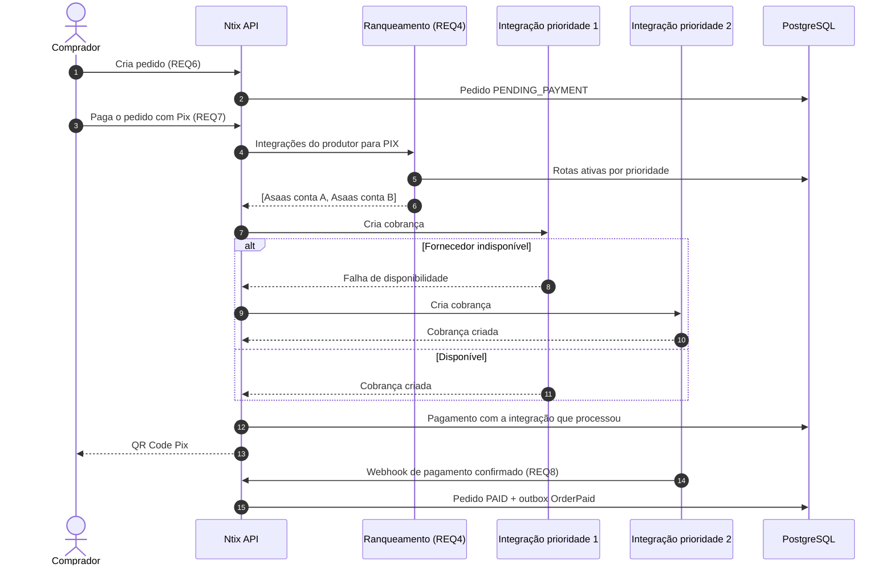
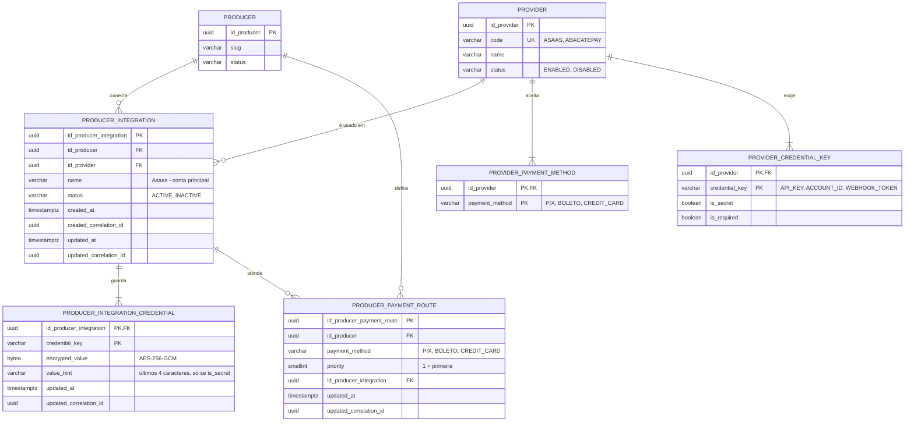
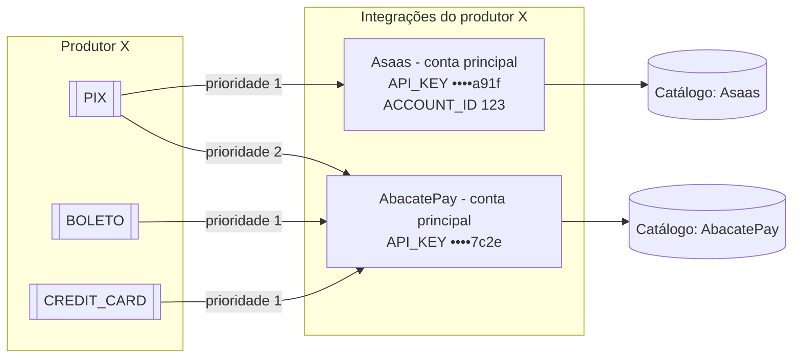
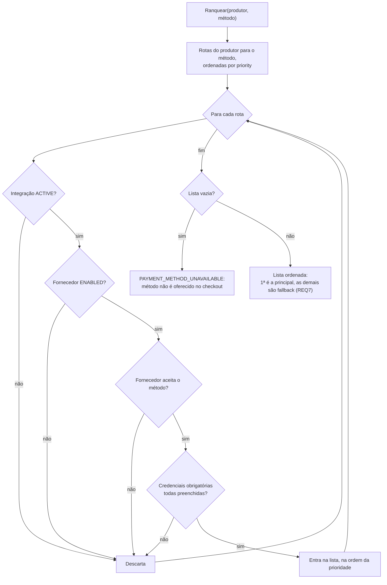
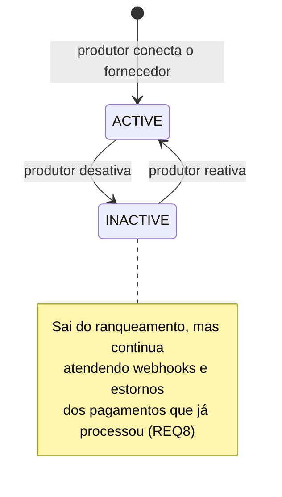

# REQ4 - Integrações de Pagamento do Produtor

- **Status**: Implementado (aguardando validação); vai para produção junto com o REQ5
- **Área**: produtor / plataforma / pagamentos
- **Depende de**: REQ1 (cadastro do produtor); REQ5 (autenticação do usuário do produtor)

## Contexto: o domínio de pagamentos

A Ntix é infraestrutura de tecnologia para produtores de evento. O dinheiro do ingresso não passa por um fornecedor único escolhido pela Ntix: cada produtor escolhe com qual fornecedor (Asaas, AbacatePay...) processa cada método de pagamento, com a conta e as credenciais dele. Exemplo: o produtor X processa Pix pelo Asaas e boleto e cartão de crédito pelo AbacatePay.

O domínio de pagamentos fica dividido em quatro requisitos. Este (REQ4) é a fundação: sem ele, os outros não sabem por qual fornecedor cobrar.

| REQ | Título | Entrega |
|---|---|---|
| **REQ4** | Integrações de pagamento do produtor | Catálogo de fornecedores, integrações do produtor com credenciais em chave-valor, rotas por método com prioridade e o ranqueamento da integração a usar |
| REQ6 | Criação de pedidos | Pedido do comprador, com itens e valor, em `PENDING_PAYMENT`, reservando os ingressos (o método é escolhido no REQ7) |
| REQ7 | Pagamento de pedidos | Cobrança no fornecedor eleito pelo ranqueamento do REQ4, com troca para a próxima integração quando a primeira estiver indisponível |
| REQ8 | Efetivação dos pagamentos | Confirmação pelo fornecedor (webhook), pedido `PAID`, ingressos emitidos e `OrderPaid` na outbox (o extrato fica para o requisito de carteira) |

A jornada completa de compra, com os domínios de eventos, lotes, vitrine e login do cliente (REQ9 a REQ13), está em [docs/jornada-de-compra.md](../docs/jornada-de-compra.md).



Ponto que atravessa os quatro requisitos: **o pagamento grava a integração que o processou**. Webhook, consulta e estorno voltam sempre para ela, mesmo que o produtor mude as prioridades ou inative a integração depois.

## Objetivo de Negócio

**O que entrega**: a estrutura que liga cada produtor aos seus fornecedores de pagamento e decide, para cada método, qual integração usar.

- **Catálogo de fornecedores**, mantido pela Ntix: quais fornecedores existem, que métodos cada um aceita e quais credenciais cada um exige.
- **Integrações do produtor**: uma conexão do produtor com um fornecedor (ex.: "Asaas - conta principal"), com as credenciais em chave-valor (`API_KEY`, `ACCOUNT_ID`...), cifradas no banco.
- **Rotas de pagamento**: para cada método (`PIX`, `BOLETO`, `CREDIT_CARD`), a lista ordenada de integrações, da prioridade 1 em diante.
- **Ranqueamento**: um serviço de domínio que devolve, para um produtor e um método, as integrações disponíveis em ordem de prioridade. É ele que o REQ7 consome.
- **Aba Integrações** no painel do produtor, onde ele conecta fornecedores e ordena as prioridades por método.

**O que impacta**:
- **Receita e venda**: com fallback entre integrações, a queda de um fornecedor não para a venda do evento.
- **Parceiros**: entrar um fornecedor novo é um registro no catálogo e um adaptador, sem mudar o modelo.
- **Produtor**: escolhe a taxa e o prazo de recebimento que preferir, por método, e recebe direto na conta dele.
- **Operação Ntix**: não custodia o dinheiro do ingresso e consegue desligar um fornecedor para todos de uma vez.

**Por que é positivo**: transforma pagamento em infraestrutura configurável, que é a proposta da Ntix. O produtor não precisa trocar de plataforma para trocar de fornecedor, e a Ntix não precisa negociar um fornecedor único para todos os clientes.

## Problema de Negócio

Hoje não há pagamento real: o checkout do front (`web/src/customer/payments.ts`, `CheckoutPage.tsx`) só simula a compra e registra bandeira e quatro últimos dígitos. Sem este requisito:

- Não há onde guardar com que fornecedor e com que conta cada produtor recebe.
- Um único fornecedor fixo no código obrigaria todo produtor a usá-lo, com as taxas dele, e a queda dele pararia a venda de todos os eventos.
- REQ6, REQ7 e REQ8 não têm como decidir para onde mandar a cobrança.

O requisito resolve isso com dados: produtor, integração, credenciais e rota por método, e uma regra única de ranqueamento.

## Modelo de dados



Exemplo do produtor X:



## Ranqueamento



Ciclo de vida da integração:



## Riscos

### Da ausência
| Risco | Impacto | Mitigação |
|---|---|---|
| Sem relação produtor-fornecedor | REQ6 a REQ8 não podem ser implementados; nada é vendido de verdade | Este requisito |
| Fornecedor único fixo no código | Produtor sem escolha de taxa; queda do fornecedor para a venda de toda a plataforma | Rotas por produtor e método, com prioridade |
| Credenciais fora da plataforma (planilha, variável por produtor) | Vazamento, troca manual por deploy, onboarding lento | Credenciais cifradas por integração, editáveis pelo produtor |

### De negócio no requisito
| Risco | Impacto | Mitigação |
|---|---|---|
| Credencial errada ou de outra conta | Dinheiro do ingresso cai na conta errada | Só o próprio produtor cadastra as credenciais; trilha de auditoria (`updated_correlation_id`, log com produtor e integração, nunca o valor); teste de conexão fica no REQ7 (ver Decisões) |
| Produtor sem nenhuma rota ativa para um método | Método some do checkout; venda perdida | Ranqueamento vazio devolve `PAYMENT_METHOD_UNAVAILABLE` e o checkout esconde o método; a aba mostra o método como "não configurado" |
| Mudança de prioridade no meio de uma venda | Pagamento iniciado em uma integração confirmado em outra | O pagamento grava a integração que o processou (REQ7); a prioridade vale só para novas cobranças |
| Ntix desliga um fornecedor do catálogo | Todos os produtores que dependem só dele perdem o método | `DISABLED` sai do ranqueamento na hora, e o fallback do produtor assume; comunicação ao produtor fica com a operação |

### De tecnologia no requisito
| Risco | Impacto | Mitigação |
|---|---|---|
| Vazamento de credencial pelo banco ou backup | Acesso à conta do produtor no fornecedor | Valor cifrado com AES-256-GCM (biblioteca padrão do .NET), chave fora do banco em `PaymentCredentialConfiguration__EncryptionKey` (RN9) |
| Vazamento de credencial pela API, logs ou traces | Mesmo impacto | Valor secreto nunca sai da API: a leitura devolve só `valueHint` (RN10); logs e spans citam só a chave (`API_KEY`), nunca o valor |
| Acesso de um produtor às integrações de outro | Troca de conta de recebimento, fraude | Endpoints autenticados e restritos ao produtor do usuário (RN1); teste integrado de isolamento |
| Duas prioridades iguais no mesmo método | Ranqueamento ambíguo | Índice único `(id_producer, payment_method, priority)` e substituição atômica da lista (RN6) |
| Ranqueamento lento no checkout | Latência no pagamento | Uma consulta exata por `(id_producer, payment_method)`, com índice; sem `LIKE` |
| Perda da chave de cifragem | Credenciais ilegíveis; nenhum pagamento sai | Chave em secret do GitHub e no `.env` do servidor, com backup pela operação; rotação fora do escopo |

## Implementação de Tecnologia

### Contrato

Todos os endpoints levam os headers auditáveis (`X-Correlation-Id`, `X-Origin-Service`, `X-Requested-At`). Exceto o catálogo, exigem o access token do REQ5 (`Authorization: Bearer`, política `ProducerUser`) com `producer_slug` igual ao `{slug}` da rota, e `ExecutionUser` vem do token.

#### `GET /api/v1/payment-providers`
Catálogo de fornecedores `ENABLED`, para a aba montar o formulário. Público.

**200 OK**
```json
[
  {
    "code": "ASAAS",
    "name": "Asaas",
    "paymentMethods": ["PIX", "BOLETO", "CREDIT_CARD"],
    "credentialKeys": [
      { "key": "API_KEY", "isSecret": true, "isRequired": true },
      { "key": "ACCOUNT_ID", "isSecret": false, "isRequired": true },
      { "key": "WEBHOOK_TOKEN", "isSecret": true, "isRequired": false }
    ]
  }
]
```

#### `POST /api/v1/producers/{slug}/payment-integrations`
Conecta um fornecedor.

```json
{
  "providerCode": "ASAAS",
  "name": "Asaas - conta principal",
  "credentials": { "API_KEY": "$aact_...", "ACCOUNT_ID": "123" }
}
```

- **201 Created**, `Location: /api/v1/producers/{slug}/payment-integrations/{id}`, corpo no formato da leitura.
- **400**: `PROVIDER_NOT_FOUND_NOTIFICATION_CODE`, `INTEGRATION_NAME_INVALID_NOTIFICATION_CODE`, `CREDENTIAL_KEY_REQUIRED_NOTIFICATION_CODE`, `CREDENTIAL_KEY_UNKNOWN_NOTIFICATION_CODE`, `CREDENTIAL_VALUE_INVALID_NOTIFICATION_CODE`.
- **409**: `INTEGRATION_NAME_ALREADY_EXISTS_NOTIFICATION_CODE`.

#### `GET /api/v1/producers/{slug}/payment-integrations`
**200 OK**
```json
[
  {
    "id": "6b0f...",
    "providerCode": "ASAAS",
    "name": "Asaas - conta principal",
    "status": "ACTIVE",
    "credentials": [
      { "key": "API_KEY", "isSecret": true, "valueHint": "a91f" },
      { "key": "ACCOUNT_ID", "isSecret": false, "value": "123" }
    ]
  }
]
```

#### `PUT /api/v1/producers/{slug}/payment-integrations/{id}`
Altera nome, status e credenciais. `credentials` é parcial: só as chaves enviadas são substituídas; chave enviada com `null` é removida se não for obrigatória.

```json
{ "name": "Asaas - conta principal", "status": "INACTIVE", "credentials": { "API_KEY": "$aact_novo..." } }
```

- **200 OK**, corpo no formato da leitura.
- **400**: os códigos do `POST`, mais `INTEGRATION_STATUS_INVALID_NOTIFICATION_CODE`.
- **404**: `INTEGRATION_NOT_FOUND_NOTIFICATION_CODE`.

#### `GET /api/v1/producers/{slug}/payment-routes`
**200 OK**: os três métodos, sempre presentes, com as integrações em ordem de prioridade.
```json
{
  "PIX": [ { "priority": 1, "integrationId": "6b0f...", "name": "Asaas - conta principal", "status": "ACTIVE" } ],
  "BOLETO": [],
  "CREDIT_CARD": []
}
```

#### `PUT /api/v1/producers/{slug}/payment-routes/{paymentMethod}`
Substitui a lista inteira do método. A ordem do array é a prioridade (primeiro = 1). Lista vazia remove o método.

```json
{ "integrationIds": ["6b0f...", "9a1c..."] }
```

- **200 OK**, corpo no formato do item do `GET`.
- **400**: `PAYMENT_METHOD_INVALID_NOTIFICATION_CODE`, `INTEGRATION_NOT_FOUND_NOTIFICATION_CODE`, `INTEGRATION_DUPLICATED_IN_ROUTE_NOTIFICATION_CODE`, `PROVIDER_DOES_NOT_SUPPORT_METHOD_NOTIFICATION_CODE`.

Comuns a todos: **401** sem token válido e **403** com token de outro produtor (REQ5); **499** no cancelamento; **500** sem corpo, como no REQ3.

### Regras de negócio
- **RN1**: integrações e rotas pertencem a um produtor; um usuário só lê e altera as do produtor ao qual pertence.
- **RN2**: os métodos de pagamento são `PIX`, `BOLETO` e `CREDIT_CARD`.
- **RN3**: o catálogo de fornecedores é mantido pela Ntix por script em `data/payments/`; o produtor não cria fornecedor. Carga inicial: só `ABACATEPAY`, por decisão do usuário na implementação; o `ASAAS` entra por script quando for adotado.
- **RN4**: as credenciais de uma integração são exatamente as chaves do `provider_credential_key` do fornecedor: toda obrigatória presente, nenhuma desconhecida.
- **RN5**: valor de credencial não vazio, sem espaço nas pontas, com até 2048 caracteres. Nome da integração com 1 a 64 caracteres, único por produtor.
- **RN6**: em um método, cada integração aparece uma vez e cada prioridade uma vez, de 1 em diante, sem buracos. A lista é substituída inteira em uma transação.
- **RN7**: uma integração só entra na rota de um método que o fornecedor dela aceita.
- **RN8**: o ranqueamento devolve, em ordem de prioridade, as integrações do método que estão `ACTIVE`, com fornecedor `ENABLED`, que aceitam o método e com credenciais obrigatórias completas. Lista vazia é `PAYMENT_METHOD_UNAVAILABLE`.
- **RN9**: valor de credencial é gravado cifrado (AES-256-GCM, nonce aleatório por valor) e só é decifrado no momento da cobrança (REQ7).
- **RN10**: valor de chave secreta nunca é devolvido; a leitura mostra os últimos 4 caracteres em `valueHint`. Chave não secreta é devolvida em `value`.
- **RN11**: integração não é excluída, só inativada. Inativa, sai do ranqueamento e continua na rota, sinalizada como `INACTIVE`.
- **RN12**: o ranqueamento não chama o fornecedor. A indisponibilidade em tempo de cobrança (timeout, 5XX) é tratada pelo fallback do REQ7.

### Camadas
- **Domain** (`BoundedContexts/PaymentContext`):
  - Enums `PaymentMethod`, `ProviderStatus`, `IntegrationStatus`.
  - Entidades `Provider` (métodos e chaves aceitos), `ProducerIntegration` (credenciais), `PaymentRoute` (método e lista ordenada).
  - Value objects `IntegrationNameValueObject` e `CredentialValueObject`, com `GetObfuscatedValue()` para o `valueHint`.
  - `PaymentRoute` valida RN6 e RN7; `ProducerIntegration` valida RN4 e RN5.
  - O ranqueamento (RN8) é regra do conceito e fica no domínio, como serviço puro sobre as entidades, porque REQ7 e o checkout o reutilizam.
- **Infra** (`PostgreSql/Repositories/Payments`):
  - `IPaymentProviderRepository`, `IProducerIntegrationRepository` e `IPaymentRouteRepository`, com SQL nativo e `Npgsql`, trocando modelos de persistência primitivos.
  - Cifragem em `Infra/Cryptography/CredentialCipher` (`AesGcm`), configurada por `PaymentCredentialConfiguration`. Infra recebe e devolve `byte[]`, sem referenciar Domain.
- **Application** (`UseCases`):
  - `GetPaymentProviders`, `CreateProducerIntegration`, `GetProducerIntegrations`, `UpdateProducerIntegration`, `GetPaymentRoutes`, `ReplacePaymentRoute`.
  - Cada um com `ExecuteAsync(input, auditableInfo, cancellationToken)`, Unit of Work com rollback em exceção, `*Log` e `*Diagnostics`.
  - `RankPaymentIntegrations` é o caso de uso que o REQ7 chama; neste requisito tem só testes, sem endpoint.
- **Presentation**: `PaymentProvidersV1Controller` e `ProducerPaymentsV1Controller`, com payloads em `Controllers/Payloads`.

### Banco (`data/payments/`)
- `001-create-payment-tables.sql`: schema `payments` e as seis tabelas do diagrama, com `CHECK` dos enums.
- `002-create-payment-indexes.sql`:
  - `ux_producer_integration_name (id_producer, name)`.
  - `ux_producer_payment_route_priority (id_producer, payment_method, priority)`.
  - `ux_producer_payment_route_integration (id_producer, payment_method, id_producer_integration)`.
  - `ix_producer_integration_id_producer`.
- `003-seed-payment-providers.sql`: `ASAAS` e `ABACATEPAY`, com métodos e chaves, idempotente (`ON CONFLICT DO NOTHING`). As chaves de cada fornecedor são confirmadas na documentação dele antes da implementação.

### Configuração e implantação
- `PaymentCredentialConfiguration:EncryptionKey`: 32 bytes em Base64, obrigatória; a API não sobe sem ela.
  - Local: `devops/.env.example`.
  - Esteira: secret `PAYMENT_CREDENTIAL_ENCRYPTION_KEY`, exportado no `.env` gerado no servidor a cada deploy.
- O deploy executa os scripts de `data/payments/` como os demais.
- **Front (`web/`)**: aba **Integrações** no painel (`panelPath("integracoes")`):
  - Lista de integrações com status e `valueHint`, e formulário montado pelo catálogo (campo secreto como senha).
  - Por método, a lista ordenável de integrações.
  - Fica em demonstração por padrão e chama a API com `?api=real`, pela skill `frontend-integration`.

### Observabilidade
- Logs semânticos: integração criada, alterada, inativada; rota substituída, com produtor (slug), fornecedor, método e prioridades. Nunca valor de credencial, nem em exceção copiada para span.
- Métricas: funil por caso de uso (solicitações e desfechos), mais `payment_ranking_empty_total{method, provider}` para produtor sem integração disponível.
- Dashboard no Grafana com os funis e o contador de ranqueamento vazio.

### Testes
- **Unitários**:
  - `PaymentRoute`: RN6, RN7.
  - `ProducerIntegration`: RN4, RN5.
  - Ranqueamento: RN8, com cada motivo de descarte.
  - `CredentialValueObject.GetObfuscatedValue()`.
  - Casos de uso com repositórios substituídos.
- **Integrados**: repositórios contra PostgreSQL real:
  - Unicidade das prioridades.
  - Substituição atômica da rota.
  - Ida e volta da cifragem: o banco nunca guarda o valor em claro.
  - Isolamento entre dois produtores.
- **Funcionais** (Reqnroll, `# language: pt`): os Critérios de Aceite abaixo.
- **Carga** (k6): perfil a confirmar (Decisões em aberto, item 5).

### Dependências
Nenhuma nova. `AesGcm` é da biblioteca padrão do .NET.

### Fora do escopo
- Chamadas aos fornecedores: adaptadores Asaas e AbacatePay, criação de cobrança e fallback por indisponibilidade (REQ7).
- Webhooks e efetivação (REQ8).
- Pedido (REQ6).
- Teste de conexão das credenciais com o fornecedor.
- Rotação da chave de cifragem.
- Integração de pagamento padrão da Ntix para produtor sem configuração.
- Taxas, split e repasse.
- Parcelamento por fornecedor.
- Tela de operação da Ntix para o catálogo.

## Critérios de Aceite

```gherkin
# language: pt
Funcionalidade: Integrações de pagamento do produtor

  Contexto:
    Dado o produtor "produtor-x" autenticado
    E o catálogo com "ASAAS" (PIX, BOLETO, CREDIT_CARD) e "ABACATEPAY" (PIX, BOLETO, CREDIT_CARD)

  Cenário: Conectar um fornecedor
    Quando o produtor conecta "ASAAS" com API_KEY e ACCOUNT_ID
    Então a integração é criada como ACTIVE
    E a resposta mostra só os 4 últimos caracteres da API_KEY
    E o banco guarda a API_KEY cifrada

  Cenário: Credencial obrigatória ausente
    Quando o produtor conecta "ASAAS" sem ACCOUNT_ID
    Então recebe 400 com CREDENTIAL_KEY_REQUIRED_NOTIFICATION_CODE

  Cenário: Credencial desconhecida
    Quando o produtor conecta "ASAAS" com a chave "SENHA"
    Então recebe 400 com CREDENTIAL_KEY_UNKNOWN_NOTIFICATION_CODE

  Cenário: Pix pelo Asaas, boleto e cartão pelo AbacatePay
    Dado as integrações "Asaas" e "AbacatePay" ativas
    Quando o produtor define PIX = [Asaas], BOLETO = [AbacatePay] e CREDIT_CARD = [AbacatePay]
    Então o ranqueamento de PIX devolve [Asaas]
    E o ranqueamento de BOLETO devolve [AbacatePay]

  Cenário: Fallback por prioridade
    Dado PIX = [Asaas, AbacatePay]
    Quando o produtor inativa "Asaas"
    Então o ranqueamento de PIX devolve [AbacatePay]

  Cenário: Fornecedor desligado pela Ntix
    Dado PIX = [Asaas, AbacatePay]
    Quando a Ntix desliga "ASAAS" no catálogo
    Então o ranqueamento de PIX devolve [AbacatePay]

  Cenário: Método sem integração disponível
    Dado BOLETO sem rota
    Então o ranqueamento de BOLETO é PAYMENT_METHOD_UNAVAILABLE

  Cenário: Integração repetida no método
    Quando o produtor define PIX = [Asaas, Asaas]
    Então recebe 400 com INTEGRATION_DUPLICATED_IN_ROUTE_NOTIFICATION_CODE

  Cenário: Fornecedor que não aceita o método
    Dado um fornecedor que não aceita BOLETO
    Quando o produtor o coloca na rota de BOLETO
    Então recebe 400 com PROVIDER_DOES_NOT_SUPPORT_METHOD_NOTIFICATION_CODE

  Cenário: Isolamento entre produtores
    Dado a integração "Asaas" do produtor "produtor-y"
    Quando o produtor "produtor-x" tenta colocá-la na sua rota de PIX
    Então recebe 400 com INTEGRATION_NOT_FOUND_NOTIFICATION_CODE
```

## Decisões tomadas na implementação

O usuário pediu a implementação sem novas perguntas, com as estratégias já definidas. O que não estava definido foi decidido assim:

- **Catálogo**: só o AbacatePay, conforme a [documentação dele](https://docs.abacatepay.com/pages/reference/introduction).
  - `API_KEY`: secreta e obrigatória. É a chave da API v2 (`Authorization: Bearer`), e o ambiente vem dela (`abc_dev_...` ou `abc_prod_...`).
  - `WEBHOOK_SECRET`: secreta e opcional até o REQ8. É o segredo que o produtor define no webhook e que o AbacatePay devolve em `X-Webhook-Secret`.
  - O AbacatePay não tem `ACCOUNT_ID`.
  - Métodos: `PIX`, `BOLETO` e `CREDIT_CARD`. No AbacatePay, o cartão é `CARD`, e a tradução fica no adaptador do REQ7.
  - Os cenários de dois fornecedores usam duas contas do AbacatePay ou um fornecedor de teste gravado só no banco de teste.
- **Autenticação antes do REQ5**: entrou a validação do token da [RFC 0007](../docs/rfcs/0007-autenticacao-jwt-bearer.md), com o JwtBearer, a política `ProducerUser` e o `ProducerSlugRequirement`. A emissão (login) continua com o REQ5. Até lá, o painel responde 401 e os testes funcionais assinam o token com a chave de teste.
- **Sem FK para `producers.producer`**: os scripts rodam em ordem de caminho, e `data/payments` vem antes de `data/producers`. A FK composta `(id_producer_integration, id_producer)` da rota garante no banco que a rota só aponta para integração do mesmo produtor.
- **Cifragem**: o valor cifrado leva como dado associado a integração e a chave. Um valor copiado para outra linha não decifra.
- **`valueHint`**: até 4 caracteres, nunca mais da metade do valor, para uma credencial curta não aparecer inteira.
- **`PUT` da integração**: `name` e `status` ausentes mantêm o valor atual.
- **`PUT` da rota**: corpo sem `integrationIds` recusa com `INTEGRATION_IDS_REQUIRED`, para a rota não ser apagada por engano. Para remover o método, a lista vazia tem de ser explícita.
- **Fornecedor desligado**: não pode ser conectado (`PROVIDER_NOT_FOUND`), mas as integrações dele continuam editáveis.
- **Integração de outra produtora** recebe a mesma resposta de uma inexistente: 404 no `PUT` e 400 `INTEGRATION_NOT_FOUND` na rota.
- **Concorrência**: substituições simultâneas do mesmo método são serializadas por `pg_advisory_xact_lock`. A alteração de integração trava a linha (`FOR UPDATE`).
- **Ranqueamento** (`RankPaymentIntegrationsUseCase`): sem endpoint. Recebe o id da produtora, não o slug, e devolve a prioridade original de cada integração.
- **Métrica** `payment_ranking_empty_total` virou `ntix.payments.ranking.empty` (`ntix_payments_ranking_empty_total` no Prometheus), no padrão de nomes do projeto. A tag `provider` é o fornecedor da prioridade 1, ou `none` sem rota.
- **Carga**: perfil moderado proposto no item 5, em `tsts/LoadTests/producers-payment-integrations-tests.js` e `producers-payments-funnel-tests.js`.
- **Front**: em demonstração, a credencial secreta não é guardada no navegador, só o final dela. Com `?api=real`, a aba usa o access token da sessão, que o login do REQ5 vai preencher.

## Decisões em aberto

1. **Ordem de entrega**: a autenticação virou o REQ5, e este requisito só vai para produção depois dele, porque grava a conta de recebimento.
2. **Fornecedor padrão da Ntix**: produtor sem configuração não oferece o método (ranqueamento vazio). Deve existir uma integração da própria Ntix como último fallback?
3. **Teste de conexão**: a credencial não é validada no fornecedor ao ser salva. Deve ser, assim que o REQ7 trouxer os adaptadores?
4. **Ambiente da integração** (`SANDBOX` / `PRODUCTION`): não modelado. O produtor deve poder ter uma integração de teste?
5. **Carga**: perfil do ranqueamento, que fica no caminho do checkout.
   - Proposta: moderado (50 VUs, p95 < 500 ms, < 1% de erros) para os endpoints da aba.
   - Para o ranqueamento, p95 < 50 ms, medido no REQ7.
6. **Credenciais em chave-valor**: adotadas como pedido. As chaves válidas de cada fornecedor ficam no catálogo, para validar o cadastro sem código por fornecedor.
7. **Método de pagamento como enum fixo** (`PIX`, `BOLETO`, `CREDIT_CARD`), e não como tabela. Método novo exige código, porque exige adaptador.
