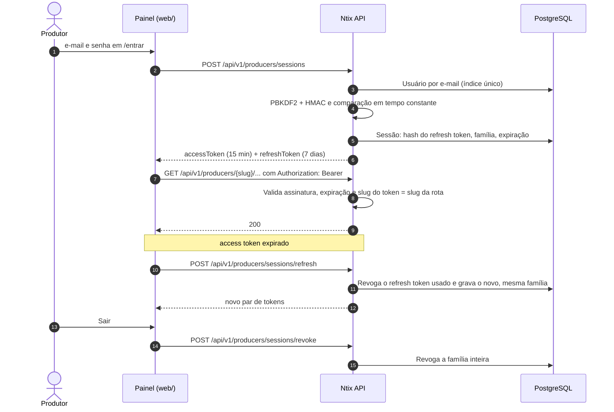
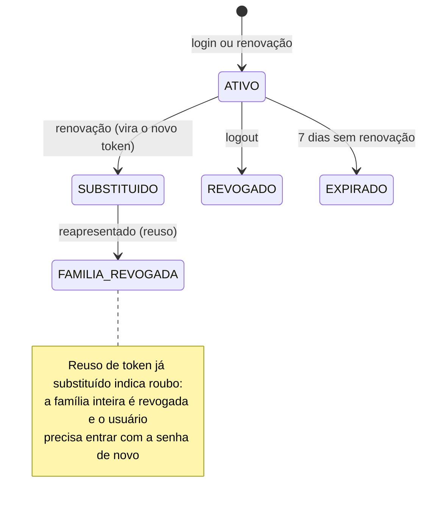
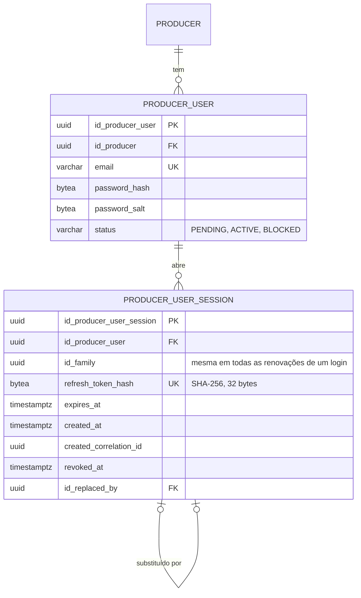

# REQ5 - Autenticação do Usuário do Produtor

- **Status**: Proposto
- **Área**: produtor / plataforma
- **Depende de**: REQ1 (cadastro do produtor, que cria o usuário administrador com senha)
- **Habilita**: REQ4 (integrações de pagamento) e todo endpoint do painel do produtor

## Objetivo de Negócio

**O que entrega**: o usuário do produtor entra na plataforma com e-mail e senha e recebe uma sessão. A API passa a saber quem é o usuário e de qual produtor ele é, e cada endpoint do painel passa a exigir isso.

- **Login**: e-mail e senha do usuário do produtor, cadastrados no REQ1.
- **Sessão**: access token JWT de 15 minutos e refresh token rotativo, que renova a sessão sem pedir a senha de novo.
- **Logout**: revoga a sessão no servidor.
- **Autorização por produtor**: um endpoint em `/api/v1/producers/{slug}/...` só atende o usuário daquele produtor.

**O que impacta**:
- **Receita**: o REQ4 grava a conta onde o produtor recebe o dinheiro dos ingressos. Sem autenticação, qualquer pessoa poderia trocá-la.
- **Produto**: o painel do produtor deixa de ser demonstração local (`web/src/producer/session.tsx` guarda a sessão no navegador) e passa a operar dados reais.
- **Operação**: cada alteração no painel fica atribuída a um usuário (`ExecutionUser`), o que dá trilha de auditoria.

**Por que é positivo**: é a porta de entrada de toda funcionalidade paga do painel, como eventos, vendas e pagamentos. Sem ela, nenhum dado do produtor pode ser exposto ou alterado pela API.

## Problema de Negócio

Hoje a API não tem autenticação. O cadastro (REQ1) grava o usuário administrador com senha, mas não há como usá-la:

- O front simula o login e guarda a sessão em `localStorage` (`ntix.demo.session.v1`).
- Todo endpoint é anônimo. O REQ4 não pode ir para produção, porque grava credenciais e a conta de recebimento.
- `X-Execution-User` é informado por quem chama, sem verificação, então a auditoria não é confiável.

## Fluxos







## Riscos

### Da ausência
| Risco | Impacto | Mitigação |
|---|---|---|
| Endpoints do painel anônimos | Qualquer pessoa altera dados de qualquer produtor, inclusive a conta de recebimento (REQ4) | Este requisito |
| Painel só em demonstração | Produtor não opera a plataforma de verdade; nenhuma receita | Este requisito |
| Auditoria por header livre | Alteração sem autor confiável | `ExecutionUser` passa a vir do token |

### De negócio no requisito
| Risco | Impacto | Mitigação |
|---|---|---|
| Descobrir quais e-mails têm conta pelo login | Lista de produtores para phishing ou concorrência | Mesma resposta e tempo parecido para e-mail inexistente e senha errada (RN3) |
| Usuário `PENDING` (e-mail não verificado) acessa o painel | Conta criada com e-mail de terceiro opera o painel | Aceito pelo usuário: `PENDING` entra até existir a verificação de e-mail (RN2); dado sensível só sai com produtor aprovado, em requisitos próprios |
| Usuário bloqueado continua com sessão aberta | Acesso por até 15 minutos depois do bloqueio | A renovação verifica o status (RN8); o access token curto limita a janela |

### De tecnologia no requisito
| Risco | Impacto | Mitigação |
|---|---|---|
| Força bruta de senha | Conta invadida | Hash lento (PBKDF2, 600 mil iterações). Limite de tentativas e rate limiting **não foram estipulados** (Decisões em aberto, item 1) |
| Roubo do refresh token (XSS) | Sessão sequestrada por até 7 dias | Rotação a cada uso e revogação da família no reuso (RN7); front sem `dangerouslySetInnerHTML` e com URLs filtradas (`safeAssetUrl`) |
| Vazamento do banco | Sessões reutilizadas | Só o hash SHA-256 do refresh token é gravado (RN6) |
| Vazamento da chave de assinatura | Tokens forjados para qualquer produtor | Chave só no secret da esteira e no `.env` do servidor; a API não sobe sem ela ou com menos de 32 bytes |
| Usuário de um produtor acessa outro | Vazamento e alteração de dados entre produtores | Autorização compara o slug do token com o da rota (RN9); teste funcional de isolamento |
| Hash lento no login sob carga | CPU saturada e latência | Hash fora da transação, como no REQ1; perfil de carga próprio (Decisões, item 4) |
| Dado pessoal no token | JWT é legível por quem o tem | Token sem e-mail nem nome, só identificadores (RN5) |

## Implementação de Tecnologia

### Contrato

Os três endpoints levam os headers auditáveis obrigatórios (`X-Correlation-Id`, `X-Origin-Service`, `X-Requested-At`).

#### `POST /api/v1/producers/sessions` (login, anônimo)
```json
{ "email": "ana@produtora.com.br", "password": "Senha@123" }
```

**200 OK**
```json
{
  "accessToken": "eyJhbGciOiJIUzI1NiIs...",
  "accessTokenExpiresIn": 900,
  "refreshToken": "mF3q...43 caracteres Base64Url",
  "refreshTokenExpiresIn": 604800,
  "user": { "id": "1d2c...", "name": "Ana Souza", "userType": "ADMINISTRATOR", "status": "PENDING" },
  "producer": { "id": "8e7f...", "slug": "produtora-x", "name": "Produtora X", "status": "PENDING" }
}
```

- **400**: `EMAIL_INVALID_NOTIFICATION_CODE`, `PASSWORD_REQUIRED_NOTIFICATION_CODE`. Só formato: a regra de força da senha não se aplica ao login.
- **401**: `INVALID_CREDENTIALS_NOTIFICATION_CODE`, para e-mail inexistente ou senha errada.
- **403**: `PRODUCER_USER_BLOCKED_NOTIFICATION_CODE`, só depois de a senha conferir.

#### `POST /api/v1/producers/sessions/refresh` (anônimo)
```json
{ "refreshToken": "mF3q..." }
```

- **200 OK**: mesmo corpo do login, com um novo par de tokens.
- **401**: `INVALID_REFRESH_TOKEN_NOTIFICATION_CODE`, para token inexistente, expirado, revogado ou reusado.
- **403**: `PRODUCER_USER_BLOCKED_NOTIFICATION_CODE`.

#### `POST /api/v1/producers/sessions/revoke` (logout)
```json
{ "refreshToken": "mF3q..." }
```

- **204 No Content**, também para token já revogado ou inexistente, para o logout ser idempotente.

#### Access token
JWT HS256, com:
- `iss`: `JwtConfiguration:Issuer`.
- `aud`: `JwtConfiguration:Audience`.
- `sub`: id do usuário do produtor.
- `producer_id` e `producer_slug`.
- `user_type`.
- `jti`: id da sessão.
- `iat` e `exp`: 15 minutos.

#### Endpoints protegidos
A partir deste requisito, todo endpoint do painel do produtor:
- Exige `Authorization: Bearer <accessToken>` e a política `ProducerUser`.
- Responde **401** sem token, ou com token inválido ou expirado. O front então chama o refresh.
- Responde **403** quando `{slug}` da rota não é o `producer_slug` do token.

Ficam anônimos: `POST /api/v1/producers` (cadastro), `GET /api/v1/producers/{slug}/whitelabel` (REQ3), `POST /api/v1/customers`, `GET /api/v1/payment-providers` (REQ4) e os três endpoints de sessão.

### Regras de negócio
- **RN1**: o login é por e-mail, único entre usuários de produtor (`ux_producer_user_email`), e senha. O e-mail é comparado normalizado, como no cadastro.
- **RN2**: usuários `PENDING` e `ACTIVE` entram; `BLOCKED` não. O status do produtor (`PENDING`, `PENDING_APPROVAL`, `ACTIVE`) não impede o login.
- **RN3**: e-mail inexistente e senha errada têm a mesma resposta. Para e-mail inexistente, a API calcula o hash com um salt fixo, para o tempo de resposta não revelar se a conta existe.
- **RN4**: a senha é conferida com `PasswordHashValueObject.Build(senha, salt, PrivateKey)`, comparada por `CryptographicOperations.FixedTimeEquals`.
- **RN5**: o access token dura 15 minutos e carrega só identificadores. Nunca carrega e-mail, nome ou documento.
- **RN6**: o refresh token tem 32 bytes aleatórios (`RandomNumberGenerator`), dura 7 dias e é gravado só como SHA-256.
- **RN7**: cada renovação revoga o refresh token usado e emite outro da mesma família. Se um token já substituído for reapresentado, toda a família é revogada.
- **RN8**: a renovação relê o usuário e recusa `BLOCKED`. O novo access token reflete o slug e o status atuais.
- **RN9**: em rotas com `{slug}`, a autorização exige `producer_slug` do token igual ao slug da rota.
- **RN10**: em endpoint autenticado, `ExecutionUser` do `AuditableInfoValueObject` é o `sub` do token, e não o header `X-Execution-User`.
- **RN11**: o logout revoga a família inteira do token informado.

### Camadas
- **Domain**:
  - `ProducerUserSession` (entidade).
  - `RefreshTokenValueObject` (geração e hash).
  - Validação do e-mail com o `EmailValueObject` existente.
  - Atualizar o comentário de `ProducerUserStatus.PENDING`: hoje diz "não acessa a plataforma", e passa a dizer "acessa até existir a verificação de e-mail".
- **Infra** (`PostgreSql/Repositories/Producers`):
  - `IProducerUserRepository.GetByEmailAsync`.
  - `IProducerUserSessionRepository`: criar, buscar por hash, revogar e substituir, e revogar família. SQL nativo e modelos primitivos.
- **Application**:
  - `CreateProducerSession`, `RefreshProducerSession` e `RevokeProducerSession`, com `ExecuteAsync(input, auditableInfo, cancellationToken)`.
  - Unit of Work na substituição do refresh token, `*Log` e `*Diagnostics`.
  - A emissão do JWT fica em um serviço de Application, configurado por `JwtConfiguration`.
- **Presentation** (`WebApi`):
  - `ProducerSessionsV1Controller`.
  - `AddAuthentication().AddJwtBearer(...)` com `ClockSkew` de 30 s, e política `ProducerUser`.
  - Requisito de autorização `ProducerSlugRequirement`, que compara o slug da rota com o do token (RN9).
  - `UseAuthentication()` e `UseAuthorization()` depois do CORS.

### Banco (`data/producers/`)
- `003-create-producer-user-session-table.sql`: tabela do diagrama, com `CHECK (octet_length(refresh_token_hash) = 32)`.
- `004-create-producer-user-session-indexes.sql`:
  - `ux_producer_user_session_refresh_token_hash`.
  - `ix_producer_user_session_id_family`.
  - `ix_producer_user_session_id_producer_user`.
- Sessões expiradas não são apagadas neste requisito (Decisões, item 5).

### Configuração e implantação
- `JwtConfiguration:SigningKey`: Base64 de 32 bytes ou mais, obrigatória.
- `JwtConfiguration:Issuer`, `JwtConfiguration:Audience`.
- `JwtConfiguration:AccessTokenMinutes` = 15 e `JwtConfiguration:RefreshTokenDays` = 7.
- Esteira: secret `JWT_SIGNING_KEY`, exportado no `.env` do servidor a cada deploy. Modelo em `devops/.env.example`.
- **Front (`web/`)**, pela skill `frontend-integration`, com `?api=real`:
  - `/entrar` chama o login.
  - `session.tsx` passa a guardar o access token em memória e o refresh token em `localStorage` (Decisões, item 2).
  - O cliente HTTP envia `Authorization`, renova uma vez no 401 e volta para `/entrar` se a renovação falhar.
  - "Sair" chama o revoke.
- CORS: o header `Authorization` passa a ser permitido. Sem credenciais de cookie.

### Observabilidade
- Logs semânticos:
  - Login aceito, com usuário e produtor (slug).
  - Login recusado, com motivo (`INVALID_CREDENTIALS`, `BLOCKED`) e e-mail ofuscado (`EmailValueObject.GetObfuscatedValue()`).
  - Renovação, logout, e reuso detectado em nível `Warning`.
  - Nunca senha nem token.
- Métricas:
  - Funil de cada caso de uso.
  - `producer_session_refresh_reuse_total`.
  - Tempo do hash no login, no mesmo histograma do cadastro.
- Dashboard: logins aceitos e recusados por motivo, renovações e reusos.

### Testes
- **Unitários**:
  - RN2, RN3 (salt fixo para e-mail inexistente), RN4, RN6, RN7 e RN8.
  - Claims do JWT sem dado pessoal (RN5).
  - `ProducerSlugRequirement` (RN9).
- **Integrados**: repositório de sessões contra PostgreSQL real:
  - Gravação só do hash.
  - Substituição atômica.
  - Revogação da família.
- **Funcionais**: os Critérios de Aceite abaixo, com a API real (`Mvc.Testing`).
- **Carga** (k6): perfil a confirmar (Decisões, item 4).

### Dependências
`Microsoft.AspNetCore.Authentication.JwtBearer`, pacote oficial da Microsoft, na versão 10.0.x alinhada ao SDK. A justificativa está na [RFC 0007](../docs/rfcs/0007-autenticacao-jwt-bearer.md). Hash, aleatoriedade e comparação usam só a biblioteca padrão.

### Fora do escopo
- Verificação de e-mail.
- Recuperação e troca de senha.
- Convite de outros usuários do produtor.
- Perfis além de `ADMINISTRATOR`.
- Login do cliente (comprador).
- Login social e MFA.
- Limite de tentativas e rate limiting (Decisões, item 1).
- Limpeza de sessões expiradas.
- Rotação da chave de assinatura.

## Critérios de Aceite

```gherkin
# language: pt
Funcionalidade: Autenticação do usuário do produtor

  Contexto:
    Dado a produtora "produtora-x" com o administrador "ana@produtora.com.br" e senha "Senha@123"

  Cenário: Login com usuário PENDING
    Dado o administrador com status PENDING
    Quando ele entra com e-mail e senha corretos
    Então recebe 200 com access token e refresh token
    E o access token não contém o e-mail

  Cenário: Senha errada e e-mail inexistente têm a mesma resposta
    Quando alguém entra com "ana@produtora.com.br" e senha "Errada@123"
    E alguém entra com "ninguem@produtora.com.br" e senha "Senha@123"
    Então as duas tentativas recebem 401 com INVALID_CREDENTIALS_NOTIFICATION_CODE

  Cenário: Usuário bloqueado
    Dado o administrador com status BLOCKED
    Quando ele entra com e-mail e senha corretos
    Então recebe 403 com PRODUCER_USER_BLOCKED_NOTIFICATION_CODE

  Cenário: Renovação da sessão
    Dado o administrador logado
    Quando ele renova a sessão com o refresh token
    Então recebe um novo par de tokens
    E o refresh token anterior deixa de funcionar

  Cenário: Reuso de refresh token
    Dado o administrador que já renovou a sessão uma vez
    Quando o refresh token anterior é reapresentado
    Então recebe 401 com INVALID_REFRESH_TOKEN_NOTIFICATION_CODE
    E o refresh token mais novo também deixa de funcionar

  Cenário: Logout
    Dado o administrador logado
    Quando ele sai
    Então recebe 204
    E o refresh token deixa de funcionar

  Cenário: Endpoint do painel sem token
    Quando alguém chama GET /api/v1/producers/produtora-x/payment-integrations sem token
    Então recebe 401

  Cenário: Isolamento entre produtores
    Dado o administrador da "produtora-y" logado
    Quando ele chama GET /api/v1/producers/produtora-x/payment-integrations
    Então recebe 403
```

## Decisões aprovadas pelo usuário

- Sessão com JWT curto e refresh token rotativo, revogável no banco.
- Usuário `PENDING` entra até existir a verificação de e-mail; `BLOCKED` não.

## Decisões em aberto

1. **Força bruta**: limite de tentativas e rate limiting não foram estipulados, e `standards.md` proíbe inventá-los.
   - Decisão provisória: nenhum, e a proteção fica no hash lento.
   - Recomendo definir um limite antes de abrir o login em produção. Exemplo: 10 tentativas por e-mail em 15 minutos, com o `Microsoft.AspNetCore.RateLimiting` nativo.
2. **Onde o front guarda o refresh token**.
   - Decisão provisória: `localStorage`, com rotação e revogação por reuso.
   - Alternativa mais resistente a XSS: cookie `HttpOnly; Secure; SameSite=Strict` no domínio da API, que exige CORS com credenciais e muda o contrato do refresh e do revoke.
3. **Durações**: access token de 15 minutos e refresh token de 7 dias. Confirma?
4. **Carga do login**: o hash leva centenas de milissegundos de propósito, então o perfil moderado (p95 < 500 ms) pode não caber.
   - Proposta: 50 VUs, p95 < 1 s e < 1% de erros no login.
   - Perfil moderado para o refresh.
5. **Limpeza de sessões expiradas**: ficam no banco. Uma rotina de limpeza entra em requisito próprio, quando houver `Workers`?
