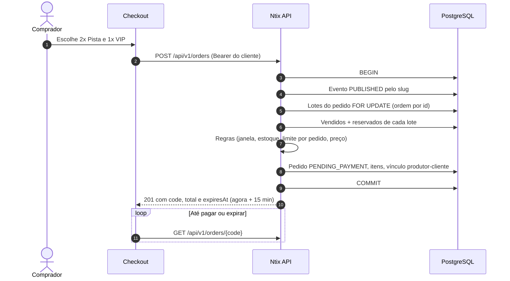
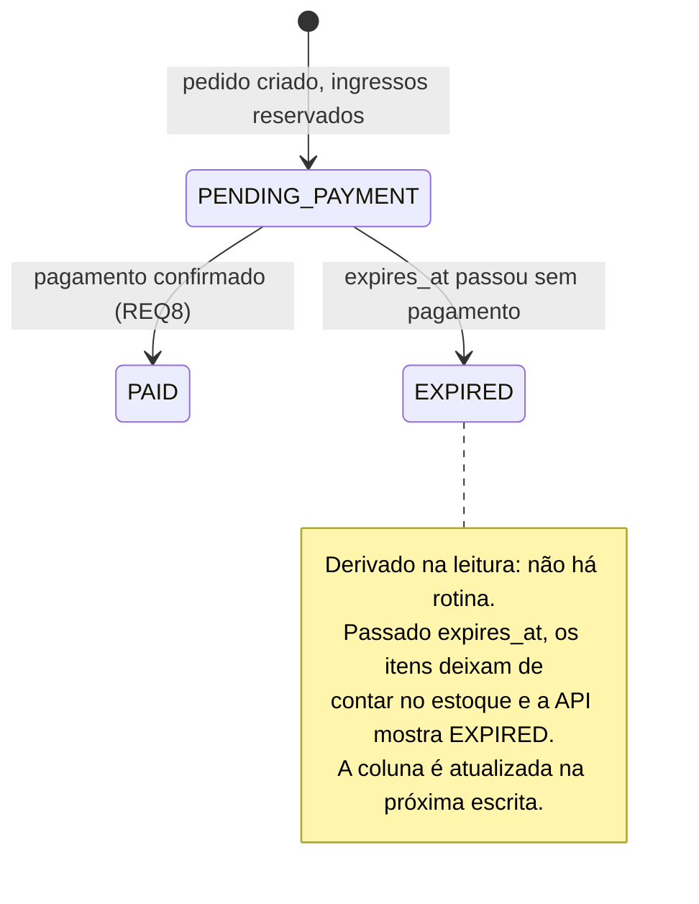
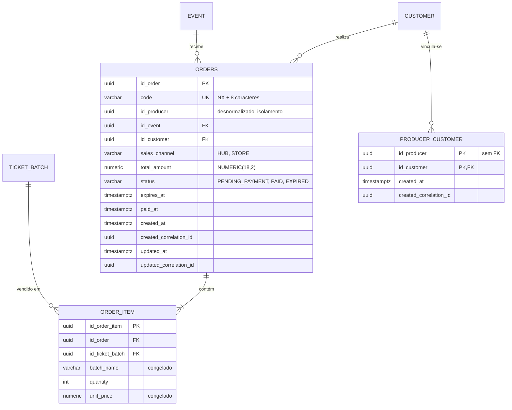

# REQ6 - Criação de Pedidos

- **Status**: Implementado (aguardando validação)
- **Área**: comprador / vendas
- **Depende de**: REQ11 (vitrine e lotes publicados); REQ12 (autenticação do cliente)
- **Habilita**: REQ7 (pagamento), REQ8 (efetivação), REQ13 (pedidos do cliente)
- **Jornada**: passo 4 de 7 da [jornada de compra](../docs/jornada-de-compra.md)

## Objetivo de Negócio

**O que entrega**: o comprador escolhe os lotes e as quantidades de um evento e recebe um pedido que **reserva** os ingressos enquanto ele paga.

- **Pedido** do comprador autenticado, de um evento, com um ou mais itens (lote e quantidade), preço congelado e total.
- **Reserva**: os ingressos do pedido saem do estoque por 15 minutos. Se o pagamento não vier, voltam sozinhos.
- **Consulta do pedido** pelo código, usada pelo checkout para acompanhar o status.
- **Vínculo comprador-produtor** (`PRODUCER_CUSTOMER`), criado no primeiro pedido com o produtor.

**O que impacta**:
- **Receita**: sem reserva, dois compradores pagariam pelo último ingresso, e um teria de ser reembolsado.
- **Experiência**: o comprador paga com a certeza de que o ingresso está guardado, com um prazo visível.
- **Produtor**: passa a ter a base dos seus compradores (`PRODUCER_CUSTOMER`), o ativo de relacionamento do whitelabel.

**Por que é positivo**: é o centro da venda. Todo o resto da jornada (pagamento, efetivação, ingresso) parte de um pedido válido, com preço e estoque garantidos.

## Problema de Negócio

O checkout cria o pedido só no navegador (`web/src/customer/orders.ts`, `createOrder`). O estoque não é controlado e o preço pode ser alterado no cliente. Sem este requisito:

- Não há o que cobrar no REQ7.
- O estoque do lote não diminui; o evento vende mais do que tem.
- O produtor não sabe quem são os compradores.

## Fluxo





## Modelo de dados



## Riscos

### Da ausência
| Risco | Impacto | Mitigação |
|---|---|---|
| Sem pedido no servidor | Nada para cobrar | Este requisito |
| Sem reserva | Venda acima do estoque e reembolso | Reserva com trava do lote |

### De negócio no requisito
| Risco | Impacto | Mitigação |
|---|---|---|
| Uma pessoa reserva todo o estoque sem pagar | Evento parece esgotado; venda perdida | Limite de 6 ingressos por pedido (RN6) e reserva de 15 minutos (RN9); limite de pedidos abertos por comprador fica em aberto (Decisões, item 2) |
| Preço manipulado no navegador | Venda abaixo do preço | O preço vem sempre do lote no servidor e é congelado no item (RN7); o corpo não tem preço |
| Produtor altera o preço com o comprador no checkout | Comprador paga o preço que viu | Preço congelado na criação do pedido |
| Reserva vence enquanto o comprador paga | Pagou e o ingresso foi para outro | O Pix expira antes da reserva, com folga para a confirmação (REQ7, RN5) |

### De tecnologia no requisito
| Risco | Impacto | Mitigação |
|---|---|---|
| Dois pedidos simultâneos pelo último ingresso | Venda acima do estoque | `SELECT ... FOR UPDATE` nos lotes do pedido, em ordem de id (sem deadlock), antes de somar o estoque (RN8) |
| Fila na trava em lançamento de evento grande | Latência no checkout | Transação curta, sem chamada externa; o pagamento (REQ7) fica fora desta transação; carga em `orders-create-tests.js` |
| Soma de vendidos cresce com o volume | Consulta lenta | Índice `ix_order_item_id_ticket_batch` com `INCLUDE (id_order, quantity)` e `ix_orders_status_expires_at`; contador por lote fica como evolução se a carga mostrar necessidade |
| Comprador lê pedido de outro pelo código | Vazamento | Consulta por `(code, id_customer)`; pedido de outro responde 404 (RN11) |
| Colisão de código | Erro 500 | Índice único e nova tentativa com savepoint, como o slug |

## Implementação de Tecnologia

### Contrato

Headers auditáveis e access token do cliente (política `Customer`, REQ12). `ExecutionUser` é o id do cliente.

#### `POST /api/v1/orders`

```json
{
  "eventSlug": "festival-horizonte",
  "salesChannel": "HUB",
  "items": [
    { "batchId": "7c1d...", "quantity": 2 },
    { "batchId": "9f0a...", "quantity": 1 }
  ]
}
```

**201 Created**, `Location: /api/v1/orders/NX7K2QH9MP`
```json
{
  "code": "NX7K2QH9MP",
  "status": "PENDING_PAYMENT",
  "salesChannel": "HUB",
  "createdAt": "2027-01-10T15:00:00.000Z",
  "expiresAt": "2027-01-10T15:15:00.000Z",
  "totalCents": 39000,
  "event": {
    "slug": "festival-horizonte",
    "title": "Festival Horizonte",
    "startsAt": "2027-03-20T18:00:00.000Z",
    "venueName": "Parque das Dunas",
    "city": "Recife",
    "state": "PE",
    "imageUrl": "https://cdn.exemplo.com/horizonte.jpg"
  },
  "items": [
    { "batchId": "7c1d...", "batchName": "1º lote - Pista", "quantity": 2, "unitPriceCents": 12000, "totalCents": 24000 },
    { "batchId": "9f0a...", "batchName": "VIP", "quantity": 1, "unitPriceCents": 15000, "totalCents": 15000 }
  ],
  "tickets": []
}
```

- **400**: `ORDER_EVENT_REQUIRED_NOTIFICATION_CODE`, `ORDER_SALES_CHANNEL_INVALID_NOTIFICATION_CODE`, `ORDER_ITEMS_REQUIRED_NOTIFICATION_CODE`, `ORDER_ITEM_QUANTITY_INVALID_NOTIFICATION_CODE`, `ORDER_ITEM_DUPLICATED_NOTIFICATION_CODE`, `ORDER_TICKET_LIMIT_EXCEEDED_NOTIFICATION_CODE`, `BATCH_NOT_FOUND_NOTIFICATION_CODE`, `BATCH_NOT_ON_SALE_NOTIFICATION_CODE`.
- **404**: `EVENT_NOT_FOUND_NOTIFICATION_CODE`.
- **409**: `BATCH_INSUFFICIENT_AVAILABILITY_NOTIFICATION_CODE`, com a mensagem indicando o lote (nome) e quantos ainda dá para escolher.

#### `GET /api/v1/orders/{code}`

**200 OK**: o corpo do `POST`. A partir do REQ7, com o bloco `payment`; a partir do REQ8, com `paidAt` e `tickets`. Pedido `PENDING_PAYMENT` com `expiresAt` vencido aparece como `EXPIRED`.
**404**: `ORDER_NOT_FOUND_NOTIFICATION_CODE`.

Comuns: **401** sem token; **403** token que não é de cliente; **499**; **500** sem corpo.

### Regras de negócio
- **RN1**: o pedido é de um cliente autenticado, para um evento `PUBLISHED`, encontrado pelo slug.
- **RN2**: `salesChannel` é `HUB` (hub da Ntix) ou `STORE` (loja do produtor). Afiliado fica fora do escopo.
- **RN3**: o pedido tem de 1 item em diante; cada lote aparece uma vez; `quantity` inteira de 1 em diante.
- **RN4**: todo lote do pedido pertence ao evento do pedido; senão, `BATCH_NOT_FOUND`.
- **RN5**: todo lote está `ON_SALE` (`TicketBatchAvailability`, REQ10): `ACTIVE` e dentro da janela de venda.
- **RN6**: a soma das quantidades do pedido é no máximo `OrderConfiguration:MaxTicketsPerOrder` (6).
- **RN7**: o preço unitário e o nome do lote vêm do lote no momento da criação e ficam congelados no item. O total é a soma de `quantity × unit_price`. O corpo da requisição não tem preço.
- **RN8**: a disponibilidade de cada lote é `quantity` menos os itens de pedidos `PAID` e de pedidos `PENDING_PAYMENT` com `expires_at` no futuro, calculada com os lotes travados (`FOR UPDATE`, em ordem de id). Se algum lote não tiver o suficiente, nenhum item é reservado (`BATCH_INSUFFICIENT_AVAILABILITY`).
- **RN9**: o pedido nasce `PENDING_PAYMENT`, com `expires_at` = agora + `OrderConfiguration:ReservationMinutes` (15).
- **RN10**: o código do pedido é `NX` + 8 caracteres de `23456789ABCDEFGHJKMNPQRSTUVWXYZ`, gerado com `RandomNumberGenerator` e único (`ux_orders_code`).
- **RN11**: o cliente só consulta os próprios pedidos; o de outro responde 404.
- **RN12**: o status `EXPIRED` é derivado na leitura e gravado na próxima escrita do pedido (REQ7/REQ8). Nenhuma rotina em segundo plano.
- **RN13**: o primeiro pedido do cliente com um produtor cria o vínculo `PRODUCER_CUSTOMER` (`INSERT ... ON CONFLICT DO NOTHING`), na mesma transação.
- **RN14**: o pedido grava o `id_producer` do evento, para isolamento por produtor (MER, decisão 4).

### Camadas
- **Domain** (`BoundedContexts/OrderContext`):
  - Entidades `Order` e `OrderItem`; enums `OrderStatus`, `SalesChannel`.
  - `OrderCodeValueObject` (geração e formato, RN10), `OrderItemQuantityValueObject`.
  - `Order.Create(evento, lotes com disponibilidade, itens pedidos, configuração, agora)` aplica RN3 a RN9 e devolve `MethodResult<Order>`.
  - `Order.GetEffectiveStatus(agora)` (RN12), usado por REQ7, REQ8 e REQ13.
- **Infra** (`PostgreSql/Repositories/Orders`):
  - `IOrderRepository`: `CreateAsync` (pedido e itens; traduz `23505` de `ux_orders_code`), `GetByCodeAsync(code, idCustomer)`, `GetByCodeForUpdateAsync`.
  - `ITicketBatchRepository.GetForUpdateAsync(ids)` (REQ10) e `GetBatchSalesAsync(ids, agora)`, que passa a somar os pedidos (completa REQ10 e REQ11).
  - `IProducerCustomerRepository.LinkAsync(idProducer, idCustomer)`.
- **Application**: `CreateOrder` (escrita que devolve o recurso, `IUseCase<TInput, TOutput>`) e `GetCustomerOrder` (consulta). Saída comum `Base/Orders/Outputs/OrderOutput`, reaproveitada por REQ7, REQ8 e REQ13. `OrderConfiguration` ganha `ReservationMinutes`.
- **Presentation**: `OrdersV1Controller` (`api/v1/orders`), payload `CreateOrderV1Request`. `BATCH_INSUFFICIENT_AVAILABILITY` vira 409 e `EVENT_NOT_FOUND`/`ORDER_NOT_FOUND`, 404.

### Banco
- `data/customers/005-create-producer-customer-table.sql`: `customers.producer_customer`, PK `(id_producer, id_customer)`, FK para `customers.customer`, sem FK para `producers`.
- `data/orders/001-create-order-tables.sql`: schema `orders`, `orders.orders` (FK para `customers.customer` e `events.event`, `CHECK` de `status` e `sales_channel`, `total_amount > 0`) e `orders.order_item` (FK para `orders.orders` e `events.ticket_batch`, `quantity > 0`, `ux_order_item_order_batch (id_order, id_ticket_batch)`).
- `data/orders/002-create-order-indexes.sql`: `ux_orders_code`, `ix_orders_id_customer_created_at`, `ix_orders_status_expires_at`, `ix_order_item_id_ticket_batch INCLUDE (id_order, quantity)`.

### Configuração e implantação
- `OrderConfiguration:ReservationMinutes` = 15 (além de `MaxTicketsPerOrder` = 6, do REQ11).
- **Front (`web/`)**: `EventPage` chama `POST /orders` ao avançar para o checkout (exige login); `CheckoutPage` usa `expiresAt` da API no contador (no lugar de `CART_MINUTES`), mostra o total do servidor e trata 409 voltando ao evento com a quantidade possível.

### Observabilidade
- Logs: pedido criado (código, evento, produtor, quantidade de ingressos, total), recusado (motivo, lote), vínculo produtor-cliente criado.
- Métricas: funil `ntix.orders.create` (desfechos: `created`, `validation_failed`, `not_on_sale`, `insufficient_availability`, `event_not_found`), `ntix.orders.get`; histograma `ntix.orders.batch_lock.duration` (tempo esperando a trava).
- Dashboard "Pedidos".

### Testes
- **Unitários**: `Order.Create` com cada regra (RN3 a RN9), `OrderCodeValueObject`, `GetEffectiveStatus`, casos de uso.
- **Integrados**: criação com itens; disponibilidade descontando `PAID` e `PENDING_PAYMENT` válidos e ignorando os vencidos; **concorrência**: N transações pelo último ingresso, só uma reserva; vínculo produtor-cliente idempotente; isolamento por cliente.
- **Funcionais**: os Critérios de Aceite.
- **Carga** (k6): `tsts/LoadTests/orders-create-tests.js`. Proposta: 100 VUs disputando um mesmo lote de 1.000 ingressos, p95 < 800 ms, nenhum ingresso acima do estoque (verificado ao fim), a confirmar.

### Dependências
Nenhuma nova.

### Fora do escopo
- Pagamento (REQ7) e confirmação (REQ8).
- Cancelamento do pedido pelo comprador (a reserva vence sozinha).
- Afiliado, cupom, taxa de serviço, meia-entrada.
- Nome do titular por ingresso (todos saem no nome do comprador, REQ8).
- Pedidos do produtor no painel.

## Critérios de Aceite

```gherkin
# language: pt
Funcionalidade: Criação de pedidos

  Contexto:
    Dado o evento "Festival Horizonte" PUBLISHED
    E o lote "Pista" de R$ 120,00 com 10 ingressos em venda
    E a cliente "Marina" autenticada

  Cenário: Criar um pedido
    Quando Marina pede 2 ingressos "Pista"
    Então recebe 201 com o pedido PENDING_PAYMENT de R$ 240,00
    E o pedido expira em 15 minutos
    E restam 8 ingressos "Pista"

  Cenário: Preço congelado
    Dado o pedido de Marina com 2 ingressos "Pista"
    Quando o produtor muda o preço do lote "Pista" para R$ 150,00
    Então o pedido de Marina continua com R$ 240,00

  Cenário: Limite por pedido
    Quando Marina pede 7 ingressos "Pista"
    Então recebe 400 com ORDER_TICKET_LIMIT_EXCEEDED_NOTIFICATION_CODE

  Cenário: Estoque insuficiente
    Dado que restam 1 ingresso "Pista"
    Quando Marina pede 2 ingressos "Pista"
    Então recebe 409 com BATCH_INSUFFICIENT_AVAILABILITY_NOTIFICATION_CODE

  Cenário: Último ingresso disputado
    Dado que resta 1 ingresso "Pista"
    Quando Marina e João pedem 1 ingresso "Pista" ao mesmo tempo
    Então só um dos dois recebe 201
    E o outro recebe 409 com BATCH_INSUFFICIENT_AVAILABILITY_NOTIFICATION_CODE

  Cenário: Reserva vencida volta ao estoque
    Dado o pedido de Marina com 2 ingressos "Pista" criado há 16 minutos
    Quando Marina consulta o pedido
    Então o pedido está EXPIRED
    E restam 10 ingressos "Pista"

  Cenário: Lote fora da janela
    Dado o lote "2º lote" com venda a partir de amanhã
    Quando Marina pede 1 ingresso "2º lote"
    Então recebe 400 com BATCH_NOT_ON_SALE_NOTIFICATION_CODE

  Cenário: Lote de outro evento
    Quando Marina pede um lote do evento "Show Y" no pedido de "Festival Horizonte"
    Então recebe 400 com BATCH_NOT_FOUND_NOTIFICATION_CODE

  Cenário: Pedido de outra cliente
    Dado o pedido de João
    Quando Marina consulta o código do pedido de João
    Então recebe 404 com ORDER_NOT_FOUND_NOTIFICATION_CODE

  Cenário: Primeiro pedido cria o vínculo com o produtor
    Quando Marina faz o primeiro pedido com o produtor "mare-cultural"
    Então Marina passa a ser cliente de "mare-cultural"
```

## Decisões tomadas na implementação

Implementado na ordem da jornada, depois do REQ12. O que o requisito não definia foi decidido assim, seguindo as decisões provisórias dele:

- **Reserva de 15 minutos** (`OrderConfiguration:ReservationMinutes`) e **limite de 6 ingressos por pedido** (`MaxTicketsPerOrder`), sem limite de pedidos abertos por comprador (Decisões em aberto, itens 1 a 3).
- **Rotas**: `POST /api/v1/orders` (201 com `Location`) e `GET /api/v1/orders/{code}`, num controller próprio (`OrdersV1Controller`), com a política `Customer`. O `ExecutionUser` é o id do cliente do token.
- **Lotes do pedido lidos pelo evento**: `ITicketBatchRepository.ListByIdsForUpdateAsync(eventId, ids)` traz só os lotes daquele evento, em ordem de id e com `FOR UPDATE`. O lote de outro evento simplesmente não volta, e o domínio responde `BATCH_NOT_FOUND` (RN4). O `GetByIdForUpdateAsync` do REQ10 continua sendo o do produtor.
- **Controle de concorrência em duas camadas**: (1) a trava pessimista `FOR UPDATE` dos lotes do pedido, em ordem de id, antes de somar e gravar; (2) a barreira do banco, uma constraint trigger adiada que confere o estoque no COMMIT mesmo para quem não travou. Testes: simulação concorrente em memória (com controle negativo) e, contra o PostgreSQL, 30 compradores por 5 ingressos, pedidos de vários ingressos, reservas vencidas e transações brutas que ignoram a trava.
- **Estoque somado depois da trava**: `GetSalesAsync` soma itens de pedidos `PAID` (vendidos) e `PENDING_PAYMENT` com `expires_at` no futuro (reservados), na mesma transação. É a mesma consulta da vitrine (REQ11) e do painel do produtor (REQ10), que deixaram de mostrar zero.
- **Código do pedido**: sorteado uma vez e, se `ux_orders_code` colidir, sorteado de novo até 5 vezes com savepoint, mantendo a reserva. Esgotar as tentativas é falha inesperada (500).
- **Recusa devolve todos os lotes com problema**: a falta de estoque de dois lotes vira duas notificações, uma por lote, com o nome e quantos ainda dá para escolher.
- **`GetByCodeForUpdateAsync` e `GetByCode` sem cliente não foram criados**: o REQ7 e o REQ8 criam o que precisarem. Hoje só existe `GetByCodeAsync(code, customerId)`.
- **Pedido sem evento**: a FK composta `(id_event, id_producer)` garante o evento do pedido; a consulta ainda responde 404 se ele sumir, em vez de falhar.
- **Front (`?api=real`)**: o pedido é criado quando a pessoa chega ao checkout conectada (depois do login, se ela ainda não estava). O pedido fica no carrinho (`cart.order`), então recarregar o checkout reaproveita a reserva enquanto ela vale, em vez de criar outra. O prazo do contador e o total vêm do servidor. 409, lote fora de venda e limite voltam ao evento com a mensagem da API; sessão expirada e falha de rede ficam no checkout com o aviso. Também foi corrigido o checkout, que mandava para a home enquanto a vitrine real ainda carregava.
- **Carga**: `tsts/LoadTests/orders-create-tests.js`, com o perfil de disputa proposto (100 VUs, lote de 1.000, p95 < 800 ms). Escrito, não executado; o teardown confere vendidos + reservados do lote.
- **Dashboard** `ntix-orders.json` e seção "Pedidos (REQ6)" de `docs/observabilidade.md`.

## Decisões em aberto

1. **Reserva de 15 minutos** (o front de demonstração usa 10): o Pix do AbacatePay vale no mínimo 5 minutos e precisa de folga para a confirmação (REQ7). Confirmar.
2. **Pedidos abertos por comprador**: sem limite. Limitar a um pedido `PENDING_PAYMENT` por evento por comprador, para reduzir a retenção de estoque?
3. **Limite de 6 ingressos por pedido**, vindo do front de demonstração (`MAX_TICKETS_PER_ORDER`). Deve ser configurável por evento?
4. **Pedido de vários lotes do mesmo evento** num só pedido: adotado, como o checkout atual. Pedido com eventos diferentes, não.
5. **Expiração derivada na leitura**, sem worker: adotada para não criar uma aplicação nova. Um worker só seria necessário para avisos (ex.: e-mail de pedido expirado).
6. **Carga**: perfil de disputa proposto acima.
