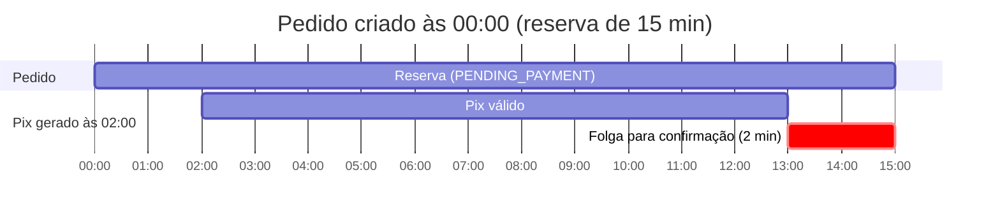
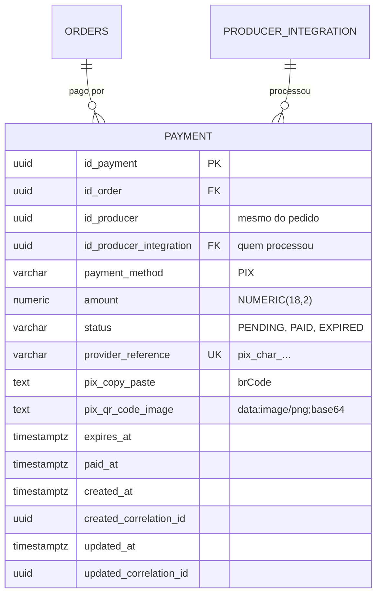

# REQ7 - Pagamento de Pedidos com Pix

- **Status**: Implementado (aguardando validação)
- **Área**: comprador / pagamentos
- **Depende de**: REQ6 (criação de pedidos); REQ4 (integrações e ranqueamento); REQ12 (autenticação do cliente)
- **Habilita**: REQ8 (efetivação)
- **Jornada**: passo 5 de 7 da [jornada de compra](../docs/jornada-de-compra.md)

## Objetivo de Negócio

**O que entrega**: o comprador paga o pedido com Pix. A Ntix gera a cobrança na conta AbacatePay **do produtor**, escolhida pelo ranqueamento do REQ4, e devolve o QR Code e o Pix copia e cola.

- **Métodos disponíveis** para o pedido, para o checkout mostrar só o que funciona.
- **Cobrança Pix** no AbacatePay, com a `API_KEY` da integração do produtor, valor do pedido e validade dentro da reserva.
- **Fallback**: se a integração de prioridade 1 falhar, a Ntix tenta a próxima da rota, sem o comprador perceber.
- **Pagamento gravado** com a integração que o processou, para a confirmação (REQ8) voltar a ela.

**O que impacta**:
- **Receita**: é o primeiro dinheiro real na plataforma, direto na conta do produtor, sem custódia da Ntix.
- **Disponibilidade da venda**: a queda de uma conta AbacatePay não para a venda se o produtor tiver outra na rota.
- **Parceiro**: estreia o adaptador AbacatePay; o próximo fornecedor entra com outro adaptador, sem mudar o fluxo.

**Por que é positivo**: Pix é o método dominante na venda de ingressos no Brasil, liquida na hora e tem a menor taxa. Entregar só Pix primeiro põe a jornada no ar com o menor esforço.

## Problema de Negócio

O checkout simula o Pix (`CheckoutPage.tsx`, `payWithPix`) e nunca cobra. O REQ4 sabe por qual integração cobrar, mas ninguém chama o fornecedor. Sem este requisito, o pedido do REQ6 nunca é pago e o produtor não recebe.

## Fluxo

```mermaid
sequenceDiagram
    autonumber
    actor Comprador
    participant Web as Checkout
    participant API as Ntix API
    participant DB as PostgreSQL
    participant AP1 as AbacatePay (prioridade 1)
    participant AP2 as AbacatePay (prioridade 2)

    Web->>API: GET /api/v1/orders/{code}/payment-methods
    API->>DB: Ranqueamento do REQ4 por método com adaptador
    API-->>Web: [PIX]
    Comprador->>Web: Pagar com Pix
    Web->>API: POST /api/v1/orders/{code}/payments {PIX}
    API->>DB: BEGIN; pedido FOR UPDATE
    API->>API: Pedido PENDING_PAYMENT, sem Pix pendente válido, janela suficiente
    API->>DB: Integrações ranqueadas + credenciais cifradas
    API->>AP1: POST /v2/transparents/create (Bearer API_KEY do produtor)
    alt Falha (timeout, 5XX, 429, 401, 4XX)
        AP1-->>API: erro
        API->>AP2: POST /v2/transparents/create
        AP2-->>API: pix_char_..., brCode, brCodeBase64
    else Sucesso
        AP1-->>API: pix_char_..., brCode, brCodeBase64
    end
    API->>DB: payment PENDING com a integração que processou; COMMIT
    API-->>Web: 201 QR Code, copia e cola, expiresAt
```

### Janela do Pix



O Pix expira `ConfirmationGraceSeconds` (2 min) antes da reserva. Assim, um pagamento feito no último segundo do Pix ainda encontra os ingressos reservados quando o webhook chega (REQ8). Como o AbacatePay exige no mínimo 300 s de validade, o Pix só é gerado se faltarem ao menos 7 minutos de reserva (RN5).

## Modelo de dados



## Riscos

### Da ausência
| Risco | Impacto | Mitigação |
|---|---|---|
| Pedido sem cobrança | Nenhuma venda paga | Este requisito |
| Sem fallback | Queda de uma conta para a venda do evento | Tentativa na próxima integração ranqueada (RN7) |

### De negócio no requisito
| Risco | Impacto | Mitigação |
|---|---|---|
| Dois Pix para o mesmo pedido, pagos os dois | Cobrança em dobro e estorno manual | Um Pix pendente válido por pedido: a segunda chamada devolve o mesmo (RN4), com o pedido travado; `externalId` = id do pagamento |
| Pix pago depois da reserva | Ingresso vendido a dois | Pix expira 2 min antes da reserva (RN5) |
| Produtor sem integração Pix válida | Pedido sem como pagar | Publicação exige método disponível (REQ10, RN10); aqui, `PAYMENT_METHOD_UNAVAILABLE` |
| Credencial errada do produtor (401 no AbacatePay) | Venda perdida silenciosamente | Fallback para a próxima; log e métrica por integração com o motivo, para o produtor corrigir |

### De tecnologia no requisito
| Risco | Impacto | Mitigação |
|---|---|---|
| `API_KEY` do produtor vazada em log, trace ou exceção | Acesso à conta do produtor | Decifrada só em memória no momento da chamada; header `Authorization` nunca logado; span com o código do fornecedor e o status HTTP, nunca corpo nem headers |
| Chamada externa dentro da transação segura a trava do pedido | Conexões presas se o AbacatePay ficar lento | Timeout por tentativa de 5 s e no máximo 3 integrações tentadas (RN7); só o pedido é travado, não os lotes |
| Timeout depois de o AbacatePay criar a cobrança | Pix órfão na conta do produtor | `externalId` = id do pagamento: a nova tentativa na **mesma** integração devolve o mesmo Pix; na próxima integração o Pix órfão expira sozinho sem ser exibido |
| Limite de 100 req/s por loja no AbacatePay | 429 em pico | 429 trata como falha e passa para a próxima integração; métrica por motivo |
| Imagem do QR grande no banco | Crescimento da tabela | Só o `brCodeBase64` do Pix vigente, alguns KB por pagamento; sem dependência para gerar QR |

## Implementação de Tecnologia

### Contrato

Headers auditáveis e access token do cliente (política `Customer`). Só o dono do pedido opera.

#### `GET /api/v1/orders/{code}/payment-methods`

**200 OK**
```json
{ "methods": [ { "method": "PIX" } ] }
```

Lista vazia quando nenhum método tem integração disponível. **404**: `ORDER_NOT_FOUND_NOTIFICATION_CODE`.

#### `POST /api/v1/orders/{code}/payments`

```json
{ "method": "PIX" }
```

**201 Created** (Pix novo) ou **200 OK** (Pix pendente já existente, RN4)
```json
{
  "id": "5e9b...",
  "method": "PIX",
  "status": "PENDING",
  "amountCents": 39000,
  "expiresAt": "2027-01-10T15:13:00.000Z",
  "pix": {
    "copyPasteCode": "00020101021226950014br.gov.bcb.pix...",
    "qrCodeImage": "data:image/png;base64,iVBORw0KGgo..."
  }
}
```

- **400**: `PAYMENT_METHOD_INVALID_NOTIFICATION_CODE`, `PAYMENT_METHOD_UNAVAILABLE_NOTIFICATION_CODE`.
- **404**: `ORDER_NOT_FOUND_NOTIFICATION_CODE`.
- **409**: `ORDER_ALREADY_PAID_NOTIFICATION_CODE`, `ORDER_EXPIRED_NOTIFICATION_CODE`, `ORDER_PAYMENT_WINDOW_TOO_SHORT_NOTIFICATION_CODE`.
- **503**: `PAYMENT_PROVIDERS_UNAVAILABLE_NOTIFICATION_CODE`, quando todas as integrações falharam. Sem detalhe do fornecedor no corpo.

#### `GET /api/v1/orders/{code}` (REQ6)

Passa a trazer o pagamento mais recente:

```json
"payment": { "id": "5e9b...", "method": "PIX", "status": "PENDING", "amountCents": 39000, "expiresAt": "...", "pix": { "copyPasteCode": "...", "qrCodeImage": "..." } }
```

O bloco `pix` só aparece com o pagamento `PENDING` e dentro da validade. Pagamento `PENDING` vencido aparece `EXPIRED`.

Comuns: **401**, **403**, **499**, **500** sem corpo.

### Regras de negócio
- **RN1**: métodos disponíveis = métodos com adaptador na Ntix (`PaymentMethodsWithAdapter`: hoje só `PIX`, pelo fornecedor `ABACATEPAY`) cujo ranqueamento do REQ4 para o produtor do pedido não é vazio.
- **RN2**: o pagamento exige pedido do cliente, em `PENDING_PAYMENT` efetivo (`Order.GetEffectiveStatus`). Pago: `ORDER_ALREADY_PAID`. Vencido: `ORDER_EXPIRED` (e o pedido é gravado `EXPIRED`).
- **RN3**: o valor cobrado é o `total_amount` do pedido, em centavos. O comprador não informa valor.
- **RN4**: um pedido tem no máximo um Pix `PENDING` válido. Se existir, a chamada devolve o mesmo (200), sem nova cobrança. O pedido é travado (`FOR UPDATE`) durante a operação.
- **RN5**: a validade do Pix termina `PaymentConfiguration:ConfirmationGraceSeconds` (120) antes do `expires_at` do pedido, e precisa ser de no mínimo 300 s (mínimo do AbacatePay). Se não couber, `ORDER_PAYMENT_WINDOW_TOO_SHORT`, e o comprador faz um novo pedido.
- **RN6**: a cobrança vai para as integrações devolvidas pelo ranqueamento do REQ4 para `PIX`, na ordem de prioridade.
- **RN7**: qualquer falha numa integração (timeout de `AbacatePayConfiguration:TimeoutSeconds` = 5, erro de rede, resposta não 2XX ou corpo sem `brCode`) passa para a próxima, até `PaymentConfiguration:MaxProviderAttempts` (3). Todas falharam: `PAYMENT_PROVIDERS_UNAVAILABLE` (503), sem gravar pagamento.
- **RN8**: a requisição ao AbacatePay é `POST /v2/transparents/create` com `method: "PIX"` e, em `data`: `amount` (centavos), `expiresIn` (segundos, RN5), `externalId` (id do pagamento), `description` ("Pedido {código} - {título do evento}", até 140 caracteres, só caracteres imprimíveis sem emoji), `customer` (`name`, `email`, `taxId` = CPF, e `cellphone` quando o cliente tiver) e `metadata` (`orderCode`, `paymentId`). Nunca outro dado pessoal em `metadata`.
- **RN9**: o pagamento é gravado `PENDING` com a integração que gerou o Pix (`id_producer_integration`), o `id` do AbacatePay (`provider_reference`), o `brCode`, o `brCodeBase64` e o `expiresAt` devolvidos. A confirmação (REQ8) usa sempre essa integração, mesmo que a rota mude depois (REQ4).
- **RN10**: a `API_KEY` é decifrada (`ICredentialCipher`) só no momento da chamada e nunca sai do processo.

### Camadas
- **Domain** (`PaymentContext`):
  - Entidade `Payment`; enum `PaymentStatus` (`PENDING`, `PAID`, `EXPIRED`).
  - `PixWindow.Calculate(orderExpiresAt, grace, providerMinimum, now)` (RN5).
  - `PaymentMethodsWithAdapter` (REQ10) e `Payment.GetEffectiveStatus(now)`.
- **Infra**:
  - `Http/AbacatePay/`: `AbacatePayClient` implementando `IPixChargeClient` (`ProviderCode = "ABACATEPAY"`, `CreatePixChargeAsync(apiKey, PixChargeRequestModel)`, `GetPixChargeStatusAsync(apiKey, reference)` para o REQ8), com `HttpClient` tipado por `IHttpClientFactory`, `AbacatePayConfiguration` (`BaseUrl` = `https://api.abacatepay.com/v2`, `TimeoutSeconds`), envelope `{ data, success, error }` traduzido para um resultado (`Created`, `ProviderError`, `Unavailable`) sem exceção para falha esperada.
  - `PostgreSql/Repositories/Payments/PaymentRepository`: `CreateAsync`, `GetPendingByOrderAsync`, `GetLatestByOrderAsync`.
  - `IProducerIntegrationRepository.GetCredentialsAsync(idIntegration)` (cifradas), se o REQ4 ainda não expuser.
- **Application**:
  - `GetOrderPaymentMethods` (consulta) e `CreateOrderPayment` (escrita que devolve o recurso), com `*Log` e `*Diagnostics`.
  - `CreateOrderPayment` chama `RankPaymentIntegrationsUseCase` (REQ4), escolhe o `IPixChargeClient` pelo código do fornecedor e faz o laço de fallback (RN7).
  - `PaymentConfiguration` (`ConfirmationGraceSeconds`, `MaxProviderAttempts`).
- **Presentation**: ações `payment-methods` e `payments` no `OrdersV1Controller`; payload `CreateOrderPaymentV1Request`. `PAYMENT_PROVIDERS_UNAVAILABLE` vira 503 com as notificações.

### Banco (`data/payments/`)
- `004-create-payment-table.sql`: `payments.payment`, FK para `orders.orders` e FK composta `(id_producer_integration, id_producer)` para `payments.producer_integration`, `CHECK` de `status`, `payment_method` e `amount > 0`.
- `005-create-payment-indexes.sql`: `ux_payment_provider_reference (provider_reference)` (o REQ8 encontra o pagamento por ela; o id do AbacatePay é único e prefixado, `pix_char_...`), `ix_payment_id_order_created_at`, e índice parcial `ux_payment_order_pending (id_order) WHERE status = 'PENDING'` como garantia final da RN4 (o pagamento vencido é gravado `EXPIRED` antes de criar o novo).

### Configuração e implantação
- `AbacatePayConfiguration:BaseUrl`, `AbacatePayConfiguration:TimeoutSeconds` = 5.
- `PaymentConfiguration:ConfirmationGraceSeconds` = 120, `PaymentConfiguration:MaxProviderAttempts` = 3.
- Nenhum secret novo: a `API_KEY` é a do produtor, gravada no REQ4.
- A VPS precisa de saída HTTPS para `api.abacatepay.com`.
- **Front (`web/`)**: `CheckoutPage` lista os métodos da API (esconde cartão enquanto não houver adaptador), chama `POST /payments`, mostra QR Code (`qrCodeImage`) e botão de copiar (`copyPasteCode`), contador por `payment.expiresAt` e polling de `GET /orders/{code}` a cada 3 s até `PAID` (REQ8) ou `EXPIRED`.

### Observabilidade
- Logs: Pix gerado (pedido, pagamento, integração, fornecedor, tentativa), tentativa falhou (integração, motivo: `timeout`, `http_401`, `http_429`, `http_5xx`, `http_4xx`, `invalid_response`), todas falharam, Pix existente devolvido. Nunca `API_KEY`, `brCode`, CPF ou e-mail.
- Métricas: funil `ntix.payments.pix.create` (`created`, `reused`, `unavailable`, `providers_failed`, `order_paid`, `order_expired`, `window_too_short`); `ntix.payments.provider.calls{provider, outcome}`; histograma `ntix.payments.provider.duration{provider}`; `ntix.payments.fallback.used`.
- Dashboard "Pagamentos" com taxa de falha por fornecedor e uso de fallback.

### Testes
- **Unitários**: `PixWindow` (limites de RN5), laço de fallback com `IPixChargeClient` substituído (primeira falha por timeout, 401, 429, 5XX; todas falham; teto de tentativas), RN4, montagem do corpo do AbacatePay (RN8, descrição truncada e sem emoji), tradução das respostas do `AbacatePayClient` com `HttpMessageHandler` falso.
- **Integrados**: `PaymentRepository` (índice parcial de pendente único, FK composta), ida e volta da credencial cifrada até a chamada (com o cliente HTTP substituído).
- **Funcionais**: os Critérios de Aceite, com o `IPixChargeClient` substituído no `WebApplicationFactory` (a esteira não chama o AbacatePay).
- **Teste manual em sandbox** (fora da esteira): integração com chave `abc_dev_...`, geração do Pix e `POST /v2/transparents/simulate-payment`, roteiro em `docs/`.
- **Carga** (k6): `tsts/LoadTests/orders-payments-tests.js` contra um fornecedor falso; p95 < 50 ms do ranqueamento (pendente do REQ4) e p95 < 1,5 s do `POST /payments` sem contar a latência do fornecedor, a confirmar.

### Dependências
- `Microsoft.Extensions.Http` (10.0.14) em `src/Infra`, para `IHttpClientFactory` e `HttpClient` tipado. Pacote oficial da mesma família das abstrações da RFC 0002. Exige a **RFC 0008** em `docs/rfcs/`, escrita antes da implementação.
- Sem biblioteca de resiliência (Polly): o fallback é entre integrações, não retentativa na mesma, e cabe num laço com `CancellationTokenSource` por tentativa.

### Fora do escopo
- Cartão de crédito e boleto (adaptadores próprios).
- Confirmação, webhook e emissão dos ingressos (REQ8).
- Estorno e reembolso.
- Split, taxa da Ntix, cupom do AbacatePay.
- Teste de conexão das credenciais ao salvar a integração (REQ4, decisão em aberto 3).

## Critérios de Aceite

```gherkin
# language: pt
Funcionalidade: Pagamento de pedidos com Pix

  Contexto:
    Dado o produtor "mare-cultural" com as integrações AbacatePay "Conta A" e "Conta B" na rota de PIX, nessa ordem
    E o pedido "NX7K2QH9MP" de Marina, PENDING_PAYMENT, de R$ 390,00, criado agora

  Cenário: Métodos disponíveis
    Quando Marina consulta os métodos do pedido
    Então recebe só PIX

  Cenário: Gerar o Pix
    Quando Marina paga o pedido com PIX
    Então recebe 201 com o QR Code e o Pix copia e cola
    E o Pix vale até 2 minutos antes do fim da reserva
    E o pagamento fica PENDING com a integração "Conta A"
    E o AbacatePay recebeu 39000 centavos com o CPF de Marina

  Cenário: Fallback para a próxima integração
    Dado que a "Conta A" não responde em 5 segundos
    Quando Marina paga o pedido com PIX
    Então recebe 201
    E o pagamento fica PENDING com a integração "Conta B"

  Cenário: Todas as integrações falham
    Dado que "Conta A" e "Conta B" respondem 500
    Quando Marina paga o pedido com PIX
    Então recebe 503 com PAYMENT_PROVIDERS_UNAVAILABLE_NOTIFICATION_CODE
    E nenhum pagamento é gravado

  Cenário: Segundo clique devolve o mesmo Pix
    Dado que Marina já gerou o Pix do pedido
    Quando Marina paga o pedido com PIX de novo
    Então recebe 200 com o mesmo Pix copia e cola
    E o AbacatePay foi chamado uma vez só

  Cenário: Reserva quase vencida
    Dado o pedido criado há 9 minutos
    Quando Marina paga o pedido com PIX
    Então recebe 409 com ORDER_PAYMENT_WINDOW_TOO_SHORT_NOTIFICATION_CODE

  Cenário: Pedido vencido
    Dado o pedido criado há 16 minutos
    Quando Marina paga o pedido com PIX
    Então recebe 409 com ORDER_EXPIRED_NOTIFICATION_CODE

  Cenário: Método sem integração
    Dado que a rota de PIX do produtor está vazia
    Quando Marina paga o pedido com PIX
    Então recebe 400 com PAYMENT_METHOD_UNAVAILABLE_NOTIFICATION_CODE

  Cenário: Pedido de outra cliente
    Quando João paga o pedido "NX7K2QH9MP"
    Então recebe 404 com ORDER_NOT_FOUND_NOTIFICATION_CODE
```

## Decisões tomadas na implementação

Implementado na ordem da jornada, depois do REQ6. O que o requisito não definia foi decidido assim, seguindo as decisões provisórias dele:

- **Dependência**: `Microsoft.Extensions.Http` 10.0.14 em `Infra`, com a [RFC 0008](../docs/rfcs/0008-microsoft-extensions-http.md). Sem Polly.
- **Configuração**: `PaymentConfiguration` (`ConfirmationGraceSeconds` 120, `PixMinimumSeconds` 300, `MaxProviderAttempts` 3) e `AbacatePayConfiguration` (`BaseUrl`, `TimeoutSeconds` 5), ambas com padrão no código e no `appsettings`. A validade mínima do Pix é do fornecedor, mas fica em `PaymentConfiguration` para o domínio (`PixWindow`) não conhecer o AbacatePay.
- **Rotas**: `GET /api/v1/orders/{code}/payment-methods` e `POST /api/v1/orders/{code}/payments`, no `OrdersV1Controller`. 201 gera o Pix e 200 devolve o pendente (o caso de uso diz qual pelo `Reused`); o 201 aponta o `Location` para o pedido.
- **Transações**: o ranqueamento do REQ4 abre a própria transação, e ela não aninha. O caso de uso lê o pedido sem travar (para saber o produtor), roda o ranqueamento e só então abre a transação que trava o pedido (`FOR UPDATE`) e faz o resto, com a chamada ao fornecedor dentro dela, como o requisito pede.
- **Vencimento gravado**: pedido vencido grava `EXPIRED` no pedido (e no Pix pendente) e confirma a transação antes de recusar com `ORDER_EXPIRED`. Pix pendente vencido é gravado `EXPIRED` antes de gerar o novo, e a recusa por janela curta também confirma essa gravação.
- **Falha da integração por dentro**: além das falhas do fornecedor, são motivos de falha que passam para a próxima: `no_adapter` (fornecedor sem adaptador), `missing_credential` (integração sem `API_KEY`) e `credential_unreadable` (valor cifrado adulterado ou de outra chave). Nenhuma delas derruba o pagamento enquanto houver outra integração.
- **`expiresAt` do Pix** é o que a Ntix calculou (`PixWindow`), e não o devolvido pelo AbacatePay, para o contador e a folga de confirmação não dependerem do formato de data do fornecedor.
- **Celular** (decisão em aberto 5, **confirmada no sandbox**): o AbacatePay **exige** `customer.cellphone` como texto e não valida o formato. Ausente ou nulo dão 422 (`Property 'data.customer.cellphone' is missing`), e vazio é aceito. O cliente guarda 11 dígitos e o fornecedor recebe `(81) 99999-0000`; sem celular cadastrado, vai `""`, nunca um número inventado. (A primeira versão omitia o campo e derrubou todas as integrações com 422 para o cliente sem celular.) Se a conta de produção recusar o vazio, o celular passa a ser exigido do comprador antes do Pix.
- **Motivo da recusa no log**: na recusa 4xx do fornecedor, o log da tentativa (`7102`) traz o texto do campo `error` da resposta, truncado em 200 caracteres (ex.: `Fornecedor: Property 'data.customer.cellphone' is missing`). É o único trecho da resposta que sai do adaptador: nem o corpo inteiro nem headers, e nada em métrica ou span. 401, 429 e 5xx não levam texto.
- **Contrato com o sandbox**: `tsts/IntegratedTests/Payments/AbacatePaySandboxTests.cs` roda o adaptador de verdade contra o sandbox, só com `ABACATEPAY_SANDBOX_API_KEY` definida (chave `abc_dev_...`); a esteira não define e os testes são ignorados.
- **QR Code em base64 no banco** (decisão em aberto 4): adotado como o requisito descreveu. O front só usa a imagem se for `data:image/...`; senão, gera o QR do copia e cola com `qrcode.react`.
- **Sem `GetPendingByOrderAsync`**: o pagamento pendente é sempre o mais recente do pedido, então `GetLatestByOrderAsync` basta. `IProducerIntegrationRepository.GetCredentialsAsync` também não foi preciso: `GetByProducerAsync` já traz as credenciais cifradas.
- **Consulta do pedido** (`GET /orders/{code}`) passa a trazer o bloco `payment`, com `pix` só para a cobrança pendente e válida.
- **Front (`?api=real`)**: o checkout mostra só Pix, gerado pela API (o cartão da demonstração fica escondido), com QR Code, copia e cola, contador pelo `expiresAt` do Pix e consulta do pedido a cada 3 s. O pagamento confirmado (REQ8) mostra o aviso e leva a "Meus ingressos"; a conta do comprador na API real é o REQ13.
- **Testes**: a esteira usa o `FakePixChargeClient` (`tsts/UnitTests`) no lugar do AbacatePay. O roteiro manual no sandbox está em [docs/pagamento-pix-sandbox.md](../docs/pagamento-pix-sandbox.md).
- **Carga**: `tsts/LoadTests/orders-payments-tests.js`, com o perfil proposto (50 VUs, p95 do `POST` < 1,5 s e do segundo clique < 500 ms), contra um fornecedor falso. Escrito, não executado.
- **Dashboard** `ntix-payments.json` e seção "Pagamento do pedido com Pix (REQ7)" de `docs/observabilidade.md`.

## Decisões em aberto

1. **Folga de 2 minutos** entre o fim do Pix e o fim da reserva, e o mínimo de 7 minutos de reserva para gerar o Pix: confirmar os números.
2. **Falha 4XX de negócio** (ex.: "PIX is not available for this store") também passa para a próxima integração: adotado, porque o problema é da conta, não do pedido.
3. **Até 3 integrações tentadas** por pagamento, com 5 s cada (pior caso de 15 s com o pedido travado). Confirmar.
4. **Guardar o QR Code em base64 no banco**, para não depender de biblioteca de QR no back. Alternativa: só o `brCode`, e o front gera o QR (já tem `qrcode.react`). A alternativa é mais leve; adotar?
5. **`cellphone` do cliente**: enviado só quando o cliente tem celular cadastrado (é opcional no cadastro). Confirmar no sandbox se o AbacatePay aceita sem ele.
6. **Validade mínima**: a documentação do AbacatePay diverge (60 s no sandbox, 300 s na criação); adotado 300 s.
7. **Carga**: perfil proposto acima.
