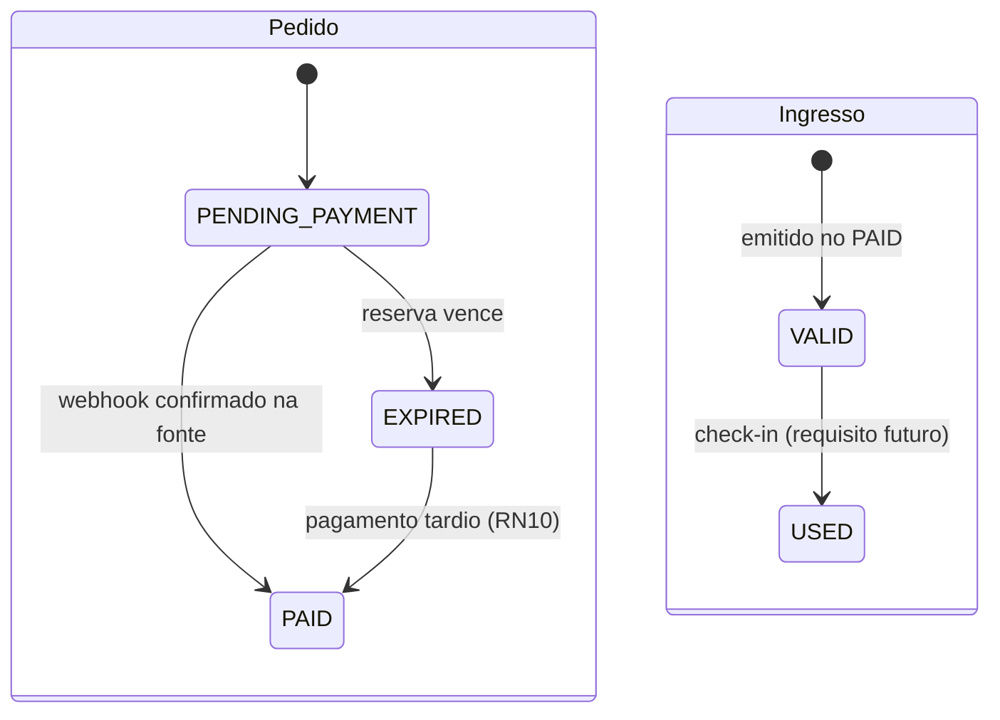
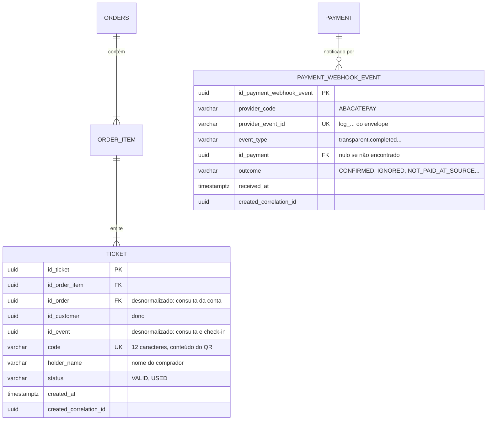

# REQ8 - Efetivação dos Pagamentos

- **Status**: Proposto
- **Área**: pagamentos / vendas
- **Depende de**: REQ7 (pagamento de pedidos com Pix)
- **Habilita**: REQ13 (pedidos e ingressos do cliente); requisito futuro de carteira e extrato (consome `OrderPaid`)
- **Jornada**: passo 6 de 7 da [jornada de compra](../docs/jornada-de-compra.md)

## Objetivo de Negócio

**O que entrega**: quando o comprador paga o Pix, o AbacatePay avisa a Ntix. A Ntix confirma o pagamento na fonte, marca o pedido como pago, **emite os ingressos** e registra o fato para os próximos processos.

- **Webhook** do AbacatePay recebido e autenticado.
- **Confirmação na fonte**: a Ntix consulta o AbacatePay com a credencial da integração que gerou o Pix, em vez de confiar só no corpo do webhook.
- **Pedido pago** e **ingressos emitidos**, um por unidade comprada, com código único.
- **Evento `OrderPaid`** na outbox, para carteira, extrato e e-mail de confirmação futuros.

**O que impacta**:
- **Receita**: fecha a primeira venda real de ponta a ponta (marco M4 da jornada).
- **Experiência**: o checkout mostra "pagamento confirmado" segundos depois do Pix, com os ingressos prontos.
- **Operação**: cada confirmação fica rastreável (evento do webhook, consulta na fonte, pedido, ingressos).

**Por que é positivo**: sem efetivação, o comprador paga e não recebe nada. É o passo que transforma dinheiro recebido em ingresso entregue.

## Problema de Negócio

Depois do REQ7, o Pix é gerado e pago, mas a Ntix nunca sabe. O pedido fica `PENDING_PAYMENT`, vence e o estoque volta, com o dinheiro já na conta do produtor. Seria um reembolso manual a cada venda.

## Fluxo

```mermaid
sequenceDiagram
    autonumber
    participant AP as AbacatePay
    participant API as Ntix API
    participant DB as PostgreSQL
    actor Comprador
    participant Web as Checkout

    AP->>API: POST /api/v1/payment-webhooks/abacatepay<br/>X-Webhook-Signature, X-Webhook-Secret
    API->>API: Assinatura HMAC-SHA256 do corpo bruto
    API->>DB: Pagamento por transparent.id (provider_reference)
    API->>API: X-Webhook-Secret = WEBHOOK_SECRET da integração (se cadastrado)
    API->>DB: Evento do webhook já processado? (id do envelope)
    API->>AP: GET /v2/transparents/check?id=pix_char_... (API_KEY da integração)
    AP-->>API: status PAID
    API->>DB: BEGIN; pedido FOR UPDATE
    API->>DB: payment PAID, pedido PAID, ingressos, OrderPaid na outbox, evento do webhook
    API->>DB: COMMIT
    API-->>AP: 200
    loop polling a cada 3 s
        Web->>API: GET /api/v1/orders/{code}
    end
    API-->>Web: PAID + ingressos
    Web-->>Comprador: Pagamento confirmado
```



## Modelo de dados



## Riscos

### Da ausência
| Risco | Impacto | Mitigação |
|---|---|---|
| Pagamento sem confirmação | Comprador pagou e não recebe ingresso; reembolso manual | Este requisito |

### De negócio no requisito
| Risco | Impacto | Mitigação |
|---|---|---|
| Webhook falso marca pedido como pago | Ingresso emitido sem pagamento | Assinatura, segredo da integração **e** consulta na fonte com a `API_KEY` da integração: só `PAID` no AbacatePay confirma (RN4) |
| Webhook repetido emite ingressos em dobro | Ingressos a mais | Deduplicação pelo id do envelope e pedido já `PAID` não emite de novo (RN6) |
| Pagamento depois da reserva vencida | Ingresso a mais que o estoque | O Pix vence 2 min antes da reserva (REQ7); se mesmo assim chegar tarde, o pedido é honrado e sinalizado (RN10, Decisões, item 1) |
| Produtor não cadastra o webhook no AbacatePay | Pedidos pagos nunca confirmam | A aba Integrações mostra a URL e o passo a passo; métrica de pedidos com Pix pago não confirmado fica para a consulta ativa (Decisões, item 2) |

### De tecnologia no requisito
| Risco | Impacto | Mitigação |
|---|---|---|
| Endpoint público recebe tráfego malicioso | Carga e tentativas de fraude | Assinatura verificada antes de qualquer consulta ao banco; corpo limitado a 64 KB; respostas 401/404 sem detalhe |
| AbacatePay não recebe 2XX em 30 s e reenvia | Processamento duplicado | Idempotência (RN6); transação curta; a consulta na fonte tem timeout de 5 s |
| Consulta na fonte falha (AbacatePay fora) | Pagamento não confirmado | Resposta 503, e o AbacatePay reenvia (5 s, 5 min, 30 min, 2 h...) |
| Segredo comparado com `==` | Ataque de tempo | `CryptographicOperations.FixedTimeEquals` |
| Código do ingresso adivinhável | Ingresso falsificado | 12 caracteres de 31 símbolos (~59 bits) com `RandomNumberGenerator`, único por índice |

## Implementação de Tecnologia

### Contrato

#### `POST /api/v1/payment-webhooks/abacatepay` (anônimo, chamado pelo AbacatePay)

Não exige os headers auditáveis do front, porque quem chama é o AbacatePay. A API gera o `CorrelationId` deste fluxo (exceção registrada em `standards.md`), usa `OriginService = "abacatepay-webhook"` e `ExecutionUser = "abacatepay"`.

Headers lidos: `X-Webhook-Signature` (Base64 do HMAC-SHA256 do corpo bruto), `X-Webhook-Secret`.

Corpo (formato do AbacatePay, lido de forma tolerante: só os campos usados):
```json
{
  "id": "log_12345",
  "event": "transparent.completed",
  "apiVersion": 2,
  "devMode": false,
  "data": {
    "transparent": { "id": "pix_char_abc", "externalId": "5e9b...", "amount": 39000, "status": "PAID" }
  }
}
```

| Situação | Resposta | AbacatePay reenvia? |
|---|---|---|
| Confirmado, ou já processado antes | **200** | não |
| Evento que não é `transparent.completed` | **200** (registrado como `IGNORED`) | não |
| Na fonte o status não é `PAID` | **200** (registrado como `NOT_PAID_AT_SOURCE`) | não |
| Assinatura ou segredo inválidos | **401**, sem corpo | não |
| Pagamento não encontrado | **404**, sem corpo | não |
| Corpo ilegível ou acima de 64 KB | **400**, sem corpo | não |
| Consulta na fonte indisponível | **503**, sem corpo | sim |
| Falha inesperada | **500**, sem corpo | sim |

#### `GET /api/v1/orders/{code}` (REQ6)

Com o pedido pago:
```json
{
  "code": "NX7K2QH9MP",
  "status": "PAID",
  "paidAt": "2027-01-10T15:04:12.000Z",
  "payment": { "id": "5e9b...", "method": "PIX", "status": "PAID", "amountCents": 39000 },
  "tickets": [
    { "code": "K7M2QX9HP4TA", "batchName": "1º lote - Pista", "holderName": "Marina Souza", "status": "VALID" },
    { "code": "R3ND8WQ2LZ6C", "batchName": "1º lote - Pista", "holderName": "Marina Souza", "status": "VALID" },
    { "code": "B9XH4MP7QK2E", "batchName": "VIP", "holderName": "Marina Souza", "status": "VALID" }
  ]
}
```

### Regras de negócio
- **RN1**: a assinatura `X-Webhook-Signature` é o HMAC-SHA256, em Base64, do corpo **bruto**, com a chave pública do AbacatePay (`AbacatePayConfiguration:WebhookPublicKey`). É verificada antes de ler o JSON. Inválida: 401.
- **RN2**: o pagamento é encontrado por `data.transparent.id` = `provider_reference`. Não encontrado: 404 e registro `PAYMENT_NOT_FOUND`.
- **RN3**: se a integração que gerou o pagamento tem `WEBHOOK_SECRET`, o header `X-Webhook-Secret` precisa ser igual (comparação em tempo constante). Diferente ou ausente: 401. O parâmetro `webhookSecret` da URL não é usado, porque URL vai para log.
- **RN4**: só `transparent.completed` confirma. Antes de confirmar, a API consulta `GET /v2/transparents/check?id={provider_reference}` com a `API_KEY` **da integração que gerou o pagamento** (REQ7, RN9). Só `status = PAID` na fonte confirma.
- **RN5**: o envelope é deduplicado por `(provider_code, provider_event_id)`. Evento já registrado com desfecho final responde 200 sem reprocessar.
- **RN6**: a confirmação, numa transação com o pedido travado: pagamento `PAID` com `paid_at`; pedido `PAID` com `paid_at`; um ingresso por unidade de cada item; `OrderPaid` na outbox; registro do evento do webhook. Pedido já `PAID`: nada muda, 200.
- **RN7**: o código do ingresso tem 12 caracteres de `23456789ABCDEFGHJKMNPQRSTUVWXYZ`, gerado com `RandomNumberGenerator`, único (`ux_ticket_code`). O titular é o nome completo do comprador. O ingresso nasce `VALID`.
- **RN8**: `OrderPaid` leva id e código do pedido, produtor, evento, cliente, canal, total em centavos, itens (lote, quantidade, preço) e o pagamento (id, integração, método). Sem nome, e-mail ou CPF.
- **RN9**: o valor confirmado na fonte é conferido com o do pagamento; divergência não confirma, registra `AMOUNT_MISMATCH` e alerta (log `Error` e métrica).
- **RN10**: pagamento confirmado na fonte com o pedido já vencido (`expires_at` passou) **é honrado**: o comprador pagou. O pedido vira `PAID`, os ingressos são emitidos mesmo que o lote fique acima da quantidade, e a confirmação é sinalizada (`paid_after_expiration`) para o produtor tratar.
- **RN11**: pagamento `PENDING` cujo `expires_at` passou é exibido `EXPIRED` (REQ7). Não há evento de expiração do AbacatePay.

### Camadas
- **Domain**:
  - `TicketContext` (ou dentro de `OrderContext`): entidade `Ticket`, enum `TicketStatus`, `TicketCodeValueObject` (RN7).
  - `Order.ConfirmPayment(payment, customerName, now)` gera os ingressos e devolve o `OrderPaidEvent` (RN6, RN10).
  - `WebhookSignature.IsValid(rawBody, signature, key)` (RN1) e `Payment.Confirm(paidAt, amountAtSource)` (RN9) no `PaymentContext`.
- **Infra**:
  - `IPixChargeClient.GetPixChargeStatusAsync` (do REQ7) no `AbacatePayClient`, com `GET /v2/transparents/check`.
  - `PostgreSql/Repositories/Orders/TicketRepository` (`CreateManyAsync`, com savepoint e nova tentativa em colisão de código).
  - `PaymentRepository`: `GetByProviderReferenceAsync`, `ConfirmAsync`. `PaymentWebhookEventRepository`: `GetAsync`, `CreateAsync`.
  - `IOutboxRepository` existente.
- **Application**: `ConfirmPaymentFromWebhook` (input: corpo bruto, assinatura, segredo, `CorrelationId` gerado), com `*Log` e `*Diagnostics`. O `GetCustomerOrder` (REQ6) passa a carregar os ingressos.
- **Presentation**: `PaymentWebhooksV1Controller` (`api/v1/payment-webhooks`), ação `abacatepay`, que lê o corpo bruto (`Request.Body`, limite de 64 KB com `[RequestSizeLimit]`) e só traduz o desfecho em status HTTP, sem corpo.

### Banco
- `data/orders/003-create-ticket-table.sql`: `orders.ticket`, FK para `orders.order_item` e `orders.orders`, `CHECK` de `status`.
- `data/orders/004-create-ticket-indexes.sql`: `ux_ticket_code`, `ix_ticket_id_customer_id_event`, `ix_ticket_id_order`.
- `data/payments/006-create-payment-webhook-event-table.sql`: `payments.payment_webhook_event`, `ux_payment_webhook_event_provider_event (provider_code, provider_event_id)`.

### Configuração e implantação
- `AbacatePayConfiguration:WebhookPublicKey`: a chave pública que o AbacatePay publica na documentação de segurança dos webhooks. Não é segredo; fica em `appsettings.json`.
- A URL pública do webhook é `https://{api}/api/v1/payment-webhooks/abacatepay`. Cada produtor cadastra no painel do AbacatePay um **Webhook v2** com essa URL, o evento `transparent.completed` e o mesmo segredo gravado como `WEBHOOK_SECRET` na integração (REQ4). Sandbox e produção têm webhooks separados.
- Ambiente local: o AbacatePay não chama `localhost`. A validação ponta a ponta é no ambiente publicado, com chave `abc_dev_...` e `simulate-payment`.
- **Front (`web/`)**:
  - `IntegrationsPage` mostra a URL do webhook com botão de copiar e o passo a passo, e marca a integração sem `WEBHOOK_SECRET` com um aviso.
  - `CheckoutPage` encerra o polling no `PAID` e leva a `OrderConfirmedPage`, que lista os ingressos da resposta.

### Observabilidade
- Logs: webhook recebido (tipo, id do envelope, pagamento), recusado (motivo), confirmado (pedido, pagamento, quantidade de ingressos), duplicado, divergência de valor, pagamento tardio. Nunca o corpo inteiro, segredo, nome ou CPF do pagador.
- Métricas: funil `ntix.payments.webhook` com desfechos `confirmed`, `duplicate`, `ignored`, `not_paid_at_source`, `invalid_signature`, `invalid_secret`, `payment_not_found`, `source_unavailable`, `amount_mismatch`; `ntix.orders.paid_after_expiration`; histograma do tempo entre a criação do Pix e a confirmação.
- Dashboard "Pagamentos": confirmações por minuto, recusas por motivo, pagamentos tardios.

### Testes
- **Unitários**: `WebhookSignature` (com o exemplo da documentação), RN3 em tempo constante, `Order.ConfirmPayment` (quantidade de ingressos, idempotência, pedido vencido), `TicketCodeValueObject`, cada desfecho do caso de uso com cliente e repositórios substituídos.
- **Integrados**: confirmação completa numa transação (pagamento, pedido, ingressos, outbox, evento do webhook); deduplicação concorrente do mesmo envelope (só um processa); colisão de código de ingresso.
- **Funcionais**: os Critérios de Aceite, com o `IPixChargeClient` substituído e o corpo assinado com a chave configurada no teste.
- **Carga** (k6): `tsts/LoadTests/payments-webhook-tests.js`, 50 webhooks/s por 2 minutos contra pedidos preparados, p95 < 500 ms, a confirmar.

### Dependências
Nenhuma nova (usa o `HttpClient` do REQ7 e `HMACSHA256` da biblioteca padrão).

### Fora do escopo
- `transparent.refunded`, `transparent.disputed`, `transparent.lost` (registrados como `IGNORED`; estorno é requisito próprio).
- Carteira, taxa de intermediação e extrato (consumidor do `OrderPaid`).
- E-mail de confirmação com os ingressos.
- Consulta ativa no AbacatePay sem webhook (Decisões, item 2).
- Nome do titular diferente do comprador, transferência de ingresso.

## Critérios de Aceite

```gherkin
# language: pt
Funcionalidade: Efetivação dos pagamentos

  Contexto:
    Dado o pedido "NX7K2QH9MP" de Marina com 2 ingressos "Pista" e 1 "VIP", PENDING_PAYMENT
    E o Pix "pix_char_abc" PENDING gerado pela integração "Conta A" com WEBHOOK_SECRET

  Cenário: Pagamento confirmado
    Dado que o AbacatePay informa o Pix "pix_char_abc" como PAID
    Quando chega o webhook transparent.completed de "pix_char_abc" assinado e com o segredo da "Conta A"
    Então a resposta é 200
    E o pedido fica PAID
    E 3 ingressos VALID são emitidos no nome de Marina
    E o evento OrderPaid está na outbox

  Cenário: Webhook repetido
    Dado que o webhook "log_12345" já confirmou o pedido
    Quando o mesmo webhook "log_12345" chega de novo
    Então a resposta é 200
    E o pedido continua com 3 ingressos

  Cenário: Assinatura inválida
    Quando chega um webhook com assinatura que não confere com o corpo
    Então a resposta é 401
    E o pedido continua PENDING_PAYMENT

  Cenário: Segredo errado
    Quando chega um webhook assinado com o segredo "outro-segredo"
    Então a resposta é 401

  Cenário: Webhook forjado com pagamento não feito
    Dado que o AbacatePay informa o Pix "pix_char_abc" como PENDING
    Quando chega o webhook transparent.completed de "pix_char_abc" assinado e com o segredo correto
    Então a resposta é 200
    E o pedido continua PENDING_PAYMENT

  Cenário: Pagamento desconhecido
    Quando chega o webhook de "pix_char_inexistente"
    Então a resposta é 404

  Cenário: AbacatePay indisponível na consulta
    Dado que a consulta de status do AbacatePay não responde
    Quando chega o webhook transparent.completed de "pix_char_abc"
    Então a resposta é 503
    E o pedido continua PENDING_PAYMENT

  Cenário: Pagamento depois da reserva
    Dado que a reserva do pedido venceu há 1 minuto
    E que o AbacatePay informa o Pix "pix_char_abc" como PAID
    Quando chega o webhook transparent.completed de "pix_char_abc"
    Então o pedido fica PAID com 3 ingressos
    E a confirmação é sinalizada como pagamento tardio

  Cenário: Comprador vê os ingressos
    Dado o pedido "NX7K2QH9MP" PAID
    Quando Marina consulta o pedido
    Então vê 3 ingressos com códigos diferentes
```

## Decisões em aberto

1. **Pagamento tardio** (RN10): honrar e emitir, mesmo acima do estoque, é o adotado (o comprador pagou e o dinheiro está com o produtor). Alternativa: não emitir e marcar para estorno, quando o estorno existir.
2. **Consulta ativa**: se o produtor não cadastrar o webhook, o pedido nunca confirma. Incluir uma verificação no AbacatePay quando o checkout consulta um pedido com Pix pendente (com intervalo mínimo entre consultas)?
3. **`WEBHOOK_SECRET` obrigatório**: hoje é opcional no catálogo (REQ4). Com a consulta na fonte, o segredo é uma camada a mais, não a única. Tornar obrigatório para a integração entrar na rota de Pix?
4. **`CorrelationId` gerado pela API** neste endpoint, porque o AbacatePay não envia os headers auditáveis: registrar como exceção em `standards.md`.
5. **Titular do ingresso** = nome do comprador em todos os ingressos do pedido. Nome por ingresso fica para depois?
6. **Carga**: perfil proposto acima.
