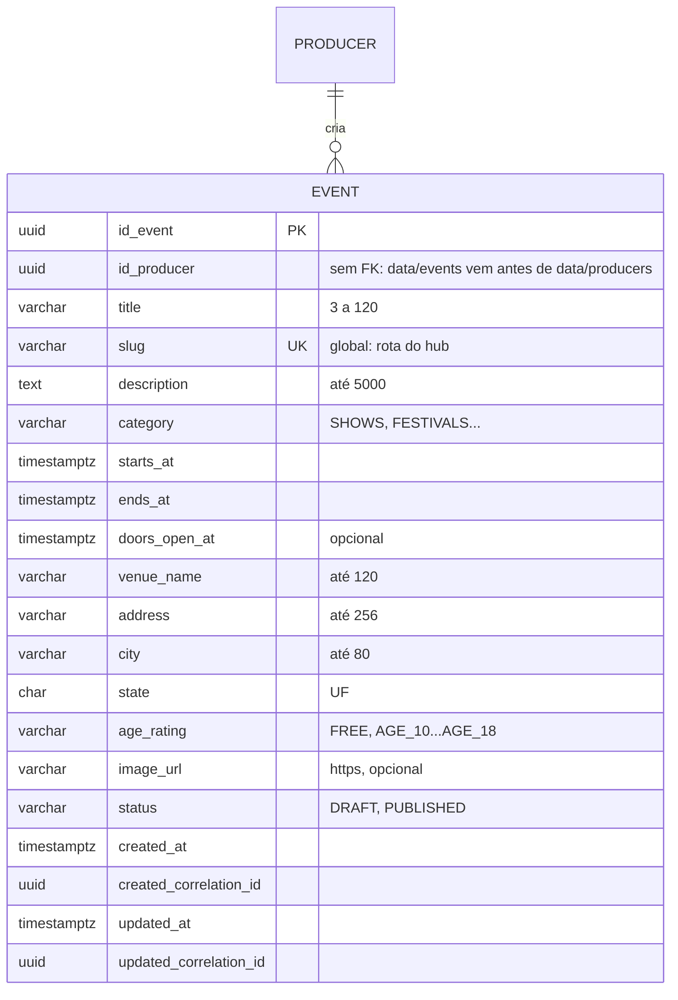
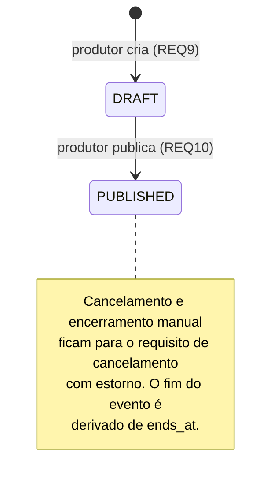

# REQ9 - Eventos do Produtor

- **Status**: Proposto
- **Área**: produtor / catálogo
- **Depende de**: REQ5 (autenticação do usuário do produtor)
- **Habilita**: REQ10 (lotes e publicação), REQ11 (vitrine), REQ6 (pedidos)
- **Jornada**: passo 1 de 7 da [jornada de compra](../docs/jornada-de-compra.md)

## Objetivo de Negócio

**O que entrega**: o produtor cadastra os eventos dele no painel, com os dados que o comprador precisa ver para decidir a compra: nome, descrição, categoria, data e hora, local e classificação etária.

- **Criar** um evento, que nasce em rascunho (`DRAFT`) e ainda não aparece para o comprador.
- **Listar** os eventos do produtor no painel, filtrando por status.
- **Ver** um evento.
- **Editar** um evento.

**O que impacta**:
- **Receita**: é o primeiro passo para vender. Sem evento na base, não há lote, pedido nem pagamento.
- **Produto**: a aba Eventos do painel (`web/src/pages/panel/EventsPage.tsx`) deixa de ser demonstração.
- **Operação**: o evento ganha um identificador e um slug estáveis, usados pela vitrine, pelo pedido e, depois, pelos afiliados.

**Por que é positivo**: é a base do catálogo. O produtor monta o evento com calma, em rascunho, e só o expõe quando estiver pronto (REQ10).

## Problema de Negócio

Hoje a API não tem o domínio de eventos. O painel e o hub usam dados fictícios (`web/src/platform/demoData.ts`, `web/src/hub/catalog.ts`). Sem este requisito:

- O produtor não consegue cadastrar o que vai vender.
- Lote (REQ10), vitrine (REQ11) e pedido (REQ6) não têm a que se referir.

## Modelo de dados





## Riscos

### Da ausência
| Risco | Impacto | Mitigação |
|---|---|---|
| Sem eventos na base | Nenhuma venda real; REQ10, REQ11 e REQ6 bloqueados | Este requisito |
| Catálogo fixo no front | Cada evento novo exige deploy | Eventos vêm da API |

### De negócio no requisito
| Risco | Impacto | Mitigação |
|---|---|---|
| Evento publicado com data errada é editado depois da venda | Comprador vai no dia errado | Edição permitida, mas registrada (log com campos alterados e `updated_correlation_id`); aviso ao comprador fica para requisito próprio (Decisões, item 3) |
| Slug muda e quebra links compartilhados | Venda perdida em link já divulgado | Slug gerado na criação e nunca mais alterado (RN4) |
| Imagem de terceiro ou conteúdo impróprio | Marca exposta | Só URL `https`, validada por `AssetUrlValueObject`; moderação fora do escopo |

### De tecnologia no requisito
| Risco | Impacto | Mitigação |
|---|---|---|
| Um produtor lê ou altera evento de outro | Vazamento e sabotagem | Rota `/producers/{slug}`, política `ProducerUser` e consulta sempre por `(id_producer, id_event)` (RN1); evento de outro produtor responde 404 |
| Slug duplicado em criações simultâneas | Erro 500 ou dois eventos na mesma URL | Índice único `ux_event_slug`, savepoint e nova versão aleatória, como o slug do produtor |
| URL de imagem maliciosa (`javascript:`) | XSS no hub | `AssetUrlValueObject` só aceita `https`; o front ainda passa por `safeAssetUrl` |

## Implementação de Tecnologia

### Contrato

Todos os endpoints exigem os headers auditáveis (`X-Correlation-Id`, `X-Origin-Service`, `X-Requested-At`) e o access token do REQ5 (`[Authorize(Policy = ProducerUser)]`), com `producer_slug` igual ao `{slug}` da rota. `ExecutionUser` vem do token.

#### `POST /api/v1/producers/{slug}/events`

```json
{
  "title": "Festival Horizonte",
  "description": "Três palcos, um pôr do sol e nenhuma pressa.",
  "category": "FESTIVALS",
  "startsAt": "2027-03-20T18:00:00.000Z",
  "endsAt": "2027-03-21T03:00:00.000Z",
  "doorsOpenAt": "2027-03-20T17:00:00.000Z",
  "venueName": "Parque das Dunas",
  "address": "Av. Beira-Mar, 1200",
  "city": "Recife",
  "state": "PE",
  "ageRating": "AGE_16",
  "imageUrl": "https://cdn.exemplo.com/horizonte.jpg"
}
```

- **201 Created**, `Location: /api/v1/producers/{slug}/events/{eventId}`, corpo no formato da leitura.
- **400**: `EVENT_TITLE_INVALID_NOTIFICATION_CODE`, `EVENT_DESCRIPTION_INVALID_NOTIFICATION_CODE`, `EVENT_CATEGORY_INVALID_NOTIFICATION_CODE`, `EVENT_PERIOD_INVALID_NOTIFICATION_CODE`, `EVENT_DOORS_OPEN_INVALID_NOTIFICATION_CODE`, `EVENT_VENUE_INVALID_NOTIFICATION_CODE`, `EVENT_STATE_INVALID_NOTIFICATION_CODE`, `EVENT_AGE_RATING_INVALID_NOTIFICATION_CODE`, `EVENT_IMAGE_URL_INVALID_NOTIFICATION_CODE`.

#### `GET /api/v1/producers/{slug}/events?status=DRAFT`

`status` opcional (`DRAFT`, `PUBLISHED`). Ordenado por `startsAt` crescente. Sem paginação neste requisito: um produtor tem poucas dezenas de eventos (Decisões, item 4).

**200 OK**
```json
[
  {
    "id": "0b6e...",
    "slug": "festival-horizonte",
    "title": "Festival Horizonte",
    "category": "FESTIVALS",
    "startsAt": "2027-03-20T18:00:00.000Z",
    "endsAt": "2027-03-21T03:00:00.000Z",
    "city": "Recife",
    "state": "PE",
    "status": "DRAFT",
    "imageUrl": "https://cdn.exemplo.com/horizonte.jpg"
  }
]
```

#### `GET /api/v1/producers/{slug}/events/{eventId}`

**200 OK**: todos os campos do `POST`, mais `id`, `slug`, `status`, `createdAt` e `updatedAt`.
**404**: `EVENT_NOT_FOUND_NOTIFICATION_CODE`.

#### `PUT /api/v1/producers/{slug}/events/{eventId}`

Mesmo corpo do `POST`. Substitui todos os campos editáveis; campo opcional ausente fica nulo. Vale em `DRAFT` e `PUBLISHED`.

- **200 OK**, corpo no formato da leitura.
- **400**: os códigos do `POST`, mais `EVENT_ALREADY_STARTED_NOTIFICATION_CODE`.
- **404**: `EVENT_NOT_FOUND_NOTIFICATION_CODE`.

Comuns: **401** sem token; **403** token de outro produtor; **499** cancelamento; **500** sem corpo.

### Regras de negócio
- **RN1**: o evento pertence a um produtor; o usuário só cria, lê e altera eventos do próprio produtor. Evento de outro produtor responde como inexistente.
- **RN2**: `title` com 3 a 120 caracteres, sem espaço nas pontas. `description` opcional, até 5000 caracteres.
- **RN3**: `category` é uma de `SHOWS`, `FESTIVALS`, `THEATER`, `STAND_UP`, `ELECTRONIC`, `SPORTS`, `GASTRONOMY`, `KIDS`, `OTHER` (as categorias do hub, `web/src/hub/catalog.ts`).
- **RN4**: o slug é gerado do título na criação, pelo `SlugValueObject`, com até 126 caracteres; se já existir, recebe a versão aleatória de 5 caracteres, como o slug do produtor. É **global** (a rota do hub é `/eventos/{slug}`) e **nunca muda**, nem quando o título muda.
- **RN5**: `startsAt` no futuro na criação; `endsAt` depois de `startsAt`; duração máxima de 30 dias.
- **RN6**: `doorsOpenAt`, quando informado, é antes ou igual a `startsAt` e no máximo 12 horas antes.
- **RN7**: `venueName` (até 120), `address` (até 256) e `city` (até 80) obrigatórios; `state` é uma das 27 UFs.
- **RN8**: `ageRating` é um de `FREE`, `AGE_10`, `AGE_12`, `AGE_14`, `AGE_16`, `AGE_18`.
- **RN9**: `imageUrl` opcional, só `https`, até 2048 caracteres (`AssetUrlValueObject`).
- **RN10**: o evento nasce `DRAFT`. Este requisito não muda o status; a publicação é do REQ10.
- **RN11**: evento que já começou (`startsAt` ≤ agora) não pode ser editado (`EVENT_ALREADY_STARTED`).

### Camadas
- **Domain** (`BoundedContexts/EventContext`):
  - Entidade `Event`, com os value objects `EventTitleValueObject`, `EventDescriptionValueObject`, `EventPeriodValueObject` (início, fim e abertura, RN5 e RN6), `VenueValueObject` (RN7), e reaproveitando `SlugValueObject`, `AssetUrlValueObject` e `IdValueObject`.
  - Enums `EventStatus`, `EventCategory`, `AgeRating`, `BrazilianState` (ou `StateValueObject`).
  - `Event.CanBeEdited(now)` (RN11) fica na entidade, porque o REQ10 reutiliza para os lotes.
- **Infra** (`PostgreSql/Repositories/Events`): `IEventRepository` com `CreateAsync` (traduz `23505` de `ux_event_slug` em `EventCreationResult.SlugAlreadyExists`, com savepoint), `GetByIdAsync(idProducer, idEvent)`, `ListByProducerAsync(idProducer, status)`, `UpdateAsync` (com `FOR UPDATE` na leitura). `EventModel` primitivo.
- **Application** (`UseCases`): `CreateEvent`, `GetProducerEvents`, `GetProducerEvent`, `UpdateEvent`, cada um com `*Log` e `*Diagnostics` herdando `FunnelDiagnostics`. Conversões em `UseCases/Base/Events/EventConversions` e saída comum em `Base/Events/Outputs/ProducerEventOutput`. O `id_producer` vem do claim `producer_id` do token.
- **Presentation**: `ProducerEventsV1Controller` (`api/v1/producers/{slug}/events`), payload `EventV1Request` (o mesmo para `POST` e `PUT`).

### Banco (`data/events/`)
- `001-create-event-tables.sql`: schema `events`, tabela `events.event` com `CHECK` de `status`, `category`, `age_rating`, `state` e `ends_at > starts_at`.
- `002-create-event-indexes.sql`: `ux_event_slug (slug)`, `ix_event_id_producer_starts_at (id_producer, starts_at)`.
- Sem FK para `producers.producer` (`data/events` roda antes de `data/producers`), como no REQ4.

### Configuração e implantação
- Nenhuma chave nova. O deploy aplica `data/events/` como as demais pastas.
- **Front (`web/`)**: aba Eventos do painel com lista, formulário de criação e edição, pela skill `frontend-integration`, em demonstração por padrão e real com `?api=real`.

### Observabilidade
- Logs: evento criado (id, slug, produtor), editado (id, campos alterados, sem valores de texto livre), edição recusada (motivo).
- Métricas: funil `ntix.events.create`, `ntix.events.update`, `ntix.events.list`, `ntix.events.get`.
- Dashboard "Eventos" no Grafana com os funis.

### Testes
- **Unitários**: cada value object (limites de RN2 a RN9), `Event.CanBeEdited`, geração de slug, casos de uso com repositório substituído.
- **Integrados**: repositório contra PostgreSQL: criação, conflito de slug com nova versão, leitura isolada por produtor, atualização.
- **Funcionais**: os Critérios de Aceite.
- **Carga** (k6): `tsts/LoadTests/producers-events-tests.js`, perfil moderado (50 VUs, p95 < 500 ms, < 1% de erros), a confirmar.

### Dependências
Nenhuma nova.

### Fora do escopo
- Publicação e lotes (REQ10).
- Exclusão de evento, cancelamento e encerramento manual.
- Programação (`schedule`) e "o que está incluso" (`included`) do hub de demonstração.
- Upload de imagem (só URL).
- Local como entidade (`VENUE`), fuso horário do evento.
- Afiliação (`allows_affiliates`, plano de comissão).

## Critérios de Aceite

```gherkin
# language: pt
Funcionalidade: Eventos do produtor

  Contexto:
    Dado o produtor "mare-cultural" autenticado

  Cenário: Criar um evento em rascunho
    Quando o produtor cria o evento "Festival Horizonte" em 20/03/2027
    Então recebe 201
    E o evento está em DRAFT com o slug "festival-horizonte"

  Cenário: Slug já usado por outro produtor
    Dado um evento "Festival Horizonte" de outro produtor
    Quando o produtor cria o evento "Festival Horizonte"
    Então o slug recebe uma versão aleatória de 5 caracteres

  Cenário: Período inválido
    Quando o produtor cria um evento que termina antes de começar
    Então recebe 400 com EVENT_PERIOD_INVALID_NOTIFICATION_CODE

  Cenário: Categoria desconhecida
    Quando o produtor cria um evento com a categoria "RODEIO"
    Então recebe 400 com EVENT_CATEGORY_INVALID_NOTIFICATION_CODE

  Cenário: Editar o título não muda o slug
    Dado o evento "Festival Horizonte" em DRAFT
    Quando o produtor muda o título para "Festival Horizonte 2027"
    Então o slug continua "festival-horizonte"

  Cenário: Listar por status
    Dado um evento em DRAFT e outro PUBLISHED
    Quando o produtor lista os eventos com status DRAFT
    Então recebe só o evento em DRAFT

  Cenário: Isolamento entre produtores
    Dado o evento "Show Y" do produtor "produtor-y"
    Quando o produtor "mare-cultural" consulta "Show Y" pelo id
    Então recebe 404 com EVENT_NOT_FOUND_NOTIFICATION_CODE

  Cenário: Evento já iniciado não é editado
    Dado um evento que começou há 1 hora
    Quando o produtor tenta editá-lo
    Então recebe 400 com EVENT_ALREADY_STARTED_NOTIFICATION_CODE
```

## Decisões em aberto

1. **Campos do evento**: adotados título, descrição, categoria, período, abertura dos portões, local (nome, endereço, cidade, UF), classificação etária e imagem. Falta algum (ex.: CEP, link do mapa)?
2. **Slug global** (um só no hub para todos os produtores) em vez de por produtor. A loja do produtor usa o mesmo slug.
3. **Edição depois de publicado**: permitida até o início do evento, sem aviso ao comprador. Deve ser bloqueada para data e local quando houver ingresso vendido?
4. **Lista do painel sem paginação**: aceitável enquanto o produtor tiver poucos eventos?
5. **Fuso horário**: datas em UTC e exibidas no fuso do navegador. Evento em outro fuso (ex.: Manaus) precisa de `timeZone` próprio?
6. **Carga**: perfil moderado nos endpoints do painel?
