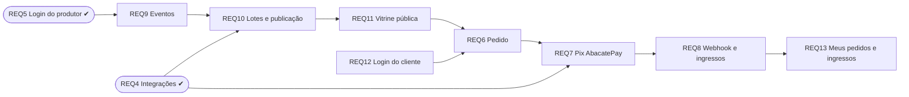
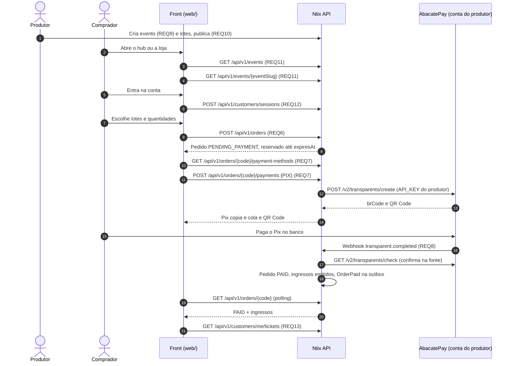

# Jornada de compra de ingressos

Plano para o comprador conseguir comprar e pagar um ingresso de verdade na Ntix, com Pix pelo AbacatePay. A jornada depende de quatro domínios que ainda não existem na API: eventos, lotes, pedidos e pagamento. Este documento fatia o trabalho em requisitos entregáveis, um PR cada, e mostra a ordem e o que cada um libera.

Base: MER v0.8 (`EVENT`, `TICKET_BATCH`, `CUSTOMER`, `PRODUCER_CUSTOMER`, `ORDER`, `ORDER_ITEM`, `TICKET`, `PAYMENT`) e o [REQ4](../backlog/REQ4-integracoes-de-pagamento-do-produtor.md), que já entregou as integrações de pagamento do produtor e o ranqueamento.

## O que já existe

| Peça | Onde | Serve para |
|---|---|---|
| Cadastro do cliente | `POST /api/v1/customers` (`CreateCustomerUseCase`) | Comprador cria a conta |
| Cadastro e login do produtor | REQ1, REQ5 | Painel autenticado (`ProducerUser`) |
| Integrações de pagamento e ranqueamento | REQ4 (`RankPaymentIntegrationsUseCase`) | Saber por qual conta AbacatePay do produtor cobrar |
| Cifragem de credenciais | `CredentialCipher` | Decifrar a `API_KEY` do produtor no momento da cobrança |
| Outbox | `outbox.outbox_event` | Publicar `OrderPaid` para o extrato e e-mails futuros |
| Front da jornada (demonstração) | `web/src/pages/hub/*`, `web/src/customer/*` | Telas prontas: vitrine, evento, checkout, conta |

## Fatiamento

Os números REQ6, REQ7 e REQ8 já estavam reservados no REQ4 para pedido, pagamento e efetivação, e são citados no código. Foram mantidos. Os domínios que faltavam entram como REQ9 a REQ13. A ordem de entrega não segue o número.

| Ordem | REQ | Título | Entrega para o front | Depende de |
|---|---|---|---|---|
| 1 | [REQ9](../backlog/REQ9-eventos-do-produtor.md) | Eventos do produtor | Painel: criar, listar, ver e editar eventos em rascunho | REQ5 |
| 2 | [REQ10](../backlog/REQ10-lotes-de-ingressos-e-publicacao-do-evento.md) | Lotes de ingressos e publicação do evento | Painel: lotes de cada evento e botão Publicar | REQ9, REQ4 |
| 3 | [REQ11](../backlog/REQ11-vitrine-publica-de-eventos.md) | Vitrine pública de eventos | Hub e loja: lista de eventos e página do evento com lotes | REQ10 |
| 3 | [REQ12](../backlog/REQ12-autenticacao-do-cliente.md) | Autenticação do cliente | Login do comprador, sessão e "meus dados" | nenhum novo (paralelo a REQ9-REQ11) |
| 4 | [REQ6](../backlog/REQ6-criacao-de-pedidos.md) | Criação de pedidos | Checkout: reserva dos ingressos por 15 minutos | REQ11, REQ12 |
| 5 | [REQ7](../backlog/REQ7-pagamento-de-pedidos-com-pix.md) | Pagamento de pedidos com Pix | Checkout: métodos disponíveis e QR Code Pix | REQ6, REQ4 |
| 6 | [REQ8](../backlog/REQ8-efetivacao-dos-pagamentos.md) | Efetivação dos pagamentos | Pedido pago e ingressos emitidos (webhook do AbacatePay) | REQ7 |
| 7 | [REQ13](../backlog/REQ13-pedidos-e-ingressos-do-cliente.md) | Pedidos e ingressos do cliente | Conta: meus pedidos e meus ingressos | REQ8 |

### Marcos de valor

| Marco | Depois de | O que dá para mostrar no ambiente |
|---|---|---|
| **M1 - Catálogo real** | REQ11 | Produtor cria e publica um evento com lotes, e ele aparece no hub e na loja |
| **M2 - Comprador identificado** | REQ12 | Comprador cria conta e entra no hub |
| **M3 - Reserva** | REQ6 | Comprador escolhe ingressos e o estoque fica reservado |
| **M4 - Primeira venda** | REQ8 | Comprador paga o Pix e recebe os ingressos; o dinheiro cai na conta AbacatePay do produtor |
| **M5 - Pós-venda** | REQ13 | Comprador consulta pedidos e ingressos na conta |

REQ12 não depende de REQ9-REQ11 e pode ser implementado em paralelo, em outra branch, se o usuário quiser acelerar.

## Jornada completa

## Mapa de telas e endpoints

| Tela (`web/`) | Endpoint | REQ |
|---|---|---|
| Painel > Eventos (`EventsPage`) | `POST/GET /api/v1/producers/{slug}/events`, `GET/PUT .../events/{eventId}` | REQ9 |
| Painel > Evento > Lotes | `POST/GET .../events/{eventId}/batches`, `PUT .../batches/{batchId}` | REQ10 |
| Painel > Evento > Publicar | `POST .../events/{eventId}/publication` | REQ10 |
| Hub (`HubHomePage`) e loja | `GET /api/v1/events` (`?producer={slug}` na loja) | REQ11 |
| Página do evento (`EventPage`) | `GET /api/v1/events/{eventSlug}` | REQ11 |
| Cadastro do comprador (`AuthForm`) | `POST /api/v1/customers` (existente) | - |
| Login do comprador (`CustomerLoginPage`) | `POST /api/v1/customers/sessions`, `/refresh`, `/revoke` | REQ12 |
| Conta > Meus dados (`ProfilePage`) | `GET /api/v1/customers/me` | REQ12 |
| Checkout (`CheckoutPage`) | `POST /api/v1/orders`, `GET /api/v1/orders/{code}/payment-methods`, `POST /api/v1/orders/{code}/payments` | REQ6, REQ7 |
| Pedido confirmado (`OrderConfirmedPage`) | `GET /api/v1/orders/{code}` (polling até `PAID`) | REQ6, REQ8 |
| Conta > Pedidos (`OrdersPage`, `OrderDetailPage`) | `GET /api/v1/customers/me/orders`, `GET /api/v1/orders/{code}` | REQ13 |
| Conta > Ingressos (`TicketsPage`, `TicketDetailPage`) | `GET /api/v1/customers/me/tickets`, `GET /api/v1/customers/me/tickets/{code}` | REQ13 |
| Painel > Integrações (`IntegrationsPage`) | Mostra a URL do webhook a cadastrar no AbacatePay | REQ8 |
| *(AbacatePay, não o front)* | `POST /api/v1/payment-webhooks/abacatepay` | REQ8 |

## Decisões transversais

Valem para todos os requisitos da jornada. Cada requisito repete o que usa.

1. **Dinheiro na API em centavos inteiros** (`priceCents`, `totalCents`), como o front já trata (`web/src/platform/types.ts`) e como o AbacatePay recebe. No banco, `NUMERIC(18,2)`, como o MER. A conversão é exata (÷ 100) e fica na `Application`.
2. **Datas em UTC**, ISO 8601, como no resto da API.
3. **Schemas no banco**, respeitando a ordem de caminho de `data/` (uma FK só aponta para schema que vem antes):

   | Pasta | Tabelas | FKs entre schemas |
   |---|---|---|
   | `data/customers` | `customer` (existe), `customer_session`, `producer_customer` | nenhuma para `producers` |
   | `data/events` | `event`, `ticket_batch` | nenhuma para `producers` |
   | `data/orders` | `orders`, `order_item`, `ticket` | para `customers.customer` e `events.*` |
   | `data/payments` | `payment`, `payment_webhook_event` (além das do REQ4) | para `orders.orders` |

   `order` é palavra reservada, por isso a tabela é `orders.orders`, como o MER prevê.
4. **Disponibilidade sem worker**: o estoque de um lote é `quantity` menos os itens de pedidos `PAID` e de pedidos `PENDING_PAYMENT` ainda dentro de `expires_at`. A reserva vence sozinha, sem rotina de liberação. Uma regra de domínio (`TicketBatchAvailability`) é usada por REQ10, REQ11 e REQ6.
5. **Código do pedido e do ingresso**: o comprador vê códigos curtos, nunca o UUID. Pedido `NX` + 8 caracteres; ingresso com 12. Alfabeto sem caracteres ambíguos, gerado com `RandomNumberGenerator` e garantido por índice único.
6. **Paginação** nas listas públicas e da conta: `page` (a partir de 1) e `pageSize` (padrão 20, máximo 50), resposta com `items`, `page`, `pageSize` e `totalItems`. Padrão novo, registrado em `standards.md` quando o REQ11 for implementado.
7. **Só Pix nesta jornada.** Boleto e cartão já existem no catálogo do REQ4, mas não têm adaptador. O checkout só oferece o método que tem integração disponível **e** adaptador na Ntix.
8. **Taxa de intermediação, comissão de afiliado, carteira e extrato** ficam fora da jornada. O dinheiro vai direto para a conta AbacatePay do produtor. O `OrderPaid` na outbox é o ponto de partida do requisito de carteira.

## Fora da jornada (próximos requisitos candidatos)

- Vendas do evento no painel do produtor (lista de pedidos e compradores).
- Check-in na portaria (`TICKET.status = USED`).
- Cancelamento de evento, estorno e reembolso (`transparent.refunded`).
- Cartão de crédito e boleto pelo AbacatePay.
- Carteira, taxa de intermediação e extrato (MER: `WALLET`, `INTERMEDIATION_FEE_PLAN`).
- Afiliados e links de compartilhamento.
- Cupons, meia-entrada, local do evento como entidade (`VENUE`).
- Aprovação do produtor pelo backoffice (`PRODUCER_APPROVAL`).

## Decisões em aberto da jornada

As de cada requisito estão nele. Estas atravessam vários:

1. **Produtor ainda não aprovado pode vender?** Não existe aprovação implementada: todo produtor está `PENDING`. Provisório: publicar e vender não exige `ACTIVE` (REQ10). Exigir travaria a jornada até existir o backoffice.
2. **Tempo de reserva**: 15 minutos (`OrderConfiguration:ReservationMinutes`), em vez dos 10 do front de demonstração, porque o Pix do AbacatePay vale no mínimo 5 minutos e a efetivação precisa de folga (REQ6, REQ7).
3. **Ingresso gratuito**: fora do escopo. O AbacatePay não cobra menos de R$ 1,00, então o lote custa no mínimo `100` centavos (REQ10).
4. **Taxa de serviço para o comprador**: não cobrada. O total do pedido é a soma dos itens.
