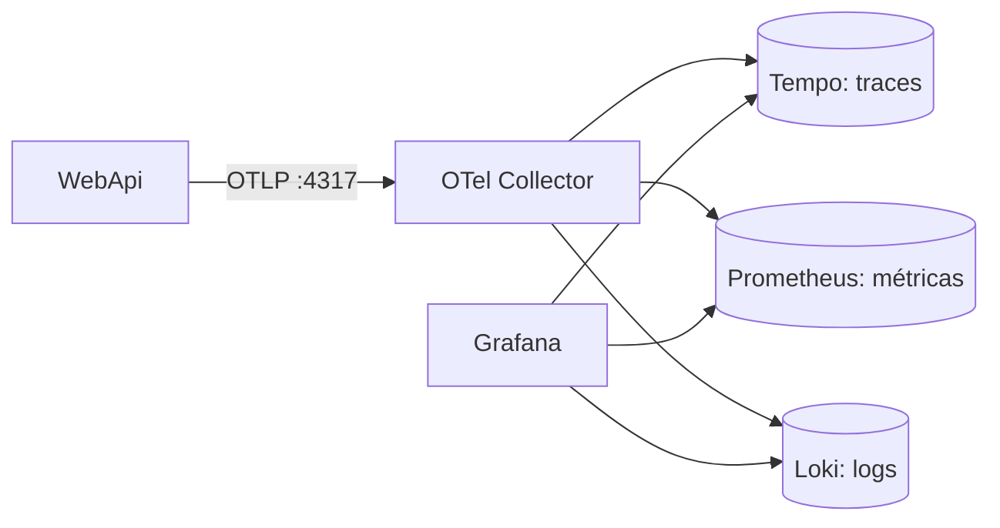

# Observabilidade

A `WebApi` envia logs, traces e métricas via OTLP ao OpenTelemetry Collector, que distribui cada sinal. Tudo é visto no Grafana.



## Como acessar

1. Suba a stack com `docker compose -f devops/docker-compose.yml up -d`.
2. Rode a API. Sem configuração extra, ela envia para `http://localhost:4317`; use `OTEL_EXPORTER_OTLP_ENDPOINT` para mudar o destino.
3. Abra o Grafana em <http://localhost:3000>, pasta **Ntix**.

| Dashboard | Conteúdo |
|---|---|
| **Ntix Funil de Cadastro de Cliente** | Funil de negócio, conversão, evolução, logs e traces do cadastro |
| **Ntix WebApi** | Tráfego, latência, erros, concorrência, memória, GC, thread pool, logs e traces |
| **Ntix Funil de Integrações de Pagamento** | Funis de conexão de fornecedor, alteração de integração, substituição de rota e ranqueamento, ranqueamentos vazios por método e fornecedor, logs e traces (REQ4) |

## Integrações de pagamento (REQ4)

| Fluxo | Métricas no Prometheus | Desfechos (`outcome`) |
|---|---|---|
| Catálogo de fornecedores | `ntix_payments_providers_requests_total`, `ntix_payments_providers_outcomes_total` | `served`, `validation_failed`, `error` |
| Conexão de fornecedor | `ntix_payments_integrations_creation_requests_total`, `..._outcomes_total` | `created`, `validation_failed`, `name_already_exists`, `producer_not_found`, `error` |
| Consulta das integrações | `ntix_payments_integrations_query_requests_total`, `..._outcomes_total` | `served`, `validation_failed`, `producer_not_found`, `error` |
| Alteração de integração | `ntix_payments_integrations_update_requests_total`, `..._outcomes_total` | `updated`, `validation_failed`, `not_found`, `name_already_exists`, `producer_not_found`, `error` |
| Consulta das rotas | `ntix_payments_routes_query_requests_total`, `..._outcomes_total` | `served`, `validation_failed`, `producer_not_found`, `error` |
| Substituição de rota | `ntix_payments_routes_replacement_requests_total`, `..._outcomes_total` | `replaced`, `validation_failed`, `producer_not_found`, `error` |
| Ranqueamento (REQ7) | `ntix_payments_ranking_requests_total`, `..._outcomes_total` | `ranked`, `unavailable`, `validation_failed`, `error` |

- `ntix_payments_ranking_empty_total{method, provider}` conta os ranqueamentos vazios, em que o método some do checkout. `provider` é o fornecedor da integração de prioridade 1, ou `none` quando o método não tem rota.
- Logs e spans citam a chave da credencial (`API_KEY`), nunca o valor. O valor secreto também não sai na API: a leitura mostra só os últimos caracteres.
- Para provocar o desfecho `error` nos testes de funil (`tsts/LoadTests/producers-payments-funnel-tests.js`), pare o PostgreSQL durante a execução.

## Eventos do produtor (REQ9)

Dashboard: `ntix-producer-events-funnel.json`.

| Fluxo | Métricas no Prometheus | Desfechos (`outcome`) |
|---|---|---|
| Criação de evento | `ntix_events_create_requests_total`, `..._outcomes_total` | `created`, `validation_failed`, `producer_not_found`, `error` |
| Alteração de evento | `ntix_events_update_requests_total`, `..._outcomes_total` | `updated`, `validation_failed`, `event_not_found`, `already_started`, `producer_not_found`, `error` |
| Lista de eventos | `ntix_events_list_requests_total`, `..._outcomes_total` | `served`, `validation_failed`, `producer_not_found`, `error` |
| Consulta de evento | `ntix_events_get_requests_total`, `..._outcomes_total` | `served`, `validation_failed`, `producer_not_found`, `event_not_found`, `error` |

| Criação de lote (REQ10) | `ntix_events_batches_create_requests_total`, `..._outcomes_total` | `created`, `validation_failed`, `event_not_found`, `event_already_started`, `name_already_exists`, `error` |
| Alteração de lote (REQ10) | `ntix_events_batches_update_requests_total`, `..._outcomes_total` | `updated`, `validation_failed`, `event_not_found`, `batch_not_found`, `event_already_started`, `name_already_exists`, `quantity_below_sold`, `error` |
| Lista de lotes (REQ10) | `ntix_events_batches_list_requests_total`, `..._outcomes_total` | `served`, `validation_failed`, `event_not_found`, `error` |
| Publicação de evento (REQ10) | `ntix_events_publish_requests_total`, `..._outcomes_total` | `published`, `validation_failed`, `event_not_found`, `not_draft`, `event_already_started`, `without_batch`, `without_payment_method`, `error` |

| Vitrine: lista (REQ11) | `ntix_events_search_requests_total`, `..._outcomes_total` | `served`, `validation_failed`, `error` |
| Vitrine: página do evento (REQ11) | `ntix_events_public_get_requests_total`, `..._outcomes_total` | `served`, `event_not_found`, `error` |

- A vitrine é anônima: o log registra os filtros usados (produtora, categoria, UF) e o slug do evento, que é público; nunca dado do visitante.
- A alteração de evento registra no log só os nomes dos campos que mudaram (`title`, `period`, `venue`...), nunca os valores de texto livre.
- `without_payment_method` na publicação indica produtora sem integração Pix disponível: o caminho é a aba Integrações.

## Sessão do cliente (REQ12)

Dashboard: `ntix-customer-sessions.json`.

| Fluxo | Métricas no Prometheus | Desfechos (`outcome`) |
|---|---|---|
| Login | `ntix_customers_sessions_create_requests_total`, `..._outcomes_total` | `created`, `invalid_credentials`, `rate_limited`, `validation_failed`, `error` |
| Renovação | `ntix_customers_sessions_refresh_requests_total`, `..._outcomes_total` | `refreshed`, `invalid_token`, `reuse_detected`, `validation_failed`, `error` |
| Logout | `ntix_customers_sessions_revoke_requests_total`, `..._outcomes_total` | `revoked`, `not_found`, `validation_failed`, `error` |
| Meus dados | `ntix_customers_me_requests_total`, `..._outcomes_total` | `served`, `customer_not_found`, `validation_failed`, `error` |

- `ntix_customers_sessions_login_rate_limited_total` conta os logins barrados pelo limite de tentativas; `ntix_customers_sessions_refresh_reuse_total`, os reusos de refresh token (família revogada).
- O login aparece nos logs só ofuscado (`***.456.789-**` ou `ma***@exemplo.com`); a senha e os tokens, nunca.

## Funil de cadastro de cliente

| Passo | Métrica no Prometheus | Filtro |
|---|---|---|
| 1. Solicitação de cadastro | `ntix_customers_registration_requests_total` | |
| 2. Pararam na validação inicial | `ntix_customers_registration_outcomes_total` | `outcome="validation_failed"` |
| 2. Já existiam na base | `ntix_customers_registration_outcomes_total` | `outcome="already_exists"` |
| 2. Erros por exceção | `ntix_customers_registration_outcomes_total` | `outcome="error"` |
| 2. Contas criadas | `ntix_customers_registration_outcomes_total` | `outcome="created"` |

- A conta só conta como criada depois do commit.
- Cancelamentos pelo cliente entram só no passo 1, respondem 499 e aparecem em "Sem desfecho no período".
- Erros por exceção são registrados no funil e propagados ao controller, e a API responde 500.
- Requisições com JSON inválido são recusadas pelo framework antes do caso de uso e não entram no funil.
- Os totais vêm do `increase()` do Prometheus, que é uma estimativa: em períodos curtos, a soma dos desfechos pode variar um pouco em relação às solicitações.

### Validando o funil com carga

O script `tsts/LoadTests/customers-funnel-tests.js` gera cerca de 50 req/s por 5 minutos e imprime os totais no final. Ele valida o funil, não a performance: o teste de latência é o `customers-create-tests.js`.

Cada requisição sorteia seu ramo, em paralelo com as demais. Os pesos mudam aleatoriamente a cada 30 segundos e são diferentes a cada execução, então a conversão varia ao longo do teste.

| Ramo do funil | Peso sorteado por janela, antes de normalizar | Variações |
|---|---|---|
| Contas criadas | 0,3 a 1,0 | 10% de homônimos |
| Validação | 0 a 0,5 | Nome, email, CPF e headers auditáveis |
| Já existiam | 0 a 0,5 | Mesmo email, email em maiúsculas ou mesmo CPF |

1. Com a stack e a API no ar, rode o teste. `DURATION`, `RATE` e `MIX_WINDOW_SECONDS` mudam o padrão com `-e`:

   ```bash
   k6 run -e BASE_URL=http://localhost:5001 tsts/LoadTests/customers-funnel-tests.js
   ```

2. Para exercitar **Erros por exceção**, pare o banco no meio da execução, em outro terminal, e religue depois de cerca de 30 segundos:

   ```bash
   docker stop ntix-postgresql-local
   ```

   ```bash
   docker start ntix-postgresql-local
   ```

3. Ao terminar, aguarde cerca de 30 segundos e abra o dashboard do funil com um período que cubra toda a execução, como **Last 15 minutes**.
4. Compare o quadro impresso pelo k6 com o dashboard. Os valores devem ser próximos, não idênticos, porque o `increase()` é uma estimativa. Execuções anteriores dentro do período também somam. Para isolar uma execução, ajuste o período exatamente a ela.

O teste falha se alguma resposta não for reconhecida ou se um cenário receber um desfecho diferente do esperado. Erros são aceitos em qualquer cenário, por causa do passo 2.

## Definição da senha

A métrica `ntix_customers_password_hash_duration_seconds` mede o tempo das iterações de hash. A linha **Definição da senha** do dashboard do funil mostra o p95 em amarelo a partir de 250 ms e em vermelho a partir de 500 ms. Se ficar vermelho, o servidor está sem CPU para o número de iterações em `PasswordHashValueObject.ITERATIONS`.

## Traces e logs

- Span `CreateCustomer`, com `ntix.outcome`, `ntix.customer_id` e os campos auditáveis, spans `CreateCustomer.GeneratePasswordSalt` e `CreateCustomer.HashPassword`, este com `ntix.password.iterations`, e spans `CustomerRepository.*` para cada comando no banco.
- Logs chegam ao Loki com `trace_id` e os campos auditáveis. Para filtrar um fluxo: `{service_name="ntix-webapi"} | CorrelationId="<uuid>"`.
- Nenhum sinal traz email ou CPF completos, e spans com erro registram só o tipo da exceção.
