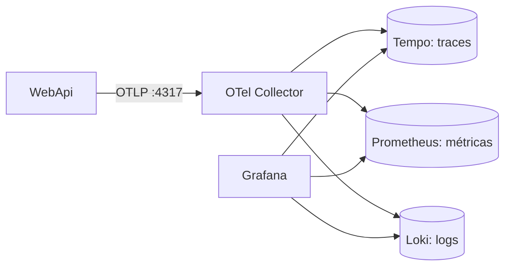

# Observabilidade

A `WebApi` envia logs, traces e métricas via OTLP ao OpenTelemetry Collector, que distribui cada sinal. Tudo é visto no Grafana.



## Como acessar

1. Suba a stack com `docker compose -f devops/docker-compose.yml up -d`.
2. Rode a API. Sem configuração extra, ela envia para `http://localhost:4317`; use `OTEL_EXPORTER_OTLP_ENDPOINT` para mudar o destino.
3. Abra o Grafana em <http://localhost:3000>, pasta **Ntix**.

| Dashboard | Conteúdo |
|---|---|
| **Ntix Funil de Cadastro de Cliente** | Funil de negócio, conversão, evolução, logs e traces do cadastro |
| **Ntix WebApi** | Tráfego, latência, erros, concorrência, memória, GC, thread pool, logs e traces |

## Funil de cadastro de cliente

| Passo | Métrica no Prometheus | Filtro |
|---|---|---|
| 1. Solicitação de cadastro | `ntix_customers_registration_requests_total` | |
| 2. Pararam na validação inicial | `ntix_customers_registration_outcomes_total` | `outcome="validation_failed"` |
| 2. Já existiam na base | `ntix_customers_registration_outcomes_total` | `outcome="already_exists"` |
| 2. Erros por exceção | `ntix_customers_registration_outcomes_total` | `outcome="error"` |
| 2. Contas criadas | `ntix_customers_registration_outcomes_total` | `outcome="created"` |

- A conta só conta como criada depois do commit.
- Cancelamentos pelo cliente entram só no passo 1 e aparecem em "Sem desfecho no período".
- Requisições com JSON inválido são recusadas pelo framework antes do caso de uso e não entram no funil.
- Os totais vêm do `increase()` do Prometheus, que é uma estimativa: em períodos curtos, a soma dos desfechos pode variar um pouco em relação às solicitações.

### Validando o funil com carga

O script `tsts/LoadTests/customers-funnel-tests.js` gera cerca de 50 req/s por 5 minutos e imprime os totais no final. Ele valida o funil, não a performance: o teste de latência é o `customers-create-tests.js`.

Cada requisição sorteia seu ramo, em paralelo com as demais. Os pesos mudam aleatoriamente a cada 30 segundos e são diferentes a cada execução, então a conversão varia ao longo do teste.

| Ramo do funil | Peso sorteado por janela, antes de normalizar | Variações |
|---|---|---|
| Contas criadas | 0,3 a 1,0 | 10% de homônimos |
| Validação | 0 a 0,5 | Nome, email, CPF e headers auditáveis |
| Já existiam | 0 a 0,5 | Mesmo email, email em maiúsculas ou mesmo CPF |

1. Com a stack e a API no ar, rode o teste. `DURATION`, `RATE` e `MIX_WINDOW_SECONDS` mudam o padrão com `-e`:

   ```bash
   k6 run -e BASE_URL=http://localhost:5001 tsts/LoadTests/customers-funnel-tests.js
   ```

2. Para exercitar **Erros por exceção**, pare o banco no meio da execução, em outro terminal, e religue depois de cerca de 30 segundos:

   ```bash
   docker stop ntix-sqlserver-local
   ```

   ```bash
   docker start ntix-sqlserver-local
   ```

3. Ao terminar, aguarde cerca de 30 segundos e abra o dashboard do funil com um período que cubra toda a execução, como **Last 15 minutes**.
4. Compare o quadro impresso pelo k6 com o dashboard. Os valores devem ser próximos, não idênticos, porque o `increase()` é uma estimativa. Execuções anteriores dentro do período também somam. Para isolar uma execução, ajuste o período exatamente a ela.

O teste falha se alguma resposta não for reconhecida ou se um cenário receber um desfecho diferente do esperado. Erros são aceitos em qualquer cenário, por causa do passo 2.

## Traces e logs

- Span `CreateCustomer`, com `ntix.outcome`, `ntix.customer_id` e os campos auditáveis, e spans `CustomerRepository.*` para cada comando no banco.
- Logs chegam ao Loki com `trace_id` e os campos auditáveis. Para filtrar um fluxo: `{service_name="ntix-webapi"} | CorrelationId="<uuid>"`.
- Nenhum sinal traz email ou CPF completos, e spans com erro registram só o tipo da exceção.
